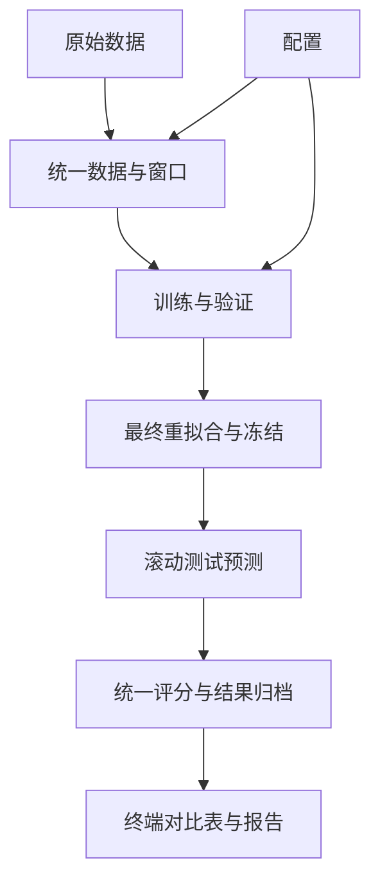

# PowerForecast

**面向算力中心的中短期电力负荷预测研究框架**

> 项目状态：已完成 NLR 数据上的 HDSF 迁移复现和独立测试。支持完整日自适应划分、14 天历史、MAPE 选择、24h / 7d 曲线及各自日均指标、对照与融合消融。真实精度以保存的独立测试结果为准；不将研究目标当作已实现结果。

开发时重点阅读：[架构与接口](#8-架构与接口)、[方法与数据接入](#9-方法与数据接入流程)、[开发与实验约束](#10-开发与实验约束)、[验收与维护](#11-验收与维护)。研究任务以[研究与实验方案](docs/算力中心中短期用电负荷预测——研究与实验方案.md)及用户后续明确约定为依据；架构和公共开发规则集中维护在本 README。

维护时按同一条流程处理：**数据配置与适配 → 公共窗口 → 模型接口 → 统一实验编排 → 公共评分与展示 → 验证和归档**。新增内容按职责接入对应层；扩展步骤见第 9 部分，代码与展示规范见第 10 部分，提交前检查见第 11 部分。下文的维护约定不代表对应自动检查已经实现，当前能力与待补事项分别说明。

## 1. 项目简介

本项目研究算力中心（数据中心、超算/HPC 中心）的电力负荷变化规律，构建兼顾**预测精度、可解释性和场景适应性**的多变量时间序列预测方法。

重点任务：

- **24 小时预测**：每次预测未来 **96 个 15 分钟点**。
- **7 天预测**：每次预测未来 **672 个 15 分钟点**。
- 融合历史 IT 负荷、制冷/辅助设施负荷、室外温度、湿度及时间特征。
- 统一比较统计模型、机器学习、深度学习和拟提出的创新模型。
- 输出可复现的预测结果、误差指标、可视化图表与消融实验。

课题希望实现高精度负荷预测（目标精度 95%），但该数值是**研究目标而非本项目已实现的结果**。具体“准确率”口径须在实验报告中明确。

## 2. 数据集

| 数据集 | 用途 | 注意事项 |
| --- | --- | --- |
| **NLR HPC Facility PUE**（优先） | 设施级功率、IT/辅助系统功率、环境变量联合预测 | 先核对字段口径、时区、连续性与缺失率 |
| **Google PowerData 2019** | 功率利用率预测与基准对照 | 利用率不直接等于 kW；时间跨度较短 |
| **Google ClusterData 2019** | CPU/任务等算力活动辅助分析 | 不是直接的实测功率标签 |
| **Alibaba Cluster Trace** | 任务调度、资源使用及算电关系研究 | 多数版本缺少连续的真实功率标签 |

NLR 官方地址：<https://data.nlr.gov/submissions/300>

建议将下载后的文件放到以下目录：

```text
data/raw/NLR_Dataset/esif.influx.buildingData.PUE.combined.parquet
data/raw/NLR_Dataset/esif.influx.buildingData.outside.combined.parquet
```

原始数据原则上**只读、不可覆盖**；数据处理后的文件写到 `data/interim/` 或 `data/processed/`。原始数据、模型权重和大体积结果通常不提交 Git。

## 3. 项目目录结构

```text
PowerForecast/
├── configs/
│   ├── datasets/                # 数据路径、字段、单位、时区、清洗口径
│   ├── experiment.yaml          # 基础实验协议
│   ├── models.yaml              # 基础模型参数和默认清单
│   ├── hdsf.yaml                # HDSF 实验预设
│   └── hdsf_models.yaml         # HDSF 参数、权重路径和默认清单
├── data/
│   ├── raw/                     # 原始数据，只读
│   ├── interim/                 # 中间数据与保留的处理版本
│   └── processed/               # 15分钟网格与 metadata.json
├── src/
│   ├── data/                    # 加载、适配、清洗、重采样、特征和窗口
│   │   └── pipeline.py          # 数据预处理编排
│   ├── models/
│   │   ├── __init__.py          # 注册表与延迟加载工厂
│   │   ├── base.py              # BaseForecaster 接口
│   │   ├── statistical/         # 基线、季节 AR、SARIMA
│   │   ├── ml/                  # Ridge、ExtraTrees、LightGBM、XGBoost
│   │   ├── deep/                # LSTM、TCN、DLinear
│   │   ├── foundation/          # 基座适配、离线权重和预测缓存
│   │   └── proposed/            # HDSF、本地成员、单纯形及扩展占位
│   ├── training/                # 统一训练与预测检查
│   ├── evaluation/
│   │   ├── metrics.py           # 唯一公共指标计算入口
│   │   ├── backtest.py          # 曲线、日均、逐起报及非重叠评价
│   │   ├── reporting.py         # 所有方法共用的终端对比表
│   │   └── visualization.py     # 预测曲线图
│   └── utils.py                 # 配置、项目路径、种子和 JSON
├── scripts/
│   ├── inspect_data.py          # 原始字段检查
│   ├── prepare_data.py          # 预处理入口
│   ├── run_experiment.py        # 统一实验与已存结果显示入口
│   ├── run_hdsf.py              # 转发到统一入口的 HDSF 预设
│   ├── analyze_nlr.py           # 数据质量与负荷特征分析
│   ├── report_hdsf.py           # 预测重新计分、审计和报告
│   ├── audit_hdsf_core.py       # 与原始单纯形求解器比较
│   └── verify_foundation_batch.py # 基座批量推理隔离检查
├── results/                     # runs/、cache/、logs/、analysis/
├── docs/                        # 方案、方法说明、结果报告与轻量图表
├── tests/                       # 数据、因果性、指标和模型检查
├── requirements*.txt            # 基础、可选、HDSF 及环境锁定依赖
├── pyproject.toml
└── README.md                    # 架构、运行方式及公共约定
```

## 4. 安装与快速运行

Python 3.11 及以上。Windows PowerShell 示例（项目中已有 `.venv` 时可直接使用）：

```powershell
# 仅首次新建环境时执行；已有 .venv 可直接使用下方入口
py -3.13 -m venv .venv
.\.venv\Scripts\python.exe -m pip install -r requirements.txt
# 完整默认实验包含 HDSF，还需基座依赖与离线权重
.\.venv\Scripts\python.exe -m pip install -r requirements-hdsf.txt
# 全模型默认清单还包含 SARIMA、XGBoost 等可选依赖
.\.venv\Scripts\python.exe -m pip install -r requirements-optional.txt

# 不依赖原始数据，检查两个预测任务的完整流程
.\.venv\Scripts\python.exe scripts/run_experiment.py --demo --models naive seasonal_naive three_day_mean ridge

# 检查本地 NLR 原始字段与样例；预处理不会改动原文件
.\.venv\Scripts\python.exe scripts/inspect_data.py
.\.venv\Scripts\python.exe scripts/prepare_data.py

# 默认执行下文列出的 18 个对照模型和 HDSF，以及 24h、7d
.\.venv\Scripts\python.exe scripts/run_experiment.py

# HDSF：简单基线、季节 AR、DLinear、基座成员、本地成员和融合消融
.\.venv\Scripts\python.exe scripts/run_hdsf.py
# 等价的统一入口
.\.venv\Scripts\python.exe scripts/run_experiment.py --config configs/hdsf.yaml
# 直接重显最近完成的真实数据实验
.\.venv\Scripts\python.exe scripts/run_experiment.py --results latest
# 直接查看本轮 HDSF 已保存结果
.\.venv\Scripts\python.exe scripts/run_hdsf.py --results results/runs/20261013T120519Z_abc86d
.\.venv\Scripts\python.exe scripts/analyze_nlr.py
.\.venv\Scripts\python.exe scripts/report_hdsf.py results/runs/<运行目录> --output docs/HDSF-NLR复现结果.md

# 缩小日期范围或指定模型 / 预测任务
.\.venv\Scripts\python.exe scripts/run_experiment.py --start 2019-01-01 --end 2019-12-31
.\.venv\Scripts\python.exe scripts/run_experiment.py --models seasonal_naive extra_trees --horizons 24h

# 消融：full / target_only / no_weather / no_auxiliary
.\.venv\Scripts\python.exe scripts/run_experiment.py --demo --models seasonal_naive three_day_mean --ablation no_weather

.\.venv\Scripts\python.exe -m pytest -q
```

入口也支持 `python -m scripts.run_experiment` 等模块形式。配置中的相对路径以项目根目录为基准。主实验和预处理等带参数入口支持 `--help`。

Google PowerData 2019 使用独立的 **D14/D22 历史协议预设**，从 `data/raw/Google/` 直接读取 57 条供电域及机器映射，沿用原数据聚合、评分掩码、成员历史和开发/测试起报点。运行命令如下；无需经过 NLR 预处理。该预设调用配置指定的旧 HDSF 源码和数值环境，离线权重只读，新增模型、缓存及结果保存在本项目 `results/`。完整依赖、结果和限制见 [Google HDSF D14/D22 复现报告](docs/Google-HDSF-D14-D22复现.md)。

```powershell
.\.venv\Scripts\python.exe scripts/run_experiment.py --config configs/google_hdsf.yaml
# 两数据集全模型对照：NLR 使用统一的目标历史与日历特征
.\.venv\Scripts\python.exe scripts/run_experiment.py --config configs/all_models_nlr.yaml
# 重显本轮完整对照表，无需训练
.\.venv\Scripts\python.exe scripts/run_experiment.py --results results/runs/20261014T162657Z_google_8ef216
```

终端结果沿用原 `PowerData_Prediction` 的中文方法名、任务分表、列分隔线、数值右对齐和百分比格式：24h 主表并列展示验证/测试 WAPE、MAPE；7d 主表并列展示曲线/日均 WAPE、MAPE及基线误差减少。补充表提供 RMSE、24h 日均指标及 MAPE 改进幅度。全部已评估方法都会显示，缺少基线或指标无定义时显示 `N/A`。`--results latest` 选择最近完成的非合成数据实验；也可指定某个结果目录。HDSF 的样本内验证校准指标以 `*` 标记，选择用的验证交叉检验分数另行显示。

**后续方法接入约定：** 所有新增方法（包括 HDSF）完成实现与验证后，都要加入相应实验的默认模型清单及这套统一输出表，作为常规对照一起展示；具体步骤见[方法接入流程](#91-新增方法)。

`configs/datasets/nlr.yaml` 优先读取 `data/raw/NLR_Dataset/` 中的 `esif.influx.buildingData.PUE.combined.parquet` 和 `esif.influx.buildingData.outside.combined.parquet`，也兼容 `data/raw/nlr/` 与项目根目录的 `NLR_Dataset/` 下的同名文件，无需复制原始数据。当前预处理输出为 `data/processed/nlr_esif_combined.parquet`；旧 `nlr.parquet` 保留供历史实验核验。`other.yaml` 是其他 CSV / TSV / Parquet 数据集的字段映射模板，需要根据实际字段修改。

## 5. 数据口径与实验协议

- NLR 本地文件的时间字段为 `ts`，天气字段为 `outdoor_air_temp`、`outdoor_air_humidity`。温度按[官方数据说明](https://data.nlr.gov/submissions/300)从华氏度转为摄氏度，湿度为百分比。
- 默认目标 `facility_power_kw` 是 IT、制冷、HVAC、照明插座、泵五项功率的区间均值之和，属于**派生的分项汇总标签**，不等同于直接测量的设施总功率。任一分项缺失，该区间标签保持缺失。可修改 `target` 为 `it_power_kw` 做 IT 功率预测。
- 原始时间戳没有时区信息；官方目录页也未明确时区。配置暂按 UTC 解释，`timezone_verified: false` 会写入质量报告。正式研究前应核实数据时区，调整配置后重新预处理。
- 删除配置范围外的异常时间记录（包括天气中的 1970 年记录）；按固定物理范围屏蔽异常值，重复时间戳取均值，再对齐 15 分钟网格。区间采用左闭右开 `[t, t+15min)`，时间戳标注区间起点；预测起点 `t` 的历史最多包含 `t-15min` 区间。
- 只对历史协变量做有限的前向填充，默认最多 4 个区间。目标标签不填充，不使用后向填充或双向插值；缺失历史或标签的样本窗口会跳过，并记录数量。长缺测或过短日期范围可能没有可用的 7 天窗口，此时明确报错。
- 重采样按区间内可用的有限分钟记录求均值；“有效聚合目标”不等于 15 条原始分钟记录全部齐全。原始区间覆盖数由数据分析另行报告。首尾完整覆盖日用于确定研究边界，内部缺测日期保留在时间轴上。
- 起止不完整日先剔除，按完整日顺序划分训练 / 验证 / 测试，默认约 60% / 20% / 20%，验证至少 8 天、测试至少 9 天；短序列可能没有足够监督样本，会明确报错。每个窗口的全部预测标签必须落在所属划分内；验证和测试窗口可使用起点之前已观测到的历史。
- 历史输入默认 14 天（1344 点）。初始拟合与标准化仅使用训练数据；依据验证集起报平均 MAPE 选择模型，再按冻结配置重拟合训练+验证数据。HDSF 总体模型选择使用验证交叉检验 MAPE，融合拟合分数单独标为样本内结果。所有任务在测试推理前统一冻结，滚动测试更新历史观测、不重新拟合。每天产生一次起点；7 天完整窗口可重叠，同时导出每 7 天起报一次的非重叠检验。
- 未来输入仅包含已知的日历特征。真实未来 IT 负荷、制冷负荷和天气观测不会进入输入；未来天气预报接入需另行实现。
- WAPE、MAPE 使用百分数；MAPE 阈值在配置中预先冻结，默认排除绝对值不超过 `1e-8` 的标签，报告 `mape_n` 与 `mape_excluded`；全零标签的 WAPE / MAPE 无定义时写为 JSON `null`。24h 与 7d 的每日均值先分别聚合再计分；默认 CSV 和 Python 表格同时输出曲线与日均的 MAPE/RMSE/WAPE、相对基线误差减少比例。不将 `100-WAPE` 自动宣称为准确率。

## 6. 模型与扩展

预处理以功率源的完整时间范围对齐，较短天气源只产生缺失协变量，不裁剪功率记录。实验按所选目标的首尾完整覆盖日确定研究边界，内部缺测日保留并跳过不完整窗口；更早的 IT 观测仍可用于另设 IT 目标。

| 模型 | 当前实现 | 依赖 |
| --- | --- | --- |
| `naive`、`seasonal_naive` | 最新值 / 上一日周期基线，默认执行 | 基础依赖 |
| `three_day_mean`、`seasonal_ar` | 前三天同刻均值 / 固定参数季节自回归，完整视野只递归使用自身预测 | 基础依赖 |
| `ridge`、`extra_trees` | 直接多步回归；历史及未来日历展开为特征 | scikit-learn |
| `sarima` | 在末段连续训练数据拟合参数；每个起点对历史滤波后预测 | statsmodels |
| `lightgbm`、`xgboost` | 每个预测步一个回归器，长预测任务计算量较大 | 对应可选库 |
| `lstm`、`tcn`、`dlinear` | CPU 可用的基础网络与训练封装；LSTM / TCN 使用历史变量，DLinear 使用目标历史，均不使用未来日历 | torch |
| `hdsf` | 半日 L1 单纯形、A/B 混合、验证 MAPE 选择、LightGBM/线性与水平/形状本地成员 | requirements-hdsf.txt、六种预训练权重 |
| `proposed` | 显式扩展占位，运行会抛出 `NotImplementedError` | 待设计 |

HDSF 的方法来源、与旧协议的差异、环境与运行说明见 [HDSF方法与新方案适配](docs/HDSF方法与新方案适配.md)。当前本机 `.venv` 已通过系统包复用原基座运行环境；独立重建可安装 `requirements-hdsf.txt` 并配置权重路径。其余可选模型为基础实现，按需安装单个库或可选依赖：

```powershell
.\.venv\Scripts\python.exe -m pip install -r requirements-optional.txt
.\.venv\Scripts\python.exe scripts/run_experiment.py --models lstm --horizons 24h
```

缺少依赖时会提示具体安装方式，不会悄悄替换成基线。`configs/models.yaml` 管理参数，`configs/experiment.yaml` 管理随机种子、窗口、划分、起点步长和输出。扩展模型继承 `src.models.base.BaseForecaster`，实现 `fit(WindowBatch)` 和 `predict(ForecastInputs)`，再接入 `src/models/__init__.py` 的注册工厂；预测接口不接收标签。

## 7. 结果与验证

2026-10-13 按当前 ESIF 原文件名完成重新预处理、普通默认实验和 HDSF 对照实验，见 [NLR 文件对齐与重跑](docs/NLR数据对齐与重跑.md)及 [HDSF-NLR 本轮重跑结果](docs/HDSF-NLR数据对齐重跑结果.md)。两份原始文件的 SHA-256 与旧审计记录一致，处理数据逐值一致；本轮属于同内容重跑，实验协议沿用原约束。旧 [HDSF-NLR 复现结果](docs/HDSF-NLR复现结果.md)继续保留，方法及协议差异见 [HDSF 方法与新方案适配](docs/HDSF方法与新方案适配.md)。下表为本轮 HDSF 对照预设：14 天目标历史与已知日历、约 60/20/20 划分；时区暂按 UTC，保留待核实标记。

| HDSF 测试任务 | MAPE (%) | RMSE (kW) | WAPE (%) |
| --- | --- | --- | --- |
| 24h 曲线 | 5.2950 | 208.6780 | 3.9321 |
| 24h 日均 | 4.2641 | 173.9386 | 3.2196 |
| 7d 曲线 | 11.0896 | 359.0128 | 7.5732 |
| 7d 日均 | 10.0184 | 340.2688 | 7.0040 |

24h / 7d 分别有 328 / 251 个有效测试起报，曲线 MAPE 相对各任务简单基线减少 24.12% / 12.74%；本次融合未超过测试中最强单成员。缺测窗口未填补，误差仅代表可评估的连续观测时段。报告已从预测行重新计分，冻结模型哈希及重载预测核对通过。

每次实验建立独立的 `results/runs/<UTC时间>_<随机标识>/` 目录，保留：

- `manifest.json`：完整配置、库版本、数据来源、划分边界、特征清单、实验状态和选中模型。
- `metrics.csv`：所有方法验证 / 测试的曲线与日均 WAPE、MAPE、MAE、RMSE，起报波动及相对基线改进幅度。
- 各任务的 `windows.json`、`selection.json`：有效及跳过窗口数，以及测试前冻结的验证集选择结果。
- `frozen-before-test.json`：所有任务测试前的选中模型、阈值、模型文件哈希及冻结时间。
- 各模型的验证 / 测试预测 Parquet、逐起报 / 步长 / 预测天 / 日均指标 CSV、非重叠指标 JSON、首个测试曲线 PNG 和模型文件。基础模型保存为 `.joblib`，深度模型保存为 `.pt` 状态字典。
- HDSF 的 `fusion.json`：成员池、分段权重、混合候选、验证折、训练边界、模型快照和校准耗时。报告入口重算预测指标、验证冻结文件，并输出状态代理分析、计算成本与限制说明。

预处理同时生成 `data/processed/nlr_esif_combined.metadata.json`，记录单位、派生公式、时间假设、来源文件信息与缺失率。配置发生变化后应重新预处理；实验入口会检查配置是否与预处理记录匹配。

测试覆盖字段及单位转换、微秒时间戳对齐、缺失标签保护、因果填充、时间划分边界、未来观测隔离、指标零值口径、基线训练预测和模型保存。合成数据结果只用于流程验证，不能作为真实负荷预测的研究结论。

## 8. 架构与接口

### 8.1 模块职责

当前代码按数据、模型、实验编排、评价与展示分层。算法实现放在 `src/`，命令行入口与实验编排放在 `scripts/`，数据和实验选择由 `configs/` 驱动。



| 层 | 主要代码 | 职责与边界 |
| --- | --- | --- |
| 配置 | [实验配置](configs/experiment.yaml)、[HDSF配置](configs/hdsf.yaml)、[数据配置](configs/datasets/nlr.yaml) | 字段、单位、时区、输入长度、预测长度、划分、种子、阈值和输出路径；模型参数及默认清单放模型配置 |
| 数据 | [pipeline.py](src/data/pipeline.py)、[features.py](src/data/features.py)、[splitting.py](src/data/splitting.py) | 保留原始时间轴，生成历史特征、已知未来特征与分区内的完整标签窗口 |
| 模型 | [base.py](src/models/base.py)、[注册工厂](src/models/__init__.py) | 模型实现拟合和预测；按类别放入相应目录，可选依赖在请求该模型时加载 |
| 训练与推理 | [trainer.py](src/training/trainer.py)、[predictor.py](src/training/predictor.py) | 统一创建和拟合模型，检查预测形状与有限值，应用配置中的预测下界 |
| 实验编排 | [run_experiment.py](scripts/run_experiment.py) | 控制训练、验证、重拟合、全任务冻结、测试与归档顺序；HDSF 入口转发到同一流程 |
| 评价 | [metrics.py](src/evaluation/metrics.py)、[backtest.py](src/evaluation/backtest.py) | 统一误差定义、曲线和日均计分、逐起报/提前量分析与非重叠周检验 |
| 展示与审计 | [reporting.py](src/evaluation/reporting.py)、[report_hdsf.py](scripts/report_hdsf.py) | 根据已有结果展示所有方法；报告从预测行复算指标、核对冻结模型，展示代码不参与选择权重 |

普通与 HDSF 模型预设默认覆盖 18 个对照：Naive、Seasonal Naive、前三天同刻均值、Seasonal AR、SARIMA、Ridge、ExtraTrees、LightGBM、XGBoost、LSTM、TCN、DLinear，以及 Chronos-2、TiRex-2、TimesFM 2.5、TimesFM 3.0、Toto 2.0、PatchTST-FM，另保留 HDSF 及其成员和消融。两种预设共用输出模块。`--results latest` 展示最近一份已完成的真实数据实验记录；旧记录中未运行的方法不会因默认清单更新而自动出现。

基础预设从数据配置取得历史协变量；本轮 HDSF 预设显式设置 `history_covariates: []`，只使用目标历史和已知日历。跨预设比较前要核对并统一特征清单和有效起报点，不能仅凭数据集名称相同就当作同条件实验。

运行模型时须选用包含该模型参数的配置。普通 `configs/models.yaml` 与专用 `configs/hdsf_models.yaml` 都已配置上述模型；两份预设的 HDSF 参数需保持一致。六类预训练模型可以独立用 `--models chronos2 tirex2 timesfm25 timesfm30 toto2 patchtstfm` 运行，HDSF 内部的长历史与联合/单变量成员标识继续保留。快速合成流程检查用显式 `--models` 选择轻量方法；完整默认清单需要可选依赖和离线权重。

`configs/all_models_nlr.yaml` 是 NLR 全模型比较预设，使用 14 天目标历史与日历、现有完整日划分，所有方法共用有效起报点。Google 预设在原 HDSF 以外增加同一组 18 个对照；按用户确认，新增监督学习对照使用 7 天目标历史、相对日内/周相位和跨 57 域训练，SARIMA 分供电域拟合，开发/最终标签仍截止 D14/D22。原 HDSF 及基础成员的历史、分组和融合规则保持不变。两数据集的训练规模、特征与单位不同，分别报告，不能直接混排精度。

完整清单、运行命令、逐模型输出和评分口径集中在[双数据集全模型核对](docs/双数据集全模型核对.md)。`scripts/audit_model_coverage.py --nlr <NLR运行目录> --google <Google运行目录>` 会检查 18 个模型的两个任务、开发/测试预测及曲线/日均指标；缺少实际产物时返回失败。

2026-10-15 已完成两数据集全模型实跑：NLR `20261014T191440Z_3bac9d`、Google `20261014T191923Z_google_9a3ad6`。18 个模型的 24h/7d 开发及测试输出全部齐备，144/144 项覆盖与独立指标重算检查通过；42 项测试及保存模型恢复核验通过。报告保留完整指标、样本数、浮点容差与协议限制。

正式入口为 `scripts/run_experiment.py` 和 `scripts/run_hdsf.py`，当前没有根目录 `run.py / run.bat` 启动器。增加其他入口时，应复用统一主流程，并有明确的使用需求。

### 8.2 数据和模型接口

设 `N` 为起报数、`L` 为历史长度、`C` 为历史特征数、`H` 为预测长度、`K` 为已知未来特征数。`ForecastInputs` 与 `WindowBatch` 定义在 [splitting.py](src/data/splitting.py)。

| 对象或字段 | 形状/含义 | 当前接口要求 |
| --- | --- | --- |
| `ForecastInputs.history` | `[N, L, C]` | 第 0 个特征始终是目标历史；其余是已观测协变量和日历特征 |
| `ForecastInputs.future_known` | `[N, H, K]` | 当前只包含已知日历，不能混入预测视野内真实天气、IT 或负荷 |
| `origins / target_times` | 起报时间 / 各步目标时间 | 保留真实时间戳，不把删除缺测后的行号当连续时间 |
| `WindowBatch.targets` | `[N, H]` | 仅用于拟合与计分；不传入 `predict()` |
| `BaseForecaster.fit(batch)` | 返回已拟合模型 | 标准化、特征选择等训练状态只由本阶段允许的训练数据拟合 |
| `BaseForecaster.predict(inputs)` | 返回 `[N, H]` | 一次生成完整视野，输出须有限且形状正确；多步递归只能使用自身预测 |
| `BaseForecaster.save(path)` | 默认 `.joblib`；深度模型 `.pt` | 保留推理所需的参数、标准化状态与配置；新模型要核对保存/恢复后的预测一致性 |

预处理输出须是带时区、升序且完整的 15 分钟时间网格；重复时间戳先处理，缺测保留为缺失值。适配时先将时间戳统一到 UTC 纳秒精度，避免微秒/纳秒索引混合造成对齐丢失。当前完整日协议要求每日本地日界线有 96 点；若改用存在夏令时的时区，须先解决 92/100 点日期的协议，不能直接按 96 点硬切。

共享输入按只读约定使用；数组变换先创建副本，不能原地改动公共 `history / future_known / targets`，以免污染后续模型。数据类的字段冻结并不自动阻止 NumPy 数组内容被修改。

分区天数达到最低值不保证监督样本足够。14 天输入、7 天标签至少需要连续 21 天才能构造一个训练窗口，实际训练还需要更多窗口；短验证期的 7 天标签全部重叠时，也可能无法形成 HDSF 的有效交叉检验。应延长有效数据范围并记录失败原因，不能靠填补目标或跨分区借标签解决。

HDSF 除标准接口外，还有验证校准和最终本地成员重拟合阶段：`calibrate(validation)` 只用验证标签确定半日权重与 mix；`refit(train+validation)` 保持融合配置固定。当前编排针对 HDSF 显式处理这两个阶段，其他新融合方法若需要类似步骤，也要在主流程中明确接入。

### 8.3 模块依赖与复用边界

| 模块 | 可以负责的工作 | 扩展时保持的边界 |
| --- | --- | --- |
| `src/data/` | 读取、字段和单位适配、清洗、特征、划分与窗口 | 按配置提供统一输入，不根据某模型的测试效果改变处理规则 |
| `src/models/` | 特征变换、模型拟合、成员预测及方法内部融合 | 读取公共输入，不解析命令行、不寻找某个数据集的原始文件、不自行决定测试划分 |
| `src/training/` | 模型工厂调用、训练封装、公共预测检查 | 公共数值和形状要求统一处理，方法内部状态由模型保存 |
| `src/evaluation/` | 指标、回测计分、结果表和图形 | 指标函数接收实际值与预测值；展示层读取结果，不重训或重选参数 |
| `scripts/` | 参数解析、配置装配、阶段调用、进度和归档 | 复用公共算法与评价函数；专用入口转发预设，完整实验顺序由统一入口维护 |
| `src/utils.py` | 配置读取、路径、种子、JSON 等通用工具 | 只放跨模块通用功能；某方法专用工具留在该方法旁边 |

- `src/` 不反向导入 `scripts/`；模块之间通过明确参数、数据对象和返回值协作，避免循环导入及隐藏的全局状态。
- 方法校准需要评分时，可以调用公共指标函数；不能让模型依赖终端格式、报告内容或已存测试排名。
- 输入重排、归一化、滞后特征等方法内部变换放在模型或相邻辅助模块中；面向所有方法的数据清洗和窗口规则由数据层维护。
- 优先扩展已有职责模块。只有明确的新职责或多个实际调用者需要共享时才抽出新模块，不为一个分支建立多层工厂和重复封装。
- 新增入口复用统一主流程。编排变长时，按训练、校准、冻结、测试、归档等完整职责提取函数；算法公式不继续堆进命令行入口。

### 8.4 配置职责与覆盖规则

| 配置位置 | 应维护的内容 |
| --- | --- |
| `configs/datasets/<数据集>.yaml` | 数据身份、路径、字段映射、目标、单位、时区、清洗、派生公式和可用历史变量 |
| 实验配置，如 `experiment.yaml / hdsf.yaml` | 数据与模型配置的选择、预测任务、历史长度、划分、起报步长、评分阈值、种子及输出策略 |
| 模型配置，如 `models.yaml / hdsf_models.yaml` | 方法参数、权重来源、推理选项和相应实验的默认模型清单 |

命令行明确提供的选项覆盖它对应的配置选择或参数；未提供时使用所选配置。当前历史协变量先取数据配置，实验配置若显式提供 `history_covariates`，则以实验配置为准，空列表表示只用目标历史与日历。新增覆盖规则要集中处理并写入实验记录，不能在模型内部再按数据集名称暗中覆盖参数。

同一份实验中的各方法共用已经构造好的窗口。若方法只使用部分输入，记录它实际消费的变量与历史范围；若需要改变公共目标、窗口或起报点，建立明确的实验预设并注明可比范围。共享的 HDSF 参数目前存在于两份模型配置，更新时要同步核对；实现配置继承或公共参数文件前，不假定它们会自动同步。

## 9. 方法与数据接入流程

### 9.1 新增方法

**所有新增方法，包括 HDSF，都必须进入相应实验的默认对比表。** 适用任务的曲线与日均 MAPE/RMSE/WAPE、基线改进幅度和样本数量都要保留。只提供独立脚本、研究命令或文档结果不算接入完成。

1. **明确方法身份。** 记录方法名、来源、输入变量、适用预测任务、预训练/本地训练方式和新增假设。复现、迁移适配与自主改进要分别说明。
2. **实现公共接口。** 按类别放入 `src/models/`，继承 `BaseForecaster`；预测接口只接收 `ForecastInputs`。需要验证校准或额外后处理的参数，应在测试前由主流程确定并冻结。
3. **注册并配置。** 更新 `MODEL_NAMES / create_model()`、相应模型配置中的参数与 `default_models`，确保 CLI 可以直接运行。数据路径和字段映射放数据配置，避免写进算法核心。
4. **接入统一输出。** 在 `reporting.py` 的 `METHOD_NAMES` 中添加易读名称，使用同一套 `metrics.csv` 行结构；输出模块会展示全部已评估方法。若验证分数经过融合校准，还要接入样本内分数标记和独立选择分数说明。新增展示需求应修改公共展示模块。
5. **完成同条件比较。** 同一任务使用相同目标、数据处理、划分、历史输入约定、起报点、预测视野和评分口径；改变这些条件时另建实验并注明。HDSF 作为已有常规对照保留，不能为突出新方法删去较强对照。
6. **验证并归档。** 检查未来观测隔离、完整多步预测、适用任务的真实 CLI 输出、模型保存与恢复、逐起报结果和指标复算；再同步 README 中的模型、依赖、命令与结果说明。

当前接口要求完整曲线输出。若将来接入只生成日均值的方法，应明确扩展结果结构，并把曲线字段显示为 `N/A`；不能重复日均值冒充已经复现了 15 分钟曲线。缺少依赖、权重或有效窗口时明确报错，不用基线预测冒充目标方法。

增加 HDSF 内部成员时，还需同步 `hdsf.py` 的成员池、实际成员实现及 `fusion.json` 中的身份记录，重新用验证集校准并冻结；只增加输出名称不代表新增了可比较的方法。

做输入长度敏感性时，除全局 `context_length` 外，还需核对基座的 `context_days` 和本地模型实际截取的历史范围，并记录缓存身份；不能只修改窗口长度或模型显示名称就宣称比较了不同输入长度。

### 9.2 新增或替换数据集

1. **确认数据身份。** 检查文件哈希、时间范围、采样频率、目标物理含义、单位、时区、缺失和序列数量。与同学对齐时，同时核对原始文件、处理规则、划分边界、输入特征、起报点和指标口径；相同文件名或数据集名称不足以证明实验一致。
2. **新增数据配置。** 参考 [other.yaml](configs/datasets/other.yaml)，为不同数据集建立独立配置。沿用同一数据集而替换文件时，只调整已确认需要变化的来源信息；字段、目标及处理口径改变时必须明确记录。配置 `primary_source` 可保留目标源的完整时间轴，其他来源覆盖不足时保留缺失。
3. **适配到公共数据接口。** 当前支持 CSV、TSV、Parquet、字段映射、比例与偏移换算。特殊格式或计算口径由数据层扩展；保持时间戳、缺失值及来源记录可追溯，输出通过第 8.2 部分的数据要求。
4. **重新预处理并检查窗口。** 数据内容、来源配置或处理逻辑改变后，重新生成处理数据及元数据，核对质量和各分区有效窗口。保留被历史实验引用的旧处理文件，使用新路径保存新版本；不能只更新配置后继续使用旧处理产物。
5. **复用入口并验证。** 通过 `--dataset-config` 接入统一实验，根据新数据重新拟合本地模型、标准化状态和融合参数，核对实际 CLI 的全部方法输出，再归档结果并更新 README 的数据说明。

```powershell
# 将 new_dataset 换成实际配置名
.\.venv\Scripts\python.exe scripts/inspect_data.py --config configs/datasets/new_dataset.yaml
.\.venv\Scripts\python.exe scripts/prepare_data.py --config configs/datasets/new_dataset.yaml
.\.venv\Scripts\python.exe scripts/run_experiment.py --dataset-config configs/datasets/new_dataset.yaml
```

当前公共窗口按单条目标序列构造，实验频率固定为 15 分钟。分钟级数据可按既定规则聚合；只有小时级或日级观测时，应扩展独立的频率、窗口和评价协议。多站点或多序列长表要先明确序列标识和逐序列划分方式，完成接口适配后再运行；不能将不同站点的同刻记录当成重复记录取均值。

原始文件相同不意味着其他处理口径已相同；文件改名且内容哈希一致的重复实验，应记录为来源路径对齐。新数据与新推理身份不匹配的缓存不得复用；相同输入、模型及推理配置命中的缓存可以使用，但计算成本要说明缓存状态。

当前入口会核对配置摘要与已有预处理元数据，但尚未在每次运行时自动重算所有原始源哈希。替换同路径文件时必须主动重新预处理并核验来源，不将配置摘要一致当作原始内容未变化的证据。

### 9.3 扩展应落在哪一层

| 新需求 | 首先修改的位置 | 完成时须同步的内容 |
| --- | --- | --- |
| 新数据格式、字段或单位 | 数据配置、`src/data/` | 元数据、质量报告、窗口验证和数据说明 |
| 普通新模型 | `src/models/` 与注册工厂 | 模型参数、默认清单、中文名称、依赖和适用任务 |
| 新融合或验证校准 | 模型实现与统一实验编排 | 校准分数标记、选择分数、重拟合和测试前冻结记录 |
| 新误差指标或汇总方式 | `metrics.py / backtest.py` | 从预测行复算、表格字段、指标定义和历史兼容说明 |
| 新表格或图表样式 | `reporting.py / visualization.py` 及报告入口 | 所有方法覆盖、单位、样本数、文件链接和视觉核对 |
| 模型推理加速 | 对应推理适配与缓存 | 串行/批量一致性、起报隔离、版本、设备和计算成本 |

## 10. 开发与实验约束

下列约定用于后续开发和实验审查；是否已通过验证，应以对应实验的文件和核验记录为证据。

### 10.1 数据、时间和防泄漏

- 原始文件只读。预处理输出放 `data/interim/` 或 `data/processed/`，数据单位、派生公式、异常屏蔽、缺失处理和时区假设写入元数据；配置变更后重新预处理并核对配置摘要。
- NLR 以功率源时间轴为主，天气覆盖较短只产生缺失协变量。内部缺测日期不删除、不压缩；缺失目标不插值，缺失历史或标签的窗口按公共规则跳过并报告数量。
- UTC 是用户已同意暂用的假设，`timezone_verified` 仍为 `false`。核实后若更改时区，应重新处理数据与实验，而不是只改图上的时区文字。
- 按真实时间顺序划分。一个窗口的全部标签须在所属训练/验证/测试分区内；允许使用起报前已观测历史，禁止使用预测视野内真实负荷或真实未来协变量。
- 原始分项、天气等历史信息是否可用，由实验特征清单明确。未来天气只有在获得起报时实际可用的预报并完成接口适配后才能使用。
- 批量推理时，起报点是独立样本；不能把多个起报点当作同一样本的变量，让较晚起报的观测进入较早预测。

### 10.2 选择、冻结与公平评价

- 初始模型和训练型预处理只拟合训练集；模型、超参数、融合、阈值及后处理依据验证集确定。所有任务完成选择与最终重拟合后，先保存冻结记录，再进入任何任务的测试推理。
- 滚动测试可以更新已观测输入历史，训练参数和融合策略保持固定；不得用测试标签重新拟合或调整权重。依据已看过的测试结果继续改方法时，应记录新的开发版本，后续泛化结论使用新的独立评价。
- HDSF 校准后的验证表为样本内拟合分数，终端用 `*` 标记；选择使用验证交叉检验 MAPE。当前五折会剔除标签重叠，它属于离线验证集校准，不能描述成前瞻性在线验证。
- 曲线与日均分开计分，24h 日均与 7d 的七个日均值分别统计。日均先按起报和目标日聚合，再计算误差；不能把点级 MAPE 的平均当作日均 MAPE。
- 当前表的 WAPE/RMSE 按预测实例汇总，逐起报均值、标准差及范围另行保存；这两种汇总的 RMSE/WAPE 通常不同。MAPE 剔除、跨序列等权或跨数据集汇总口径必须明确，不能直接搬用旧 Google 57 序列规则。
- 基线改进为 `100 × (1 - 方法误差 / 基线误差)`，不是百分点差。主表改进列按 WAPE，补充表另列 MAPE 改进；正值改善，负值变差，缺少有效基线时为 `N/A`。
- 7d 重叠窗口具有相关性。保留逐起报结果和固定周起报的非重叠检验；不把重叠预测点数当作独立样本数。误差图对不可评估日期留空，不插值制造连续误差轨迹。
- 如实报告所有方法和适用限制，包括优于简单基线但未超过最强单成员、低负荷误差尖峰、缺测窗口偏差。合成数据不作为研究精度；95% 是研究目标，不能把 `100-WAPE` 自动称为已实现准确率。

### 10.3 环境、基座与缓存

- 优先使用项目 `.venv`。当前环境为 Python 3.13，`include-system-site-packages=true` 复用本机已验证的基座依赖；这是本机环境安排，独立重建需安装对应依赖并配置权重路径。不要直接覆盖现有环境或盲目升级依赖，先核对运行需求和版本记录。
- 当前 HDSF 预设使用 CPU、`jobs=4`、`batch_size=32`。更改设备、精度、线程数或 batch 后记录配置；速度比较要同时说明硬件、缓存命中与冷/热启动状态。
- 旧库权重目录作为只读检查点来源，路径在 `configs/models.yaml` 与 `configs/hdsf_models.yaml` 中配置；检查缓存根目录及其 `hub/` 下的完整权重。新 NLR 预测保存到本项目缓存，旧预测包不能当作新数据结果。
- 预测缓存绑定历史输入内容及形状、预测长度、模型快照、权重文件大小/修改时间、依赖版本、适配源码与推理选项。输入或推理实现变化后使用对应新缓存身份；损坏或不完整缓存重新生成，不凭文件名存在就计分。
- 新基座适配要核对输出形状、数值、跨起报隔离以及保存/恢复行为；批量加速时比较串行结果，并污染其他 batch 样本检查隔离。
- NLR 单目标下，部分联合/单变量或同上下文长短标识可能产生重复预测；保留真实身份与说明，不能宣称为多份独立信息。成员行的零耗时若统一计入 HDSF，要明确说明；命中缓存的耗时不能当作全部冷启动成本。

### 10.4 产物与项目维护

- 每次正式实验建立独立结果目录，保留配置、种子、版本、来源和源码摘要、划分、选择、冻结模型、预测和完整指标。测试排名只用于报告，不替换测试前保存的选择。
- 模型、预测和原始结果作为实验记录保留；展示修正或指标复算应保留原始预测和历史来源记录。历史 manifest 的源码摘要代表运行时版本，不能改成当前代码摘要来伪装历史实验。
- 展示层只负责名称、排序、格式和评估说明。展示格式变化核对真实 CLI、全部方法覆盖和已有数值；指标定义变化则从预测行按公开口径重新计分并注明版本。
- 整理仓库时保留原始数据、处理数据、环境、权重、缓存和实验结果，不做无关重排。旧代码库只读，不修改其已有未提交变更。
- 原始数据、环境与大型结果按 `.gitignore` 管理；README、源码、配置和可分享的轻量报告/图表保持可检查。提交前核对改动范围、文件链接与引用，避免夹带无关用户变更。
- 长 CPU 实验记录日志与进程身份并持续检查进度；中断或失败保留真实状态和已有证据，不改成“完成”。需要终止时只处理本次任务启动的进程，不批量关闭其他 Python 实验。
- 修改公共架构、默认清单、实验协议或输出行为时同步 README；详细方法推导与某次结果放 `docs/` 并由这里链接。未实现能力与后续研究明确列出。

### 10.5 命名、可读性与重构

- Python 文件、模块、函数和配置键使用含义明确的 `snake_case`，类使用 `PascalCase`。方法标识在注册表、配置、缓存和结果文件中保持稳定；中文展示名称集中维护在 `METHOD_NAMES`，显示名调整不改变方法身份。
- 变量名说明物理量、单位或时间含义；数组边界注明形状和轴顺序。公共函数补充类型标注和简短文档，写清输入、返回值及关键约束；注释优先解释因果性、计算口径与实现选择。
- 用单一职责的函数表达完整步骤，避免一行中塞入多条语句、过深分支和含义不清的缩写。新增或实质修改的代码采用一致缩进、导入分组和排版，不对无关旧文件进行全库格式化。
- 通用逻辑先查已有实现再扩展。指标、日均聚合、分区规则和展示格式共用公共模块，复制出来的旧版本应在迁移验证后收敛到同一实现；不同算法的核心公式则保留各自明确身份。
- 导入模块只完成定义和必要依赖加载；读取大文件、加载权重、创建结果目录、启动训练或修改线程与环境设置，由明确的执行阶段触发。模型初始化和加载若需要改变运行设置，应集中处理并记录实际值。
- 随机种子、线程数、批大小和设备从明确配置取得；模型内部固定的种子组合或平滑常量属于方法参数，要保存和说明。硬编码每日 96 点的算法必须明确适用频率，扩展频率时同步核对所有相关常量。
- 重构分成可核对的小步，先保留行为，再调整职责。文件或类名变更同步修改导入、配置、命令和链接；涉及旧保存模型时保留兼容加载方式或明确迁移步骤及依赖版本。

### 10.6 终端、图表与文档排版

- 终端展示继续走公共输出模块，保持中文方法名、任务分表、列宽对齐、数值右对齐及百分比格式。MAPE/WAPE 与 RMSE 的单位一致，未知或不适用的值按现有约定显示 `N/A`；不以 0 代替缺失指标。
- 表格呈现同一实验中的全部已评估方法，排序规则明确；曲线、日均、验证校准和独立测试的含义清楚。需要摘要时保留完整表或结果文件链接，不依据测试排名删掉较差方法。
- 图形标清预测任务、实际值与预测值、时间及其时区、物理单位和起报点。相同含义使用相同颜色和线型；图例、字号、时间标签和留白在导出后检查，避免遮挡、挤压和过多装饰。
- 比较图使用一致的评分口径；共享坐标范围或另设局部图时说明范围。保留误差尖峰及缺测空白，不能为了曲线美观平滑实际观测或裁掉不利时段。绘图数据来自保存预测或公共计分结果，不从截图反推数值。
- README 负责入口、架构、公共约定和最新结果索引；方法推导、数据分析和单次实验详情放 `docs/`。公共规则只在这里集中维护，其他文档通过链接引用，避免多份副本逐渐分歧。
- Markdown 按连续的编号和层级组织，标题与内容、列表前后保留空行；示例命令明确是可直接运行、合成检查还是需要替换的模板。链接优先用仓库相对路径，轻量图表放 `docs/figures/<实验身份>/`，不同实验的同名图片分目录保存。
- 报告文件和图表使用含义明确的名称，避免 `final2 / new_final / 临时修正版` 等连续副本。实验归档沿用已有运行目录身份，研究结论更新时保留旧记录和来源。

### 10.7 依赖、异常与运行信息

- 基础、可选和 HDSF 依赖分别维护在对应 `requirements*.txt`。新增可选库延迟加载，轻量基线和 `--help` 不应被无关的大模型依赖阻断；依赖变动后更新安装说明，并记录实际实验环境版本。
- 路径通过配置和公共路径解析处理，避免依赖启动时的工作目录。机器专用权重路径保持可配置，不写进算法核心；跨机器复现时核对配置、依赖与数据身份。
- 输入错误、缺少字段、无有效窗口、依赖或权重缺失要明确报错，指出失败对象及可执行的修复方式。只在能够恢复的范围内捕获具体异常，不能用宽泛异常处理返回零预测、空结果或其他模型来伪装成功。
- 进度信息包含数据、任务、方法和完成量，正式指标由统一结果表输出。保持现有 `Data: ...`、逐方法指标、`Finished attempt ...` 等进度约定，减少逐点日志；文本文件及重定向输出采用 UTF-8，并核对 Windows 下的中文显示。
- 缓存是可重新生成的推理产物，实验结果是可追溯的记录，两者分别维护。失败或中断保留日志与已完成产物，重启建立新的运行身份并注明来源；不要把旧的未完成运行直接标为完成。

## 11. 验收与维护

### 11.1 按改动选择验证

| 改动 | 需要核对的内容 |
| --- | --- |
| 文档、目录或展示排版 | 文件与锚点链接、命令入口；展示改动用真实已存结果检查全部方法、中文列宽、指标数值和缺失字段 |
| 数据适配或窗口 | 字段/单位、时间戳精度、规则网格、原始文件保护、缺失保留、分区标签边界和未来观测隔离 |
| 新模型或融合 | 完整视野形状与有限值、因果性、训练/验证边界、冻结行为、保存恢复；适用任务的真实对照与默认表接入 |
| 基座加载或批量推理 | 离线权重身份、串行/批量一致性、跨起报隔离、缓存失效条件、运行环境和成本 |
| 指标或选择规则 | 零值/阈值、日均聚合、逐起报与汇总区别、基线改进、从预测行重新计分及测试前选择 |

验证优先针对改动的实际风险。新算法和因果性变更需要有意义的检查；文档与可逆排版改动核对链接和实际输出，无需为此反复进行完整 CPU 训练。

常用核验入口：

```powershell
# 流程检查（合成数据，覆盖两个任务）
.\.venv\Scripts\python.exe scripts/run_experiment.py --demo --demo-days 60 --models seasonal_naive three_day_mean
# 当前真实结果的输出检查
.\.venv\Scripts\python.exe scripts/run_experiment.py --results latest
.\.venv\Scripts\python.exe scripts/run_hdsf.py --results results/runs/20261013T120519Z_abc86d
# 公共数据、模型和因果性检查
.\.venv\Scripts\python.exe -m pytest -q
# 基座批量隔离检查（合成输入，仅作实现核验）
.\.venv\Scripts\python.exe scripts/verify_foundation_batch.py
# 原始 HDSF 求解器一致性检查（需旧库源码）
.\.venv\Scripts\python.exe scripts/audit_hdsf_core.py D:/AAA_Project/PowerData_Prediction/power_forecast/attainment_fusion.py
# 实际预测重新计分、冻结模型核对与报告
.\.venv\Scripts\python.exe scripts/report_hdsf.py results/runs/20261012T143252Z_18d8be --output docs/HDSF-NLR复现结果.md
git diff --check
```

“接入完成”的依据是：公共接口、配置与默认清单、统一结果表、适用任务的验证记录和说明文档都已具备。性能提升只引用已经完成的独立测试，并同时报告不足与覆盖范围。

### 11.2 当前研究边界

本轮完成 NLR 单目标、14 天输入的 HDSF 迁移、对照与融合消融。HDSF 是已有方法的适配，当前本地特征与验证方案的调整见[方法说明](docs/HDSF方法与新方案适配.md)。基座成员的 `long` 标识在本轮仍统一使用 14 天输入；不能按旧 D14/D22 或旧数据精度宣称逐项数值复现。

7/14/28 天完整输入敏感性、多数据集泛化、未来天气预报接入、业务状态标签与新算法创新仍是后续研究。当前状态分组来自起报前负荷历史，阈值只用训练数据，它是分析代理，不是已核实的业务状态。

### 11.3 修改完成前的检查

- [ ] 新功能放在对应职责层，复用了公共窗口、模型接口、计分和展示；没有形成第二套默认实验流程或反向依赖。
- [ ] 配置、方法标识、参数、默认清单、适用任务和展示名称一致；数据身份、特征变化与可比范围写清楚。
- [ ] 按第 11.1 部分完成与改动相关的检查，记录真实命令、结果及限制；实现能力、流程检查和研究精度分别表述。
- [ ] 需要正式评价的修改已检查完整多步预测、因果边界、测试前冻结、保存恢复与预测指标复算；适用任务进入正常结果表。
- [ ] 文档、示例命令、图片和锚点链接可用；终端和图形排版核对通过， README 中的“当前实现”与代码一致。
- [ ] `git diff --check` 通过，改动范围清楚；保留原始数据、环境、权重、缓存和历史结果，没有夹带无关格式化或清理。

### 11.4 后续维护优先项

下列事项尚未统一实现，按实际扩展需求推进；完成前继续用现有明确接口和人工核对规则。

| 事项 | 当前情况 | 需要改进时的方向 |
| --- | --- | --- |
| 融合方法生命周期 | `calibrate / refit` 由主流程针对 HDSF 显式调用 | 第二种融合方法接入时统一阶段约定及调度，保留原 HDSF 行为和冻结顺序 |
| 配置与模型能力校验 | 配置、默认清单、展示名称分开维护，接口有部分运行检查 | 按需集中校验参数及支持的任务、频率和输入要求；新增自动检查后写清实际覆盖范围 |
| 数据版本与来源检查 | 有配置摘要、处理数据哈希及来源审计，每次运行未自动重算全部原始哈希 | 完善版本身份与来源变化检查，兼容已有元数据和历史实验 |
| 保存与恢复 | 公共接口有 `save()`，恢复路径与深度模型重建尚未统一 | 需要独立部署或跨版本恢复时补统一加载约定，并保存必要参数与状态 |
| 通用分析与报告 | `analyze_nlr.py / report_hdsf.py` 仍包含 NLR/HDSF 专用口径 | 新数据或新方法需要分析时提取真正通用部分，把专用公式、单位和限制保留在适配处 |
