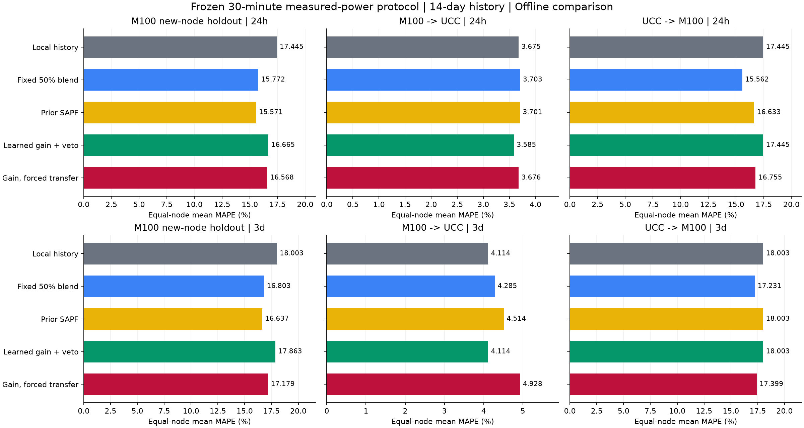
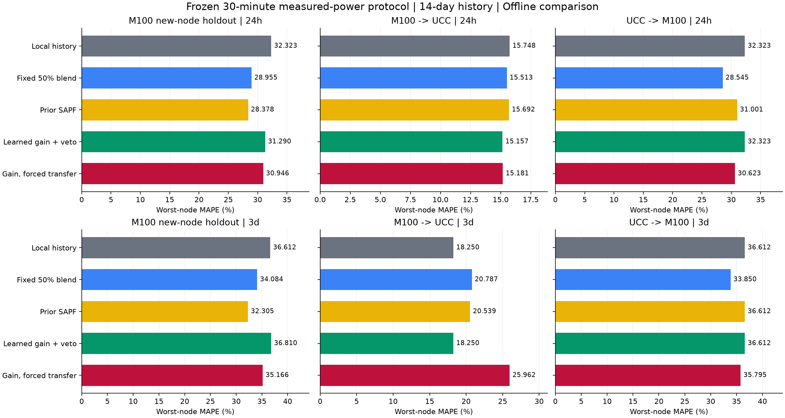
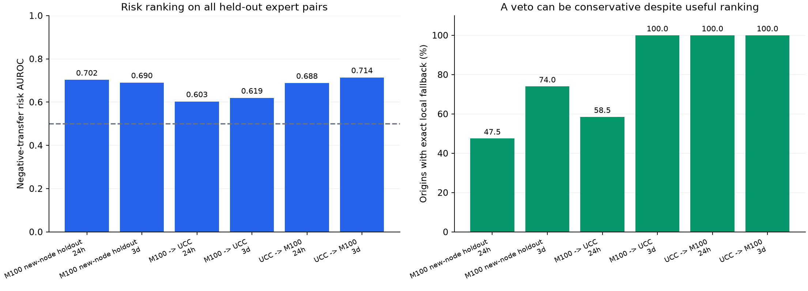

# 收益预测与M100↔UCC跨数据集迁移结果

本轮已完成源内留域收益学习、M100新留节点测试，以及M100→UCC、UCC→M100双向30分钟真实功率实验。**收益/风险模型能够提供一定的负迁移排序信息，但收益门控尚未稳定优于固定混合：M100→UCC的24h有改善；该方向3d和反向两个时长全部退回本地。不能据此宣称已经学会在未知中心稳定找到有益源。**

正式运行一次：[20261025T143438Z_sapf_transfer_771b85](../results/runs/20261025T143438Z_sapf_transfer_771b85/manifest.json)。三项研究、两个时长、10种方法的最终模型全部先冻结，再开始任何新测试；未根据测试结果修改参数、种子、收益学习器或重新训练。入口为 `scripts/run_experiment.py --config configs/sapf_transfer_suite.yaml`。方案见[冻结协议](BENEFIT_TRANSFER_PROTOCOL.md)，完整可分享证据见[目录说明](figures/benefit-transfer-20261025T143438Z_771b85/README.md)。

## 1. 主要结果

下表为测试节点等权平均**曲线MAPE（%）**。本地历史固定指前三天同刻均值；固定混合为50%本地历史+50%等权归一化单源专家。SAPF为此前的相似性/验证可靠性机制；收益策略为本轮新增的预测收益与风险门控。

| 研究 | 时长 | 本地历史 | 固定混合 | 原SAPF | 收益策略 | 收益策略比本地更差节点 | 零迁移起报 |
| --- | --- | ---: | ---: | ---: | ---: | ---: | ---: |
| M100新留节点 | 24h | 17.4445 | 15.7720 | 15.5712 | 16.6650 | 0/10 | 47.5% |
| M100新留节点 | 3d | 18.0035 | 16.8026 | 16.6368 | 17.8630 | 2/10 | 74.0% |
| M100→UCC | 24h | 3.6746 | 3.7034 | 3.7009 | 3.5849 | 12/90 | 58.5% |
| M100→UCC | 3d | 4.1139 | 4.2847 | 4.5137 | 4.1139 | 0/90 | 100% |
| UCC→M100 | 24h | 17.4445 | 15.5619 | 16.6334 | 17.4445 | 0/10 | 100% |
| UCC→M100 | 3d | 18.0035 | 17.2307 | 18.0035 | 18.0035 | 0/10 | 100% |

M100→UCC的24h，收益策略相对前三天均值改善0.0897个百分点，最差节点由15.7477%降至15.1574%，更差节点比例由固定混合的44/90降至12/90。不过前一天同刻的平均MAPE为3.4772%，仍优于收益策略。3d的零负迁移来自全部回退，不能记为正向迁移收益。

UCC→M100的固定混合分别达到15.5619%/17.2307%，均优于本地；收益策略没有利用到这些可迁移信息。M100内部收益策略平均值较本地略好，但两个时长都不如固定混合；3d最差节点36.8104%还高于本地36.6117%。





## 2. 数据与监督边界

| 项目 | M100 | UCC2023 |
| --- | --- | --- |
| 真实标签 | 节点 `total_power_avg`，W→kW | 物理服务器 `Power`，W→kW |
| 原生发布粒度 | 15min | 10min |
| 共同标签 | 完整2槽算术均值，30min | 完整3槽算术均值，30min |
| 固定源钟表区间 | [2021-12-08, 2022-02-18) | [2019-04-09, 2019-06-20) |
| 完整区间长度 | 72天 | 72天，避开已发现的回拨重复小时 |
| 本轮全局训练/验证/测试 | 8 / 4 / 10 | 12 / 8 / 90（测试D1 66、D2 24） |
| 质量/历史退出 | 旧测试10节点退出；剩余23个中1个不完整 | 145个原始ID中110个满足固定区间完整性 |
| 源时区 | UTC已核实 | naive钟表时间，时区未核实 |

历史14天=672点，24h=48点，3d=144点；所有方法使用相同目标与起报。没有插值、估算功率或用资源利用率代替监督标签。完整性只根据可用性掩码筛选，不根据功率大小、预测误差或方法表现换节点。132个适配节点共456,192个30分钟标签；原始功率文件4份SHA-256与预声明一致。

旧M100测试的10个节点不进入本轮训练、收益样本、先验、验证或新测试；加载器在打开其Parquet记录前跳过。新的M100测试身份来自上一轮验证身份，并非身份从未被看过；本轮使用完全不同日期，机制在新误差访问前固定。M100新测试只用10个节点，仍来自同一中心两个机架。

| 研究 | 模型/收益学习 | 参数选择 | 独立测试窗口（24h / 3d） |
| --- | --- | --- | ---: |
| M100新留节点 | M100训练8节点 | M100验证4节点 | 120 / 100 |
| M100→UCC | 同一M100源组 | 同一M100验证组，无UCC标签校准 | 1080 / 900 |
| UCC→M100 | UCC训练12节点 | UCC验证8节点，无M100标签校准 | 120 / 100 |

每数据集的训练/验证/测试ID全局互斥，测试ID也不在反向实验成为训练或验证。M100内部和正向研究的最终模型字节完全相同。反向和内部M100测试共享同一批目标与日期，可以配对比较，不能当成两批独立中心证据。

源开发拟合截止D50，验证D50—D56；最终源拟合截止D60。测试24h为D60—D71、3d为D60—D69，每节点12/10个起报。先完成两个源组全部拟合与选择，**2026-10-25 14:36:48 UTC统一冻结**；预注册为14:33:54 UTC。时间方案、候选网格和计算源码摘要见[预注册](figures/benefit-transfer-20261025T143438Z_771b85/preregistration.json)。

## 3. 收益预测器实际实现

单源专家为历史窗口归一化Ridge，alpha=100。只在训练节点内部构造“专家i→伪目标j，i≠j”的留域标签：`收益 = 本地历史MAPE − 专家MAPE`，单位为百分点，负值表示专家比本地更差。D24/D32/D40源检查点预测其后的固定区间，收益标签最晚D48结束，早于独立验证。专家历史表现来自更早的D20/D21源内预测；生成伪目标j的特征时，先验统计排除j。

输入42维，包括源与目标历史签名、差异及绝对差异、历史专家MAPE/收益/负迁移比例、预测时长、训练窗口数，以及专家与本地预测的分歧。源历史统计和模型预测可用，目标真实未来、数据集ID和域ID不作为数值特征。目标历史可用于推理和尺度恢复，不用目标未来反馈重新拟合。

M100收益样本2,352条，UCC为5,544条；每个源组联合学习两个时长。固定ExtraTrees回归/分类各128棵、深度6、最少叶样本20、种子42，分类balanced。UCC源内专家配对负迁移基率80.41%，平均收益−6.1092个百分点；M100为63.73%、−0.7788个百分点。它们是相关配对样本，样本量不能等同于独立中心数。

策略要求预计收益超过验证选定门槛且风险不高于上限，按正预计收益选top-k并加权；无合格源时权重和门控严格为0，输出本地预测。固定混合、等权纯迁移和收益策略使用同一套非负裁剪后的单源专家。旧SAPF保留原有先混合后公共裁剪的实现；严格的拒绝消融只在本轮收益策略内部进行。

| 源组 | 时长 | 最小预计收益pp | 最大风险分数 | 有源时迁移强度 | top-k |
| --- | --- | ---: | ---: | ---: | ---: |
| M100 | 24h | 0 | 0.5 | 0.25 | 3 |
| M100 | 3d | 1 | 0.25 | 1 | 3 |
| UCC | 24h | 1 | 0.25 | 0.25 | 1 |
| UCC | 3d | 1 | 0.25 | 0.25 | 1 |

这些设置全部来自源组独立验证节点；完整候选与选择期分数见[验证记录](figures/benefit-transfer-20261025T143438Z_771b85/source-validation-candidates.csv)，不是测试调参。UCC验证时各候选均退回本地，门槛按预先声明的平分规则选出；不能把这种平分选择解释为门槛已得到充分辨识。

## 4. 能否识别负迁移

以下均为全部测试“源专家×目标节点×起报”配对，未先按策略筛选。AUROC检验排序，Brier检验风险分数误差，收益MAE单位为MAPE百分点。分类输出未做独立概率校准，不能称为已校准发生概率。源常数Brier使用收益训练集的负迁移基率，未使用测试基率校准。

| 研究/时长 | 配对数 | 实际负迁移基率 | 风险AUROC | 风险Brier | 源基率常数Brier | 收益MAE pp |
| --- | ---: | ---: | ---: | ---: | ---: | ---: |
| M100内部24h | 960 | 56.56% | 0.7025 | 0.2240 | 0.2508 | 4.2565 |
| M100内部3d | 800 | 62.13% | 0.6904 | 0.2294 | 0.2356 | 3.4128 |
| M100→UCC 24h | 8,640 | 70.43% | 0.6029 | 0.2250 | 0.2128 | 1.8884 |
| M100→UCC 3d | 7,200 | 74.49% | 0.6193 | 0.2169 | 0.2016 | 1.9060 |
| UCC→M100 24h | 1,440 | 61.67% | 0.6880 | 0.2195 | 0.2715 | 8.3672 |
| UCC→M100 3d | 1,200 | 69.58% | 0.7139 | 0.1988 | 0.2234 | 7.6129 |

所有描述性AUROC均高于0.5，但M100→UCC的Brier不及源基率常数，说明跨数据集风险分数并未得到可靠校准。固定0.5阈值下的精确率、召回率与TP/FP/FN/TN计数均保存在[完整风险表](figures/benefit-transfer-20261025T143438Z_771b85/all-risk-summary.csv)，此阈值区别于策略使用的验证上限。

预计收益为正的配对中，实际为正的比例依次为：M100内部24h 60.82%、3d 55.31%；M100→UCC为38.87%、37.71%。UCC→M100没有任何预计正收益配对，精确率为N/A。反向实际却有552/1,440、365/1,200个有益专家配对；平均预计收益较实际低7.7017、6.6978个百分点。这支持“收益幅度预测偏保守且发生分布偏移”的诊断，不能由本轮测试直接决定修正阈值。

M100→UCC 24h被选中的1,213个专家配对里，52.76%仍是单独专家负迁移；M100内部24h/3d分别为35.47%/55.74%。所以门控后的节点平均改善不等于所有被选专家都有效；混合、抵消和回退也影响最终误差。M100→UCC 3d虽然有3,275个预计正收益配对，但无一满足该方向全部验证门槛，最终全部拒绝。



## 5. 拒绝机制的独立消融

`sapf_gain_no_veto`继承收益策略相同专家、学习器、先验和全部验证设置，唯一变化为：没有合格源时，强制用预计收益最高的一个源、保持同一混合强度。它不重新选择超参数，因此可单独评估“允许零迁移”的作用。

| 研究/时长 | 收益拒绝 平均/最差MAPE | 强制非零 平均/最差MAPE | 比本地更差节点：拒绝 / 强制 |
| --- | --- | --- | --- |
| M100内部24h | 16.6650 / 31.2897 | 16.5678 / 30.9462 | 0/10 / 2/10 |
| M100内部3d | 17.8630 / 36.8104 | 17.1788 / 35.1665 | 2/10 / 3/10 |
| M100→UCC 24h | 3.5849 / 15.1574 | 3.6761 / 15.1812 | 12/90 / 41/90 |
| M100→UCC 3d | 4.1139 / 18.2503 | 4.9284 / 25.9620 | 0/90 / 63/90 |
| UCC→M100 24h | 17.4445 / 32.3234 | 16.7552 / 30.6232 | 0/10 / 3/10 |
| UCC→M100 3d | 18.0035 / 36.6117 | 17.3987 / 35.7949 | 0/10 / 3/10 |

拒绝降低了每个组合相对本地更差的节点比例，但在M100内部和UCC→M100牺牲了平均/最差精度。只有M100→UCC两个时长同时改善了这三项指标；其中3d完全回退。结果支持拒绝具有保护作用，尚不支持“拒绝越多越好”或“已找到最优共享知识”。

## 6. 全方法比较与跨组差异

每格为**平均MAPE / 最差MAPE / 比前三天均值更差节点比例**。MAPE均为百分数；基线自身的负迁移比例不定义。比例按节点整段曲线指标比较，区别于上节的专家配对负迁移基率。

### M100新留节点

| 方法 | 24h：平均 / 最差 / 更差比例 | 3d：平均 / 最差 / 更差比例 |
| --- | --- | --- |
| `seasonal_naive` | 19.6621 / 37.8278 / N/A | 20.8695 / 40.8442 / N/A |
| `three_day_mean` | 17.4445 / 32.3234 / N/A | 18.0035 / 36.6117 / N/A |
| `ridge` | 15.8712 / 31.1613 / 50.0% | 17.9075 / 32.4082 / 50.0% |
| `normalized_ridge` | 16.0959 / 33.9433 / 40.0% | 17.8166 / 33.2861 / 50.0% |
| `uniform_transfer` | 14.9525 / 26.5445 / 30.0% | 16.2835 / 31.9896 / 30.0% |
| `fixed_blend` | 15.7720 / 28.9555 / 0.0% | 16.8026 / 34.0841 / 0.0% |
| `sapf_similarity` | 15.2535 / 28.4535 / 20.0% | 16.4301 / 30.6067 / 40.0% |
| `sapf` | 15.5712 / 28.3777 / 20.0% | 16.6368 / 32.3051 / 30.0% |
| `sapf_gain` | 16.6650 / 31.2897 / 0.0% | 17.8630 / 36.8104 / 20.0% |
| `sapf_gain_no_veto` | 16.5678 / 30.9462 / 20.0% | 17.1788 / 35.1665 / 30.0% |

### M100→UCC

| 方法 | 24h：平均 / 最差 / 更差比例 | 3d：平均 / 最差 / 更差比例 |
| --- | --- | --- |
| `seasonal_naive` | 3.4772 / 15.8339 / N/A | 4.0281 / 19.0062 / N/A |
| `three_day_mean` | 3.6746 / 15.7477 / N/A | 4.1139 / 18.2503 / N/A |
| `ridge` | 8.9732 / 23.1206 / 86.7% | 9.8900 / 27.0547 / 93.3% |
| `normalized_ridge` | 4.7113 / 20.2658 / 71.1% | 6.0150 / 28.0602 / 84.4% |
| `uniform_transfer` | 4.0100 / 18.0616 / 55.6% | 4.7255 / 23.5690 / 64.4% |
| `fixed_blend` | 3.7034 / 15.5131 / 48.9% | 4.2847 / 20.7871 / 53.3% |
| `sapf_similarity` | 4.0958 / 17.8006 / 60.0% | 5.1153 / 24.6064 / 66.7% |
| `sapf` | 3.7009 / 15.6916 / 51.1% | 4.5137 / 20.5390 / 57.8% |
| `sapf_gain` | 3.5849 / 15.1574 / 13.3% | 4.1139 / 18.2503 / 0.0% |
| `sapf_gain_no_veto` | 3.6761 / 15.1812 / 45.6% | 4.9284 / 25.9620 / 70.0% |

### UCC→M100

| 方法 | 24h：平均 / 最差 / 更差比例 | 3d：平均 / 最差 / 更差比例 |
| --- | --- | --- |
| `seasonal_naive` | 19.6621 / 37.8278 / N/A | 20.8695 / 40.8442 / N/A |
| `three_day_mean` | 17.4445 / 32.3234 / N/A | 18.0035 / 36.6117 / N/A |
| `ridge` | 14.8652 / 26.4911 / 40.0% | 16.8733 / 32.0383 / 40.0% |
| `normalized_ridge` | 17.1156 / 32.3313 / 80.0% | 21.4414 / 47.4218 / 90.0% |
| `uniform_transfer` | 14.6908 / 25.7544 / 20.0% | 17.4786 / 32.2295 / 70.0% |
| `fixed_blend` | 15.5619 / 28.5446 / 20.0% | 17.2307 / 33.8498 / 40.0% |
| `sapf_similarity` | 14.9282 / 27.6306 / 30.0% | 17.7447 / 39.1865 / 50.0% |
| `sapf` | 16.6334 / 31.0009 / 20.0% | 18.0035 / 36.6117 / 0.0% |
| `sapf_gain` | 17.4445 / 32.3234 / 0.0% | 18.0035 / 36.6117 / 0.0% |
| `sapf_gain_no_veto` | 16.7552 / 30.6232 / 30.0% | 17.3987 / 35.7949 / 30.0% |


M100→UCC归一化将原始Ridge的平均MAPE从8.9732%/9.8900%降至4.7113%/6.0150%，仍不及本地；反向归一化从14.8652%/16.8733%恶化至17.1156%/21.4414%。尺度恢复是必要候选机制，但不是跨中心有效性的充分条件。

UCC两个硬件组也不一致。正向24h的D1本地/固定混合/收益策略分别3.7698%/3.9688%/3.7145%，D2分别3.4130%/2.9736%/3.2285%；固定混合更差的44个节点全部在D1。收益策略改善了D1的选择，但没有超过D2的固定混合。所有分组均在测试后只作描述性诊断，未据此更改策略或选择硬件组。详见[机架/硬件组指标](figures/benefit-transfer-20261025T143438Z_771b85/cohort-summary.csv)。

与[Google结论](SAPF_RESULTS.md)和[旧M100结论](M100_RESULTS.md)一致，多源池化、归一化及复杂门控均不保证胜过简单本地历史。新增证据进一步显示迁移具有方向性，风险排序与最终有益决策是不同问题。Google是功率利用率，本轮是节点kW；日期、采样、节点角色和源数量也不同，不将数值当成同一排行榜或归因于单一机制。

## 7. 指标、复算与复现

MAPE/WAPE/RMSE/MAE由公共评分路径生成，曲线与日均分别计分；日均按48点，MAPE排除|标签|≤1e-8并记录计数。本轮全部计分没有排除零标签。跨域平均为节点等权，RMSE/MAE为kW；域等权WAPE不同于将所有服务器功率池化后计算的WAPE。

完整[5040条指标](figures/benefit-transfer-20261025T143438Z_771b85/all-metrics.csv)、[域等权全部指标汇总](figures/benefit-transfer-20261025T143438Z_771b85/all-metric-summary.csv)及[风险诊断](figures/benefit-transfer-20261025T143438Z_771b85/all-risk-summary.csv)已保存。原运行还保留逐起报、逐预测步、3d非重叠检查、全部预测与模型；证据目录保留配置、源内收益样本、验证候选、模型哈希及计算源码快照，不复制大型模型或原始数据。

| 验证项 | 结果 |
| --- | --- |
| 完整测试套件 | 54 passed，112.29s；包括原15min默认行为、30min窗口、历史/标签隔离和全方向先冻结 |
| 正常CLI | `--results latest`正确显示三项研究的全部默认比较，不重训 |
| 原始标签独立复算 | 132节点，1,292,544个原生点→456,192个30min标签，最大差3.33e-16 kW；四源文件哈希一致 |
| 预测指标独立复算 | 5,040条曲线/日均指标及原始钟表标签一致 |
| 收益/风险独立复算 | 20,240个测试配对，使用独立秩和AUROC与Brier复算 |
| 混合与精确回退 | 880项逐节点混合检查，1,883次零迁移起报核对；最大差7.77e-16 kW |
| 冻结/恢复 | 118个模型状态均先于任何测试冻结，60项最终模型保存恢复检查通过，源训练产物未变 |
| 计算源码/配置 | 实验执行与独立核对均匹配预注册SHA-256；测试后仅整理文档、图表和只读复核脚本 |

公共审计的`target_dataset_labels_not_used_for_selection`在此套件表示两个跨数据集方向目标标签隔离；M100内部实验本来就使用独立M100验证节点。不能将该字段解释成内部实验没有用过同数据集验证标签。

```powershell
# 显示冻结的真实结果，不拟合
.\.venv\Scripts\python.exe scripts/run_experiment.py --results results/runs/20261025T143438Z_sapf_transfer_771b85
# 从本地原始数据完整复现，自动创建新的运行目录
.\.venv\Scripts\python.exe scripts/run_experiment.py --config configs/sapf_transfer_suite.yaml
# 对原运行公共复核，output必须是新文件
.\.venv\Scripts\python.exe scripts/audit_cross_domain.py --run results/runs/20261025T143438Z_sapf_transfer_771b85 --output results/analysis/benefit_transfer_v1/recheck-new.json
# 独立保存预测/门控核对及独立原生聚合核对，均不fit
.\.venv\Scripts\python.exe docs/figures/benefit-transfer-20261025T143438Z_771b85/verify_independently.py --output results/analysis/benefit_transfer_v1/independent-new.json
.\.venv\Scripts\python.exe docs/figures/benefit-transfer-20261025T143438Z_771b85/verify_native_power.py --output results/analysis/benefit_transfer_v1/native-new.json
```

严格源码复现可在独立目录解压证据内`frozen-computational-source.tar.gz`；旧15min流程对应[扩展前快照](../archive/pre_gain_transfer_20261025/README.md)，不要求当前新增源码冒充旧哈希。源码登记中的registry保留冻结时的旧能力状态，新30min准入以专用配置和本报告为准。

## 8. 结论边界与下一步

这次确实进行了跨数据集、不同中心来源的节点/服务器实测功率迁移，超出了Google内部电力域和M100内部节点比较。它仍只有一对数据集，不能证明对所有未知中心有效，不能把节点结果合成设施总功率结论。M100仍仅两个机架，UCC质量筛选尤其排除了大量D2缺失主机，结果以完整72天观测为条件。

两数据集年份不同，特别是M100→UCC使用较晚源数据，属于离线迁移基准而非2019年可部署回测。UCC时区未核实；内部2000年合成协议轴仅表示相对时间，预测文件保留原始钟表标签。聚合左右边界及额外上报时延仍未独立核实，历史可用性使用标签+30min的假定。3d窗口重叠、同中心节点和源专家配对相关，本轮不报告基于IID假定的显著性或置信区间。

本轮可保留的机制证据是：负迁移有一定可识别性，零迁移能保护部分方向；尚缺少跨分布收益幅度校准和保留有益源的能力。下一版应先在训练/独立验证节点上检验收益偏差、风险校准及保护与收益的权衡，再预声明新的测试；这些当前已查看测试结果只能作为开发证据，不能继续充当下一版的独立调参验收集。

**NLR Eagle整体继续封存，本轮未读取其观测/标签，未参与训练、验证或策略设计。** ESIF设施分项与Eagle明确分开。Eagle最终独立验证及更多中心数据仍是后续泛化证据要求。
