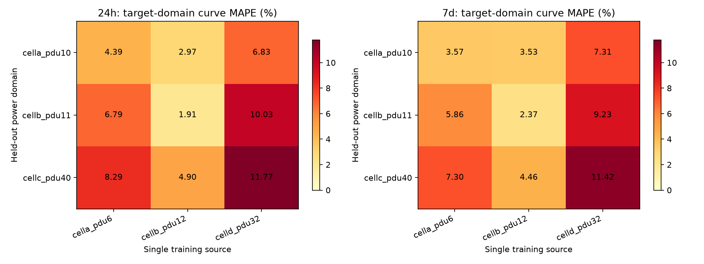

# 跨域第一阶段真实结果

**已完成 Google 三目标电力域、24h/7d 的零样本单源/多源 Ridge 实验，并通过公共指标复算、域隔离、冻结和恢复核对。多源三域平均曲线 MAPE 为 2.8084% / 3.3919%，但没有超过简单历史基线的平均表现。**

日期：2026-10-25（Asia/Shanghai）。分支 research/cross-domain-v2，基准提交 3f97a7453aa76f87c6b98ec10158a6532a0b58aa。工程验收时未提交或推送，用户原暂存工作保留；后续按用户明确要求提交当前已暂存的完整版本，未推送。

主运行：[20261024T165116Z_cross_domain_google_d531e9](../results/runs/20261024T165116Z_cross_domain_google_d531e9/manifest.json)。运行 ID 使用 UTC；本地日期为 10 月 25 日。此前一次实现核对运行 20261024T164634Z_cross_domain_google_5af4e4 保留；后续仅修正跨任务源域数量的展示、增强截止/冻结审计并复跑相同预先固定方案，没有根据测试误差调整参数、目标或源池。两次不是两份独立泛化证据。

## 1. 实际执行命令

以下命令已实际执行，均使用项目 .venv。首次分支创建在检查脏工作区之后，保留全部用户变更。

    git status --short
    git branch --show-current
    git log -5 --oneline
    git switch -c research/cross-domain-v2
    .\.venv\Scripts\python.exe scripts/audit_cross_domain.py --output results/analysis/cross-domain-v2/baseline.json
    .\.venv\Scripts\python.exe scripts/run_experiment.py --config configs/cross_domain_google.yaml
    .\.venv\Scripts\python.exe scripts/audit_cross_domain.py --run results/runs/20261024T165116Z_cross_domain_google_d531e9 --output results/analysis/cross-domain-v2/pilot-recomputation.json
    .\.venv\Scripts\python.exe -m pytest -q
    .\.venv\Scripts\python.exe scripts/run_experiment.py --demo --demo-days 60 --models seasonal_naive three_day_mean
    .\.venv\Scripts\python.exe scripts/run_experiment.py --config configs/all_models_nlr.yaml --models seasonal_naive three_day_mean
    .\.venv\Scripts\python.exe scripts/audit_model_coverage.py --nlr results/runs/20261014T191440Z_3bac9d --google results/runs/20261014T191923Z_google_9a3ad6 --output results/analysis/cross-domain-v2/historical-coverage.json
    .\.venv\Scripts\python.exe scripts/run_experiment.py --results latest
    .\.venv\Scripts\python.exe scripts/run_experiment.py --results results/runs/20261014T191923Z_google_9a3ad6
    .\.venv\Scripts\python.exe scripts/audit_cross_domain.py --verify results/analysis/cross-domain-v2/baseline.json --output results/analysis/cross-domain-v2/protection-verification.json
    git diff --check

审计命令拒绝覆盖既有输出，复查时将 output 改成未使用的新文件名。合成运行 20261024T164347Z_1cb905 只用于程序检查；真实 NLR 双基线 smoke 为 20261024T165009Z_efa09c。没有重跑 18 个模型或整套 HDSF 基座，也没有修改旧报告脚本来向历史运行写入新审计。

## 2. 目标 × 策略 × 任务曲线 MAPE

全部数字为百分数。单源 A/B/D 分别指 cella_pdu6 / cellb_pdu12 / celld_pdu32。目标有监督参考使用了目标训练标签，训练条件不同。各方法在同一目标/任务使用完全相同的测试起报和标签。

| 目标域 / 任务 | 前一天 | 前三天 | Ridge 单源 A | 单源 B | 单源 D | 多源 Ridge | 目标有监督参考 |
| --- | ---: | ---: | ---: | ---: | ---: | ---: | ---: |
| cella_pdu10 / 24h | 2.5218 | 2.2406 | 4.3893 | 2.9713 | 6.8281 | 2.4615 | 2.2732 |
| cellb_pdu11 / 24h | 1.8526 | 1.6673 | 6.7940 | 1.9106 | 10.0286 | 1.7879 | 1.6236 |
| cellc_pdu40 / 24h | 2.9450 | 3.1745 | 8.2940 | 4.9032 | 11.7682 | 4.1758 | 6.0436 |
| cella_pdu10 / 7d | 2.5941 | 2.4190 | 3.5665 | 3.5276 | 7.3122 | 2.6131 | 2.5924 |
| cellb_pdu11 / 7d | 2.0513 | 1.8011 | 5.8552 | 2.3672 | 9.2291 | 2.1849 | 1.9711 |
| cellc_pdu40 / 7d | 3.5897 | 3.3643 | 7.2980 | 4.4570 | 11.4203 | 5.3777 | 6.0096 |

24h 每域 9 个起报、864 个曲线点、9 个日均样本；7d 每域 3 个起报、2016 个曲线点、21 个日均样本。目标测试没有缺测跳过或 MAPE 小分母剔除；三域汇总曲线点分别为 2592/6048。7d 重叠点不是独立样本。

[全部曲线/日均 MAPE、WAPE、RMSE、MAE、减少比例与计数](figures/cross-domain-20261024T165116Z_d531e9/metrics.csv)，[24h 矩阵](figures/cross-domain-20261024T165116Z_d531e9/24h_transfer_matrix.csv)，[7d 矩阵](figures/cross-domain-20261024T165116Z_d531e9/7d_transfer_matrix.csv)。逐起报、步长、目标日及预测 Parquet 保存在主运行各 target/task/model 子目录中，不以截图代替数值。

## 3. 等权平均、最差域与增加源域效果

| 方法 | 24h 平均 MAPE | 24h 最差域 | 7d 平均 MAPE | 7d 最差域 |
| --- | ---: | ---: | ---: | ---: |
| 前一天同刻 | 2.4398 | 2.9450 | 2.7450 | 3.5897 |
| 前三天同刻均值 | 2.3608 | 3.1745 | 2.5281 | 3.3643 |
| 单源 A | 6.4924 | 8.2940 | 5.5732 | 7.2980 |
| 单源 B | 3.2617 | 4.9032 | 3.4506 | 4.4570 |
| 单源 D | 9.5416 | 11.7682 | 9.3205 | 11.4203 |
| 多源联合 | 2.8084 | 4.1758 | 3.3919 | 5.3777 |
| 目标有监督参考 | 3.3135 | 6.0436 | 3.5244 | 6.0096 |

多源 24h 每折含 44 个源域、350 个训练窗口，7d 为 42 域、84 个窗口。相对每个预定单源扩充到固定多源池：

| 任务 | MAPE 增大的比较 | 比例 | 涉及目标域 |
| --- | ---: | ---: | ---: |
| 24h | 0/9 | 0% | 0/3 |
| 7d | 1/9 | 11.11% | 1/3（33.33%） |

唯一正差值是 cellc_pdu40 的 7d：单源 B 为 4.4570%，多源为 5.3777%，增加 **0.9207 个百分点**，相对恶化 **20.66%**。这是固定单源与包含它的多源池在相同目标/窗口的比较，不是与目标有监督模型相减，也没有定位到哪个新增源造成变化。[完整负迁移明细](figures/cross-domain-20261024T165116Z_d531e9/negative-transfer.csv)。

多源通常改善了这些单源 Ridge，但简单历史基线的域平均更好。尚不能据此声称跨域方法具有普遍优势，或声称已验证源门控的必要性和有效性。

## 4. 起报前统计与描述性分析

在首个测试起报 D22 之前的 14 天历史，记录各域均值、变异系数、lag-1 自相关、日/周相关性及平均绝对爬坡。缺失域只在可用成对点上计算统计，不填补目标；这些量未进入模型选择。

9 个固定源→目标对中，历史均值绝对差与迁移 MAPE 的 Pearson 相关约为 24h 0.7915、7d 0.8061，周相关性差值对应约 0.8489/0.8570。样本很少，源和目标重复，统计量相关且未经独立检验，不能作因果或显著性结论。[历史统计](figures/cross-domain-20261024T165116Z_d531e9/pre-origin-profiles.csv)、[配对分析](figures/cross-domain-20261024T165116Z_d531e9/profile-transfer-analysis.csv)、[全部相关系数](figures/cross-domain-20261024T165116Z_d531e9/profile-correlations.json)。

## 5. 验证、失败与限制

| 验证 | 真实结果 |
| --- | --- |
| 完整 pytest | 51 passed；第三方警告保留，未修改环境 |
| 旧 NLR / Google 18 模型覆盖及复算 | 72 + 72 = 144/144 通过 |
| 旧 NLR HDSF | 10 个冻结模型哈希、4 项曲线/日均指标复算通过 |
| 新跨域复算 | 114 项指标检查通过，含测试及开发诊断 |
| 新模型恢复 | 42/42，首个测试窗口在 rtol=1e-6、atol=1e-7 下相符，最大绝对差 1.1921e-7 |
| 冻结与隔离 | 源域不含本折目标、训练标签截止正确、全部模型先冻结后测试均通过 |
| 历史保护 | 18,585 项通过，其中 6,520 项有哈希，12,065 项按大小/mtime 检查 |
| 用户工作 | 11 份既有文档字节一致，Git index 不变；README 在原变更基础上更新 |
| 输出检查 | 普通 demo、真实 NLR smoke、旧 Google 展示及 latest 均通过；热力图已视觉核对 |

[新审计](figures/cross-domain-20261024T165116Z_d531e9/audit.json)、[保存恢复明细](figures/cross-domain-20261024T165116Z_d531e9/saved-model-audit.json)、[证据与来源哈希](figures/cross-domain-20261024T165116Z_d531e9/evidence.json)、[最终测试日志](../results/analysis/cross-domain-v2/pytest-delivery.log)。

预检实际遇到两类数据约束：机器映射存在歧义；若干预列域的单个无效区间导致完整长窗口不足。处理方式是保留原始数据，记录映射/覆盖问题，并在测试预测前固定合格域规则，不补目标、不依据误差替换域。两个早期新增测试还暴露测试自身的浅拷贝和 Windows 默认解码问题，已修复，完整测试通过。

本实验仍受以下边界限制：

- Google 提供的是[电力域功率利用信息](https://github.com/google/cluster-data/blob/master/PowerData2019.md)，不是独立实测设施总有功功率 kW，不能用于 MAPE≤5% 总表验收。
- 仅三目标 pilot，没有完成全部 57 折；域筛选依赖完整观测条件。电力域留出不等于独立设施留出，同 cell 的源/目标可有共同行为。
- 7d 每源仅两个高度重叠训练窗口，没有 D22 前可用的独立开发集，因此参数预先固定、不选参。测试也只有三个重叠周窗口。
- 历史 Google 研究结果已被观察过，新身份不等于新采集的未触碰数据。禁止将重复运行当独立验证。
- 未训练 HAST、选择性门控或新预训练模型；未验证 Alibaba/Eagle/M100/墨尔本接入；4h/3d 与通用 A—H 仍未实现。
- 新模型恢复核验覆盖每模型首个测试窗口，未重新恢复所有历史大模型；历史权重/大缓存部分只按元数据保护。

下一步先取得更长、具备独立源域开发时间的真实序列，再按预先注册的条件扩展留域验证；如研究选择性迁移，应只用源域/开发信息设计规则，并用新的独立评价检验。独立设施总表任务需另行取得可信功率与设备边界，不能把当前利用率表改名为 kW。
