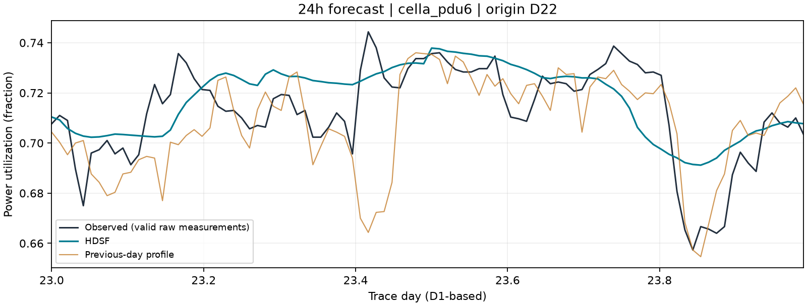
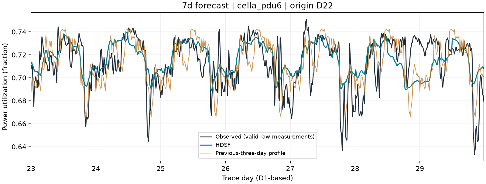

# Google PowerData 2019 HDSF D14/D22 复现（2026-10-15）

已按用户最终确认的旧 D14/D22 协议完成本轮复现。24h、7d 曲线及日均 WAPE 与历史归档一致，全部成员的开发与测试逐点预测最大差异为 **0**。本次是相同原始数据的重跑，不是新增数据集或新的独立测试。

## 运行方式

```powershell
.\.venv\Scripts\python.exe scripts/run_experiment.py --config configs/google_hdsf.yaml
.\.venv\Scripts\python.exe scripts/run_experiment.py --results results/runs/20261014T162657Z_google_8ef216
```

正式入口复用 `scripts/run_experiment.py`；该预设直接读取原始目录，无需运行 NLR 预处理。`--horizons 24h` 或 `--horizons 7d` 可单独运行任务。固定协议拒绝日期裁剪、demo、协变量消融和改动成员池的覆盖项。

配置：[google_hdsf.yaml](../configs/google_hdsf.yaml)。该预设只读调用 `D:/AAA_Project/PowerData_Prediction` 的原 HDSF 实现（Git HEAD `83f044c3259faa432eecf62abb1de70425269cce`），使用 `D:/Python 3.13/python.exe` 恢复历史 NumPy/模型库环境；项目包目录附加到搜索路径末尾，提供 Parquet 导出依赖，不覆盖历史数值依赖。换机器需调整配置中的源码、解释器、补充包和权重路径；本预设仍依赖旧项目源码。

## 数据与协议

- 原始目录 `data/raw/Google/`：57 条供电域、31 天、每条 8928 个 5 分钟点，另有 96616 行机器映射。58 个压缩文件的 SHA-256 与旧 `raw.zip` 内容逐文件一致。映射用于旧本地模型的机器数量等元信息。
- 按原始数值时间排序，每连续 3 个点聚合为一个 15 分钟点；坏实测点排除后取有效均值。整块无效时才使用此前最近 12 个有效原始点的中位数。本数据没有全无效块。
- 评分要求每个 15 分钟块的 3 个原始实测点全部有效：全数据有效 169608/169632。部分有效块均值可进入历史，不能作为有效评分真值。未来质量标记只参与评分，不进入预测。
- 沿用旧协议的数值相对时间、D1 起的日编号和成员特征；不使用探索阶段生成的日历时间 Parquet。目标单位是功率利用率比例，不是 kW。
- 24h 开发起报 D14/D16/D18/D20，测试 D22–D30；每次生成 96 点。开发本地模型固定用 D1–D14 标签，最终模型固定用 D1–D22 标签。
- 7d 开发起报 D14/D15，测试 D22/D23/D24；每次生成 672 点。保留原成员池与 14/最长 21/28 天等历史约定、Toto 分组及 TimesFM 联合/单变量方式。
- 半日分段：24h 为 2 段，7d 为 14 段。按原 pooled L1 单纯形拟合、原池化 WAPE 开发门槛及留一起报点规则选混合比例；没有改成 MAPE 或 57 序列等权目标重新选权。
- 全部任务先校准、重拟合并保存冻结记录及 D14/D22 本地模型，再执行任何测试推理。测试期仅滚动更新可观测历史，训练模型与融合权重保持固定。

数据来源：[Google PowerData 2019 官方说明](https://github.com/google/cluster-data/blob/master/PowerData2019.md)。原始时间是相对微秒偏移；本轮按旧协议的序列日编号运行，不将其当作 Unix 时间戳。

## HDSF 结果

WAPE 先在每条供电域内合并规定起报的有效预测实例计算，再对 57 条等权平均。MAPE/RMSE 按有效预测实例汇总；MAPE 阈值为 `|truth| > 1e-8`。日均先按序列、起报、目标日用共同有效点聚合，再评分。

| 任务 | MAPE (%) | RMSE（利用率） | 57 序列等权 WAPE (%) | 有效样本 |
| --- | ---: | ---: | ---: | ---: |
| 24h 曲线 | 2.355507 | 0.023330 | 2.335113 | 49243 |
| 24h 日均 | 1.448852 | 0.013890 | 1.452113 | 513 |
| 7d 曲线 | 2.723187 | 0.025453 | 2.701623 | 114902 |
| 7d 日均 | 1.861705 | 0.016474 | 1.865617 | 1197 |

24h 固定 mix=0.075，7d 固定 mix=1.000。24h 相对前一天轮廓 WAPE 减少 27.015114%；7d 曲线相对前三天均值减少 15.887797%。24h/7d 各有 9/3 个测试起报；这些起报覆盖的 57 条序列都保留。

## 全部测试对照

### 24h

| 方法 | 曲线 WAPE (%) | 曲线 MAPE (%) | 日均 WAPE (%) | 日均 MAPE (%) |
| --- | ---: | ---: | ---: | ---: |
| 前一天同刻 | 3.199447 | 3.234955 | 1.786182 | 1.786166 |
| 前三天同刻均值 | 3.022848 | 3.045817 | 2.047873 | 2.043141 |
| Chronos-2 | 2.454158 | 2.475856 | 1.582000 | 1.576494 |
| TiRex-2 | 2.433901 | 2.453647 | 1.546903 | 1.542904 |
| TimesFM 2.5 | 2.477118 | 2.498059 | 1.574647 | 1.568582 |
| Toto 2.0（联合） | 2.498113 | 2.524253 | 1.667017 | 1.663977 |
| Toto 2.0（单变量） | 2.495596 | 2.520886 | 1.663961 | 1.660419 |
| TimesFM 3.0 | 2.398056 | 2.419736 | 1.519783 | 1.517246 |
| TimesFM 3.0（长版标识） | 2.367635 | 2.392694 | 1.493629 | 1.491730 |
| TimesFM 3.0（单变量） | 2.377802 | 2.395462 | 1.522714 | 1.519046 |
| 本地24h（树/线性） | 3.083392 | 3.077451 | 2.256104 | 2.234065 |
| HDSF（最终融合） | 2.335113 | 2.355507 | 1.452113 | 1.448852 |



### 7d

| 方法 | 曲线 WAPE (%) | 曲线 MAPE (%) | 日均 WAPE (%) | 日均 MAPE (%) |
| --- | ---: | ---: | ---: | ---: |
| 前一天同刻 | 3.653823 | 3.721122 | 2.388643 | 2.405957 |
| 前三天同刻均值 | 3.211928 | 3.251596 | 2.257485 | 2.263259 |
| TimesFM 3.0（长版标识） | 2.709206 | 2.738563 | 1.932236 | 1.932480 |
| Toto 2.0（联合） | 2.918381 | 2.963377 | 2.162927 | 2.169793 |
| TimesFM 3.0（单变量） | 2.779714 | 2.806228 | 2.001516 | 1.999149 |
| PatchTST-FM | 2.742077 | 2.766735 | 1.891762 | 1.889450 |
| 本地7d（水平/形状） | 3.106821 | 3.109997 | 2.335103 | 2.318311 |
| HDSF（最终融合） | 2.701623 | 2.723187 | 1.865617 | 1.861705 |



图仅展示按元数据顺序固定取出的首条供电域、首个测试起报；全体 57 条序列参与上表评分，未按测试表现挑选示例。

## 校验与成本

- 原始文件逐文件哈希一致；冻结前后的原始文件及本地模型哈希不变。
- 所有 80 行曲线/日均、开发/测试指标都从保存的预测 Parquet 独立复算，误差在 `1e-12` 内；原始标签及质量掩码也经过核验。
- 与历史 `20261007T120914664110Z` 归档比较，全部基座、本地、HDSF 的开发及测试逐点预测差异为 0。
- 原 HDSF 因果审计退出码 0：D14/D22 训练边界、开发与测试未来数据污染、融合选择污染及冻结后复组合均通过。
- 当前项目测试 `34 passed`，真实 CLI 重显完整对照表退出码 0。
- 本轮复现主体耗时 57.8 秒（不包含后续审计）；全部基座预测命中按输入、检查点、版本、配置校验的历史缓存，D14 和 D22 本地模型在当前项目中重新训练，融合重新选权。该耗时不代表所有基座冷启动推理成本。

历史环境：`numpy=2.2.6, pandas=2.3.3, lightgbm=4.6.0, chronos-forecasting=2.3.2, torch=2.8.0+cpu, timesfm=3.0.2, granite-tsfm=0.3.10, tirex-2=0.3.0, toto-2=2.0.0, scipy=1.15.3, scikit-learn=1.7.2`。

## 证据与解释边界

- [本轮结果目录](../results/runs/20261014T162657Z_google_8ef216/)：`manifest.json`、`frozen-before-test.json`、`metrics.csv`、`models/`、`prepared-panel.npz`、逐任务预测 Parquet 及旧结构 `results.joblib`。
- [独立指标与逐点核对](../results/runs/20261014T162657Z_google_8ef216/independent-metrics-audit.json)、[因果审计](../results/runs/20261014T162657Z_google_8ef216/audit.json)、[来源对比](../results/runs/20261014T162657Z_google_8ef216/source-comparison.json)。
- `reference-source/` 保存本轮旧实现源码、桥接入口和配置；检查点仍从配置指向的只读目录加载。
- [本轮运行日志](../results/logs/google-hdsf-d14-d22-historical-runtime-20261015.log)与[因果审计日志](../results/logs/google-hdsf-causal-audit-20261015.log)。此前项目数值环境的探索运行已标记为 interrupted，保留其日志与缓存，不计为本次完成结果。
- 不混用旧池化 WAPE：例如 7d 曲线旧池化值为 2.683159%，本报告等权值为 2.701623%；CSV 的 `pooled_WAPE` 仅保留作审计。
- 开发融合拟合分数是样本内值；7d 开发窗口重叠，原留一起报点校准不是独立日期验证。本轮保留该历史标准。
- 历史方法设计曾参考同一测试期，不能将此次一致性复现称为未见过的独立泛化证据。旧 local24 的 D1 残差基线与其他日不同，本轮为保持复现一致性未修改。
- 该 Google 标准与 NLR 的单序列、14 天统一输入、自适应划分、MAPE 选择预设不同，不能直接把两者数值作为同条件精度比较。
