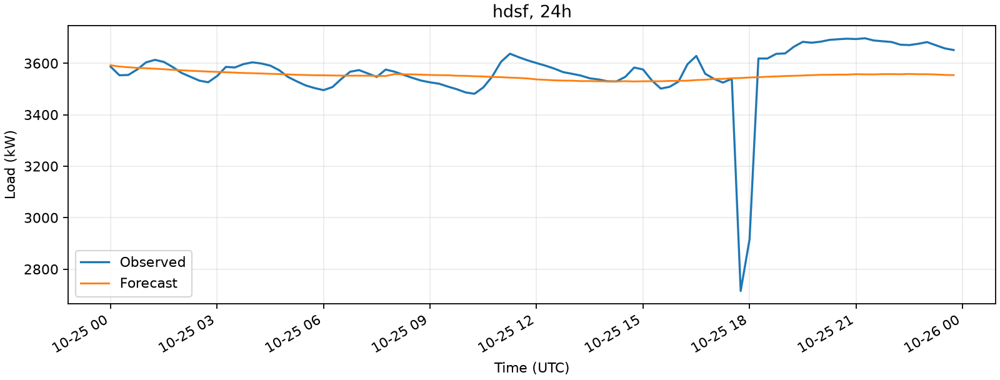
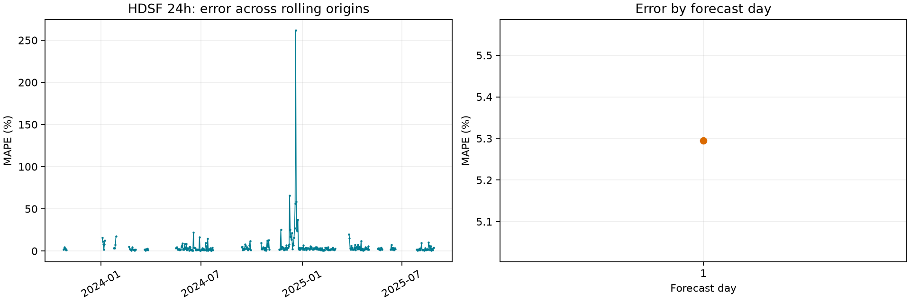
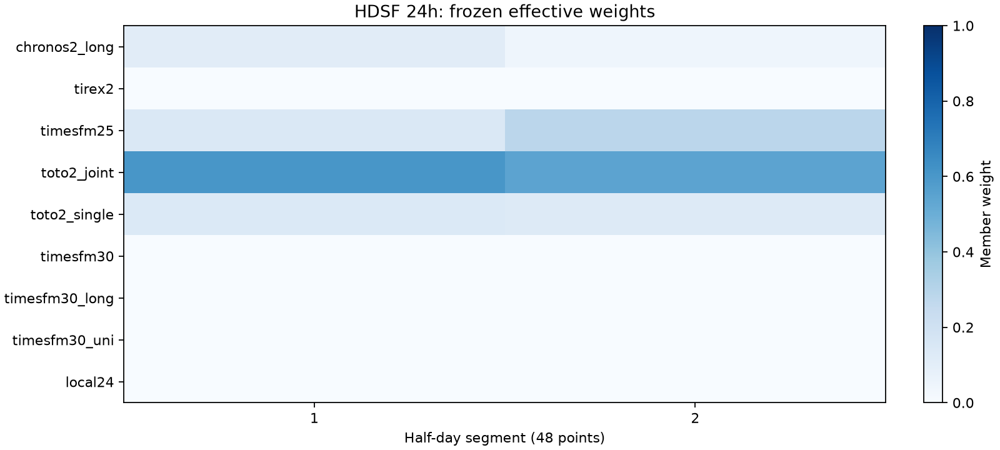
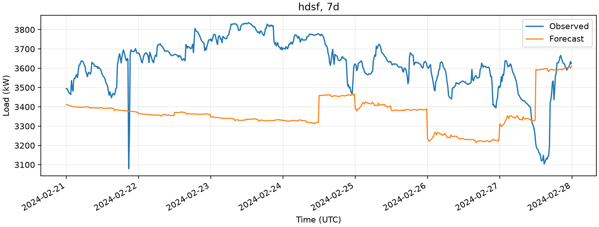
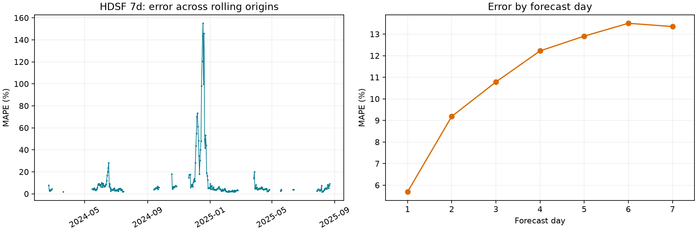
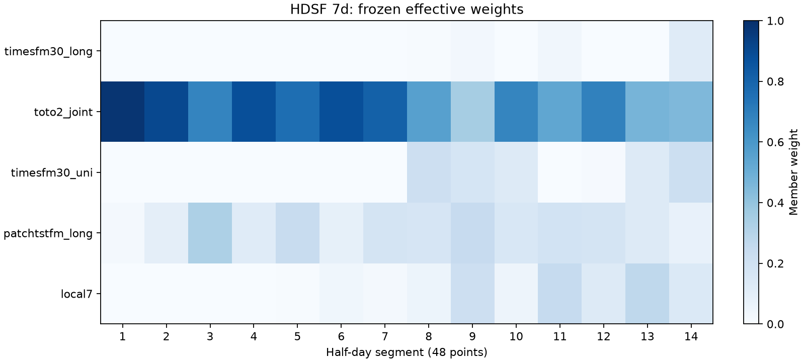

# NLR 数据集 HDSF 重跑结果（2026-10-13）

本报告由实际预测 Parquet 重新计分，并检查测试前保存的模型文件哈希。合成数据不计入研究结果。

本轮使用 `esif.influx.buildingData.PUE.combined.parquet` 与 `esif.influx.buildingData.outside.combined.parquet`，沿用既有协议重新训练本地模型、校准融合并完成独立测试。两文件 SHA-256 与旧审计记录一致，预处理结果逐值一致，因此这是同内容重跑。来源、普通默认结果和复现命令见 [NLR 文件对齐与重跑](NLR数据对齐与重跑.md)。旧实验及处理数据继续保留。

实验目录：`D:\AAA_Project\PowerForecast\results\runs\20261013T120519Z_abc86d`。随机种子：42。目标：五项分项功率的区间均值之和，单位 kW。时区暂按 UTC，尚未核实。

研究跨度 3364 个日历日，其中 3026 天具有 96 个有效聚合目标；缺失目标 12726 点（3.9406%）。内部缺测不删除、不压缩时间轴。观测功率最小值 / 中位数 / 最大值为 14.21 / 1224.75 / 4171.17 kW。

## 协议与有效窗口

| split | start | end | rows | days |
| --- | --- | --- | --- | --- |
| train | 2016-06-13 00:00:00+00:00 | 2021-12-21 23:45:00+00:00 | 193728 | 2018 |
| validation | 2021-12-22 00:00:00+00:00 | 2023-10-24 23:45:00+00:00 | 64512 | 672 |
| test | 2023-10-25 00:00:00+00:00 | 2025-08-28 23:45:00+00:00 | 64704 | 674 |

硬件：Intel(R) Core(TM) Ultra 5 125H，18 个逻辑处理器，31.46 GiB 内存；基座推理为 CPU、4 线程。

- 24h：train 有效 969、跳过 1035；validation 有效 312、跳过 360；test 有效 328、跳过 346。
- 24h HDSF：2 个半日段，混合比例 0.000，验证交叉检验 MAPE 6.4032%；融合校准总耗时 53.4 秒（包括基座验证预测）。
- 验证阶段选中模型：hdsf；HDSF 的总体模型选择使用交叉检验分数，不使用融合拟合分数。

- 7d：train 有效 726、跳过 1272；validation 有效 227、跳过 439；test 有效 251、跳过 417。
- 7d HDSF：14 个半日段，混合比例 0.800，验证交叉检验 MAPE 19.3419%；融合校准总耗时 36.8 秒（包括基座验证预测）。
- 验证阶段选中模型：hdsf；HDSF 的总体模型选择使用交叉检验分数，不使用融合拟合分数。

## 独立测试结果

- 24h：HDSF 曲线 MAPE 5.2950%，相对 seasonal_naive 的 MAPE 降低 24.12%；本次测试表中 MAPE 最低的方法为 tirex2（5.1250%）。测试排名只用于结果解释，不改变测试前冻结的选择。
- 7d：HDSF 曲线 MAPE 11.0896%，相对 three_day_mean 的 MAPE 降低 12.74%；本次测试表中 MAPE 最低的方法为 toto2_joint（11.0389%）。测试排名只用于结果解释，不改变测试前冻结的选择。

| horizon | model | evaluation | MAPE | RMSE | WAPE | n | mape_excluded | MAPE_reduction_pct | WAPE_reduction_pct |
| --- | --- | --- | --- | --- | --- | --- | --- | --- | --- |
| 24h | seasonal_naive | curve | 6.9778 | 264.8069 | 5.5533 | 31488 | 0 | 0.0000 | 0.0000 |
| 24h | seasonal_naive | daily_mean | 5.2305 | 210.8203 | 4.1969 | 328 | 0 | 0.0000 | 0.0000 |
| 24h | three_day_mean | curve | 8.3187 | 298.4954 | 6.1041 | 31488 | 0 | -19.2167 | -9.9169 |
| 24h | three_day_mean | daily_mean | 7.1070 | 269.6046 | 5.2239 | 328 | 0 | -35.8765 | -24.4693 |
| 24h | seasonal_ar | curve | 5.8391 | 211.0675 | 4.6164 | 31488 | 0 | 16.3195 | 16.8725 |
| 24h | seasonal_ar | daily_mean | 4.7641 | 173.8017 | 3.8836 | 328 | 0 | 8.9159 | 7.4654 |
| 24h | dlinear | curve | 10.7600 | 357.2005 | 9.2717 | 31488 | 0 | -54.2026 | -66.9562 |
| 24h | dlinear | daily_mean | 5.6683 | 199.4160 | 4.4863 | 328 | 0 | -8.3702 | -6.8947 |
| 24h | local24 | curve | 7.3430 | 253.6554 | 5.4632 | 31488 | 0 | -5.2338 | 1.6237 |
| 24h | local24 | daily_mean | 5.8797 | 213.4524 | 4.4143 | 328 | 0 | -12.4127 | -5.1790 |
| 24h | hdsf | curve | 5.2950 | 208.6780 | 3.9321 | 31488 | 0 | 24.1160 | 29.1940 |
| 24h | hdsf | daily_mean | 4.2641 | 173.9386 | 3.2196 | 328 | 0 | 18.4749 | 23.2859 |
| 7d | seasonal_naive | curve | 12.7056 | 436.6717 | 8.8160 | 168672 | 0 | 0.0260 | -1.9517 |
| 7d | seasonal_naive | daily_mean | 11.1497 | 406.5286 | 7.7981 | 1757 | 0 | 2.7528 | 1.7144 |
| 7d | three_day_mean | curve | 12.7089 | 424.0324 | 8.6472 | 168672 | 0 | 0.0000 | 0.0000 |
| 7d | three_day_mean | daily_mean | 11.4653 | 403.6035 | 7.9341 | 1757 | 0 | 0.0000 | 0.0000 |
| 7d | seasonal_ar | curve | 13.3972 | 399.0519 | 10.7507 | 168672 | 0 | -5.4157 | -24.3249 |
| 7d | seasonal_ar | daily_mean | 12.5116 | 382.4060 | 10.2866 | 1757 | 0 | -9.1257 | -29.6504 |
| 7d | dlinear | curve | 16.9826 | 509.9931 | 13.8878 | 168672 | 0 | -33.6277 | -60.6039 |
| 7d | dlinear | daily_mean | 15.2718 | 463.2616 | 12.6492 | 1757 | 0 | -33.2000 | -59.4285 |
| 7d | local7 | curve | 12.3426 | 378.6636 | 8.5064 | 168672 | 0 | 2.8826 | 1.6282 |
| 7d | local7 | daily_mean | 11.2097 | 359.2560 | 7.9158 | 1757 | 0 | 2.2290 | 0.2313 |
| 7d | hdsf | curve | 11.0896 | 359.0128 | 7.5732 | 168672 | 0 | 12.7413 | 12.4209 |
| 7d | hdsf | daily_mean | 10.0184 | 340.2688 | 7.0040 | 1757 | 0 | 12.6199 | 11.7235 |

MAPE/WAPE 为百分数，RMSE 为 kW。24h 的日均任务与 7d 的七个日均任务分别计分。改进幅度为相对误差减少比例；负值表示劣于基线。

## 基座成员与消融

| horizon | model | evaluation | MAPE | RMSE | WAPE | n | mape_excluded | MAPE_reduction_pct | WAPE_reduction_pct |
| --- | --- | --- | --- | --- | --- | --- | --- | --- | --- |
| 24h | chronos2_long | curve | 5.3122 | 207.6643 | 3.9442 | 31488 | 0 | 23.8694 | 28.9764 |
| 24h | tirex2 | curve | 5.1250 | 208.2783 | 3.9010 | 31488 | 0 | 26.5535 | 29.7547 |
| 24h | timesfm25 | curve | 5.6557 | 208.9248 | 4.0021 | 31488 | 0 | 18.9470 | 27.9334 |
| 24h | toto2_joint | curve | 5.2154 | 211.4095 | 3.9455 | 31488 | 0 | 25.2575 | 28.9530 |
| 24h | toto2_single | curve | 5.2154 | 211.4095 | 3.9455 | 31488 | 0 | 25.2575 | 28.9530 |
| 24h | timesfm30 | curve | 5.3822 | 211.8415 | 3.9743 | 31488 | 0 | 22.8675 | 28.4344 |
| 24h | timesfm30_long | curve | 5.3822 | 211.8415 | 3.9743 | 31488 | 0 | 22.8675 | 28.4344 |
| 24h | timesfm30_uni | curve | 5.3822 | 211.8415 | 3.9743 | 31488 | 0 | 22.8675 | 28.4344 |
| 24h | local24 | curve | 7.3430 | 253.6554 | 5.4632 | 31488 | 0 | -5.2338 | 1.6237 |
| 24h | hdsf | curve | 5.2950 | 208.6780 | 3.9321 | 31488 | 0 | 24.1160 | 29.1940 |
| 24h | hdsf_foundation_only | curve | 5.2950 | 208.6780 | 3.9321 | 31488 | 0 | 24.1160 | 29.1940 |
| 24h | hdsf_with_local | curve | 5.2920 | 208.7571 | 3.9332 | 31488 | 0 | 24.1603 | 29.1737 |
| 24h | hdsf_equal_weights | curve | 5.3422 | 206.4932 | 3.9520 | 31488 | 0 | 23.4404 | 28.8358 |
| 24h | hdsf_global_weights | curve | 5.2944 | 208.7309 | 3.9336 | 31488 | 0 | 24.1246 | 29.1666 |
| 7d | timesfm30_long | curve | 11.3774 | 375.8343 | 7.5723 | 168672 | 0 | 10.4774 | 12.4309 |
| 7d | toto2_joint | curve | 11.0389 | 365.8485 | 7.5506 | 168672 | 0 | 13.1404 | 12.6814 |
| 7d | timesfm30_uni | curve | 11.3774 | 375.8343 | 7.5723 | 168672 | 0 | 10.4774 | 12.4309 |
| 7d | patchtstfm_long | curve | 12.4077 | 395.7901 | 8.6120 | 168672 | 0 | 2.3703 | 0.4079 |
| 7d | local7 | curve | 12.3426 | 378.6636 | 8.5064 | 168672 | 0 | 2.8826 | 1.6282 |
| 7d | hdsf | curve | 11.0896 | 359.0128 | 7.5732 | 168672 | 0 | 12.7413 | 12.4209 |
| 7d | hdsf_foundation_only | curve | 11.1714 | 362.3369 | 7.6152 | 168672 | 0 | 12.0977 | 11.9349 |
| 7d | hdsf_with_local | curve | 11.0720 | 358.3555 | 7.5656 | 168672 | 0 | 12.8800 | 12.5081 |
| 7d | hdsf_equal_weights | curve | 11.3855 | 360.2952 | 7.6601 | 168672 | 0 | 10.4136 | 11.4154 |
| 7d | hdsf_global_weights | curve | 11.2201 | 364.5446 | 7.6686 | 168672 | 0 | 11.7150 | 11.3169 |

消融均在相同验证/测试窗口上计算：仅基座池、加入本地池、等权平均、统一全视野权重。统一全视野权重独立在验证集拟合；测试期不重选。

## 非重叠 7 天检验

| task | model | origins | MAPE | RMSE | WAPE | n |
| --- | --- | --- | --- | --- | --- | --- |
| 7d | seasonal_naive | 35 | 13.0425 | 413.9698 | 8.3530 | 23520 |
| 7d | three_day_mean | 35 | 13.2935 | 434.8209 | 8.7647 | 23520 |
| 7d | seasonal_ar | 35 | 14.0371 | 403.7362 | 10.7182 | 23520 |
| 7d | dlinear | 35 | 17.2205 | 512.3330 | 13.6946 | 23520 |
| 7d | timesfm30_long | 35 | 11.3602 | 345.8383 | 6.9444 | 23520 |
| 7d | toto2_joint | 35 | 11.5704 | 352.1529 | 7.3459 | 23520 |
| 7d | timesfm30_uni | 35 | 11.3602 | 345.8383 | 6.9444 | 23520 |
| 7d | patchtstfm_long | 35 | 12.7716 | 385.4910 | 8.3172 | 23520 |
| 7d | local7 | 35 | 12.7011 | 389.9563 | 8.6731 | 23520 |
| 7d | hdsf | 35 | 11.5996 | 346.1008 | 7.3514 | 23520 |
| 7d | hdsf_foundation_only | 35 | 11.5555 | 343.5245 | 7.2885 | 23520 |
| 7d | hdsf_with_local | 35 | 11.6129 | 346.9868 | 7.3696 | 23520 |
| 7d | hdsf_equal_weights | 35 | 11.6041 | 341.1117 | 7.2650 | 23520 |
| 7d | hdsf_global_weights | 35 | 11.7131 | 348.7188 | 7.4599 | 23520 |

## 起报点波动

| task | model | metric | origins | mean | std | min | max |
| --- | --- | --- | --- | --- | --- | --- | --- |
| 24h | seasonal_naive | MAPE | 328 | 6.9778 | 16.6881 | 0.6990 | 271.6817 |
| 24h | seasonal_naive | RMSE | 328 | 188.4694 | 186.0161 | 30.5378 | 1687.5840 |
| 24h | seasonal_naive | WAPE | 328 | 6.7201 | 15.4237 | 0.7019 | 251.7529 |
| 24h | hdsf | MAPE | 328 | 5.2950 | 15.8615 | 0.4645 | 261.6270 |
| 24h | hdsf | RMSE | 328 | 134.6054 | 159.4613 | 20.4963 | 1610.4684 |
| 24h | hdsf | WAPE | 328 | 5.0267 | 14.4686 | 0.4640 | 239.5107 |
| 7d | three_day_mean | MAPE | 251 | 12.7089 | 25.1558 | 1.9066 | 167.6251 |
| 7d | three_day_mean | RMSE | 251 | 288.4292 | 310.8248 | 66.1640 | 1865.0164 |
| 7d | three_day_mean | WAPE | 251 | 9.9733 | 14.5681 | 1.8993 | 77.7973 |
| 7d | hdsf | MAPE | 251 | 11.0896 | 21.6248 | 1.7646 | 155.0259 |
| 7d | hdsf | RMSE | 251 | 256.8571 | 250.8280 | 59.4975 | 1431.6749 |
| 7d | hdsf | WAPE | 251 | 8.7456 | 12.3655 | 1.7564 | 74.3750 |

这里显示 HDSF 与各任务简单基线；全部方法的起报汇总保留在 origin_variability.csv。

上表逐起报分别计分后汇总均值、总体标准差、最小值和最大值；主结果表为所有预测实例汇总计分。有效标签点数相同且无 MAPE 剔除时，两种 MAPE 汇总相同；RMSE/WAPE 的汇总口径通常不同。

## 计算成本

| horizon | model | train_seconds | inference_seconds |
| --- | --- | --- | --- |
| 24h | seasonal_naive | 0.0001 | 0.0003 |
| 24h | three_day_mean | 0.0000 | 0.0006 |
| 24h | seasonal_ar | 0.1316 | 0.1099 |
| 24h | dlinear | 16.4005 | 0.0363 |
| 24h | hdsf | 40.4185 | 36.7996 |
| 7d | seasonal_naive | 0.0001 | 0.0015 |
| 7d | three_day_mean | 0.0000 | 0.0010 |
| 7d | seasonal_ar | 0.1038 | 1.0833 |
| 7d | dlinear | 11.0447 | 0.6822 |
| 7d | hdsf | 0.0825 | 24.9230 |

训练耗时包含初始训练与最终重拟合；HDSF 验证成员生成与融合求解另记为 calibration_seconds。预测缓存已开启，输入、模型快照及适配实现一致时允许复用先前生成的基座预测，因此本次耗时属于含缓存运行，不代表全部冷启动基座推理成本。测试推理耗时含缓存读写和成员生成。成员行的 0 秒表示成本统一记入 HDSF，不能解释为没有计算成本。

## 解释与限制

- 核心半日分段单纯形 L1 与 A/B 混合结构来自旧 HDSF；这是已有方法迁移，不能宣称为全新算法。
- 本实验按新方案统一 14 天历史、60/20/20 完整日划分、MAPE 选择；旧 D14/D22、WAPE 验收门槛、21/28 天长上下文不沿用。
- 使用五折验证并剔除预测标签重叠；它是原始逐起报留一策略的长数据适配。7d 的完整交叉检验不是前瞻性在线验证；所有标签都位于验证集内。
- local24 为适配 NLR 的有限历史滞后特征 LightGBM 残差 + 线性滞后回归；不包含旧 57 序列元数据、生产率字段或无限扩展历史。
- NLR 只有一个目标通道，部分联合/单变量及同一上下文长短版本会重复；保留原成员标识并报告，不能把它们视为独立信息源。
- 本次 HDSF 优于任务的简单基线，但未超过测试中最强的单成员；不能声称融合优于所有基座，或将旧数据集的精度结论直接迁移。
- 逐起报误差最大值显著高于均值，部分负荷变化时段存在误差尖峰；没有业务状态记录，不能据此直接推断停机原因。
- 独立半日权重没有段间连续性约束，预测曲线可出现段边界阶跃；本轮保留原结构，未依据测试结果增加平滑。
- 融合拟合后的 validation 行是样本内校准分数；交叉检验分数在 fusion.json 中，独立测试才是泛化结果。
- 缺测未填补，可评估窗口偏向连续完整时段；不能把当前误差推断到缺测、停机或未覆盖工况。
- 原始分钟记录不足 15 条的区间仍按可用有限观测聚合；有效目标意味着五项区间均值齐全。原始覆盖计数另见 results/analysis/nlr-esif-combined/audit.json，不能将聚合完整误解为所有原始分钟完整。
- state_metrics.csv 的状态来自起报前负荷波动与水平变化，阈值只用训练历史；不代表已验证的业务状态标签。
- 7d 滚动窗口相关，逐起报误差和非重叠结果用于描述稳定性，不把重叠点数当独立样本数。
- 本轮完成 HDSF 迁移、对照和融合消融；多数据集泛化、业务特征创新与 7/14/28 天完整敏感性研究仍需后续实验。

全部成员及任务的完整指标见 metrics.csv，逐起报、逐预测天、原始预测、冻结配置和模型均保留在实验目录。

## 图形证据

权重图来自测试前冻结的验证融合参数；有效权重合并了 A/B 两个池的混合比例。缺测导致无法起报的日期在误差图中留空，不插值。

