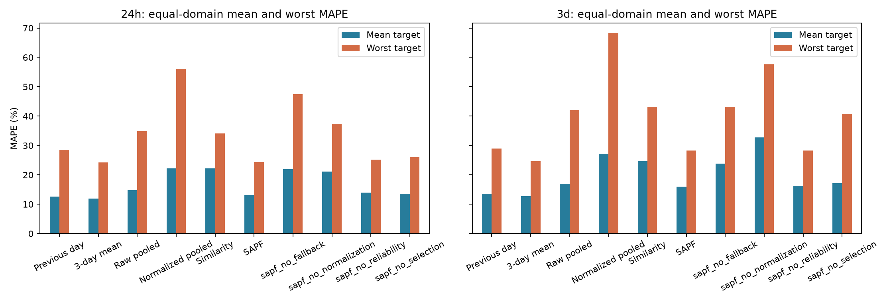
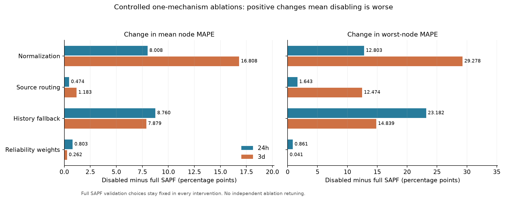

# M100 数据适配与跨节点实验结果

版本说明：本文保留首轮15min、33节点的原始结果。后续收益机制使用新日期、退出旧测试节点并接入UCC，见[收益与双向迁移报告](BENEFIT_TRANSFER_RESULTS.md)；两轮不混用测试集或分数。扩展前源码见[快照](../archive/pre_gain_transfer_20261025/README.md)。

2026-10-25。运行：[20261025T121710Z_sapf_4355ef](../results/runs/20261025T121710Z_sapf_4355ef/manifest.json)。入口为 `scripts/run_experiment.py --config configs/sapf_m100.yaml`，本轮真实 M100 预测实验只运行一次，没有据测试结果调整参数或重训。

**专用适配、14 天历史窗口、节点隔离、Ridge/归一化 Ridge/SAPF 及四项单机制消融均已完成。SAPF 的平均和最差节点 MAPE 优于原始多源 Ridge，但仍差于前三天同刻均值；RMSE 也未同步改善。因此，本轮支持部分条件机制收益，尚未证明能可靠抑制相对本地历史的负迁移。**

## 1. 实际完成范围与边界

| 项目 | 实现与证据 |
| --- | --- |
| 专用适配器 | [m100_panel.py](../src/data/m100_panel.py)：直接读取官方 15min 聚合宽表，`total_power_avg × 0.001 → node_power_kw`，原始文件 SHA-256 固定；不复用原始 20s 长表的 45 条采样规则 |
| 物理目标 | 实测节点功率的发布聚合，W→kW；不与 Google 利用率混合拟合，不构造机架或设施总功率 |
| 时间与质量 | 固定 [2021-04-23 00:00, 2021-06-22 00:00) UTC，共60日；33节点×5760点=190,080点；区间只依据全节点完整性掩码，不按功率幅度或预测误差筛选 |
| 历史与预测 | 历史1344点；24h=96、3d=288；只用目标历史及已知相对日/周相位，无未来温度、资源、功率统计或作业信息 |
| 节点隔离 | 两个机架各自按自然节点顺序模3固定分为12源节点、11独立验证节点、10测试节点；角色互斥，33节点全部保留 |
| 参数选择 | 源开发拟合截止D30；验证节点D30—D36起报选择SAPF设置；源最终拟合截止D40；两个任务全部冻结后才对测试窗口推理 |
| 模型与消融 | 10个主方法，另有12原始单源和12归一化单源诊断，共34版本/任务、68个最终模型；消融继承完整SAPF的验证选择，不各自调参 |

完整规则见[冻结协议](M100_PROTOCOL.md)、[实验配置](../configs/sapf_m100.yaml)和[模型配置](../configs/m100_models.yaml)。24h/3d最终源训练窗口为312/288，验证窗口均77，测试窗口为200/180，曲线点数19,200/51,840。每个方法使用完全相同的测试节点、起报和真实标签。

原始聚合区间左右边界和底层采样计数仍未恢复；推理仅用前一公开槽及更早数据，并按“公开时间+15min不晚于起报、无额外上报延迟”保守约束历史可用性。预测对象是后续公开网格上的聚合功率，不将这一假定改写为已核验的采集延迟或连续功率积分。

## 2. 平均、最差节点 MAPE 与负迁移比例

以下为10个测试节点等权平均，百分比均为曲线MAPE；“最差”是节点MAPE最大值。负迁移主代理为：同一节点的模型MAPE大于固定前三天同刻均值MAPE的节点比例，容差1e-10个百分点。这是性能对照，不是单个源节点作用的因果证据；无训练历史规则不标为迁移方法。

| 方法 | 24h平均 / 最差MAPE (%) | 3d平均 / 最差MAPE (%) | 较本地历史更差：24h / 3d |
| --- | ---: | ---: | ---: |
| 前一天同刻 | 12.5887 / 28.5576 | 13.5499 / 28.9108 | N/A |
| 前三天同刻均值 | **11.8758 / 24.1907** | **12.7118 / 24.6260** | N/A |
| 原始多源Ridge | 14.7920 / 34.9345 | 16.9310 / 42.1333 | 9/10 (90%) / 10/10 (100%) |
| 历史归一化多源Ridge | 22.1607 / 56.1667 | 27.2645 / 68.2600 | 10/10 (100%) / 10/10 (100%) |
| 相似性选择 | 22.2621 / 34.0666 | 24.5802 / 43.2254 | 10/10 (100%) / 10/10 (100%) |
| SAPF | 13.1163 / 24.3713 | 15.9795 / 28.3092 | 10/10 (100%) / 9/10 (90%) |

SAPF 相对原始多源Ridge，24h/3d平均MAPE减少 **11.33% / 5.62%**，最差节点MAPE减少 **30.24% / 32.81%**；但相对本地历史，平均仍高 **1.2405 / 3.2677个百分点**。24h较历史更差节点比例甚至从Ridge的90%增至SAPF的100%；3d由100%降至90%，仍有9个节点更差。不能把“优于Ridge”写成“普遍避免了负迁移”。

24h的原始/归一化Ridge最差节点均为机架1的node32；SAPF最差节点为机架1的node22。3d原始/归一化Ridge与SAPF最差节点均为机架1的node32。没有据这些结果删节点、剔除高功率点或重新挑区间。



完整[主方法汇总](figures/m100-20261025T121710Z_4355ef/main-summary.csv)保留相对本地历史、原始多源和归一化多源的三种变差比例，不能混用参考。SAPF相对原始多源的变差节点为 **4/10、4/10**，相对归一化多源为 **0/10、0/10**。

## 3. 四项独立关闭实验

每个消融只关闭一个预先定义的机制，其余源池、数据、验证选择与可靠性向量保持。没有给各消融重新找有利参数；关闭归一化时仅重拟合同一源节点上的原始kW专家。源选择的关闭定义为混合权重变成全源等权，原有距离置信度保留在历史回退门控中。

| 关闭机制 | 24h平均MAPE (%) | 相对完整SAPF变化 (pp) | 3d平均MAPE (%) | 相对完整SAPF变化 (pp) | 关闭后更差节点：24h / 3d |
| --- | ---: | ---: | ---: | ---: | ---: |
| 归一化与尺度恢复 | 21.1244 | +8.0081 | 32.7870 | +16.8075 | 10/10 / 10/10 |
| 源域路由选择 | 13.5900 | +0.4737 | 17.1628 | +1.1833 | 6/10 / 6/10 |
| 历史回退 | 21.8761 | +8.7598 | 23.8582 | +7.8787 | 10/10 / 10/10 |
| 验证可靠性加权 | 13.9191 | +0.8028 | 16.2413 | +0.2618 | 10/10 / 10/10 |

本轮条件消融中，归一化和历史回退对均值的影响大于源域路由或可靠性权重；后三项并不能与归一化的影响简单相加。该结论只针对选定的完整策略及当前测试节点，不能当作各机制在任意数据集上的独立最优收益。



完整[消融差值](figures/m100-20261025T121710Z_4355ef/controlled-ablation-deltas.csv)同时保存最差节点变化。实际100组混合重建证实：关闭归一化时权重/门控不变；关闭源选择时全源等权而门控不变；关闭回退时源权重不变、门控为1。没有把多项同时改动伪装成独立消融。

## 4. 归一化的收益依赖建模组合

在12源×10测试节点的120个固定源→目标配对上，归一化单源平均MAPE从 **128.8979%→28.6851%（24h）**、**150.8033%→31.3469%（3d）**，两任务均有 **104/120** 配对改善。所有单源均报告，终端中的预定首源不是测试最优源。很大的原始单源误差也没有从均值中隐藏。

但是，多源Ridge加入相同的历史窗口归一化后，平均MAPE增加 **7.3686 / 10.3335个百分点**，两个任务均有 **9/10** 节点变差。SAPF内部关闭归一化又使全部10个节点变差，说明“单源尺度恢复”“多源联合回归”“固定路由与回退中的专家归一化”是不同的机制比较，不能归并成“归一化普遍提高性能”。[单源配对明细](figures/m100-20261025T121710Z_4355ef/single-source-normalization-pairs.csv)保留了全部不利配对。

增加源节点相对每个固定原始单源的劣化配对为 **11/120、15/120**；相对归一化单源为 **74/120、77/120**。这些比较使用相同目标与起报，但参考模型不同，不能拿来直接相减解释为同一种负迁移减少率。

## 5. 验证选择、历史回退与其局限

| 验证期选择 | 24h | 3d |
| --- | --- | --- |
| 特征组 / top-k / 温度 | level_shape / 7 / 0.5 | level_shape / 3 / 0.5 |
| 最大迁移强度 / 可靠性幂 | 0.25 / 1 | 0.5 / 1 |
| 测试期平均实际迁移门控 | 0.1745 | 0.3507 |
| 对应平均本地历史权重 | 82.55% | 64.93% |

因此，SAPF的大部分权重来自本地历史回退，不能把其全部成绩归于跨节点知识共享。验证期SAPF平均MAPE为 **17.3716% / 16.3884%**，略优于本地历史的 **17.5944% / 17.0086%**；测试期该优势消失。验证期最差节点也没有优于本地历史：SAPF为40.8569%/37.0429%，历史为40.5492%/36.5296%。这些验证分数参与了候选选择，只用于解释策略如何形成，不是额外独立泛化证据。

候选集包含零迁移强度；本轮验证选择了正强度，测试表现没有触发事后改成零强度。这暴露出当前验证可靠性与源相似性对新节点迁移收益的预测仍不足，不能用测试反馈补救后继续报同一测试结果。

## 6. 其他指标与非重叠检查

下表均为10个节点等权平均，WAPE为%，RMSE/MAE为kW；不是把全部节点点数池化后的指标。

| 任务 | 方法 | WAPE (%) | RMSE (kW) | MAE (kW) |
| --- | --- | ---: | ---: | ---: |
| 24h | 前三天同刻均值 | 12.2022 | 0.115784 | 0.081633 |
| 24h | 原始多源Ridge | 14.3796 | 0.122553 | 0.091811 |
| 24h | 归一化多源Ridge | 21.0517 | 0.281289 | 0.134616 |
| 24h | SAPF | 13.1832 | 0.126337 | 0.086611 |
| 3d | 前三天同刻均值 | 12.8275 | 0.117289 | 0.084775 |
| 3d | 原始多源Ridge | 16.4104 | 0.132865 | 0.102871 |
| 3d | 归一化多源Ridge | 25.7762 | 0.407178 | 0.160598 |
| 3d | SAPF | 15.6711 | 0.173773 | 0.098673 |

**SAPF的RMSE比原始Ridge更高，尤其3d；MAPE、WAPE、MAE改善并未转化为所有指标上的鲁棒性改善。** 全部曲线/日均指标、样本计数及降低率在[公共metrics.csv](figures/m100-20261025T121710Z_4355ef/metrics.csv)，本轮MAPE没有零标签排除。

固定每三天起报一次的3d非重叠子集（D40/43/46/49/52/55，每节点6窗口）中，平均/最差MAPE为：历史 **12.9549%/25.7461%**，Ridge **16.9251%/41.7149%**，归一化Ridge **27.5899%/69.4423%**，SAPF **16.1897%/29.9893%**。主要结论保持，详见[非重叠结果](figures/m100-20261025T121710Z_4355ef/nonoverlap-3d.csv)。该子集仍不是独立数据中心或独立时间重复实验。

## 7. 与已冻结 Google 实验结论对照

参考[Google 10测试域正式实验](SAPF_RESULTS.md)，运行ID为20261025T082346Z_sapf_5644ac；另一个已有Google复现目录的MAPE逐项一致。本对照不是原先三个pilot目标的2.8084%与2.3608%表格。两套实验保持14天输入、15min、24h/3d及同一Ridge/SAPF候选网格，但数据长度、源域数、物理目标和训练窗口数不同，不构成训练M100后直接测试Google的跨数据集实验。

| 机制观察（均按24h / 3d） | Google | M100 |
| --- | --- | --- |
| 单源归一化改善配对 | 123/140、129/140 | 104/120、104/120 |
| 多源归一化导致更差节点 | 9/10、6/10 | 9/10、9/10 |
| SAPF相对原始Ridge平均MAPE变化 | -5.51%、+0.23% | -11.33%、-5.62% |
| SAPF相对原始Ridge最差域MAPE变化 | +15.21%、+27.95% | -30.24%、-32.81% |
| SAPF较本地历史更差节点 | 2/10、2/10 | 10/10、9/10 |
| 独立关闭消融 | 该轮未充分分离可靠性与回退 | 本轮补齐归一化、路由、回退、可靠性四项 |

共同证据是：幅值归一化对多数单源配对有用，但不保证改善多源联合模型；统计相似性也不足以保证迁移收益。差异是：M100上SAPF相对Ridge的最差节点确有改善，然而更难超过本地历史。不能根据其中任一数据集的有利结果宣称统一跨中心泛化成立。[完整对照CSV](figures/m100-20261025T121710Z_4355ef/google-m100-comparison.csv)保存共享方法的平均、最差及固定参考差值。

## 8. 验证与交付

| 核对 | 结果 |
| --- | --- |
| 当前回归测试 | **44 passed**，含专用适配、时区/网格、W→kW、缺失/重复、节点隔离、消融单变量、两任务冻结、单位篡改及旧流程兼容 |
| 公共评分/审计 | **2,856项**曲线/日均指标复算通过；角色、时间、模型/适配数据哈希、物理目标和消融继承一致 |
| 独立公式复算 | **2,856项**通过，与公共评分同一范围的第二实现；不把两次核验当作独立统计样本 |
| 原始W→适配kW | **33节点、190,080点**直接与包内total_power_avg/1000对照通过 |
| 模型保存恢复 | **68/68**，完整测试输入按原32窗口批次恢复预测，最大绝对差0 |
| 混合/消融重建 | **100组**，以分别保存的单源模型、公开权重、门控和历史规则独立重建，最大绝对差约7.11e-15 kW；先混合后公共非负裁剪 |
| 比例与非重叠 | **192项**固定参考变差比例，另**400项**非重叠指标核对通过 |
| 预注册与复现 | 12:16:59 UTC预注册，12:18:44 UTC全任务冻结；计算源码及拟合配置与预注册一致，仅数据目录状态和报告元数据后续更新 |

证据包括[预注册](figures/m100-20261025T121710Z_4355ef/preregistration.json)、[冻结](figures/m100-20261025T121710Z_4355ef/frozen-before-test.json)、[公共审计](figures/m100-20261025T121710Z_4355ef/audit.json)、[独立检查](figures/m100-20261025T121710Z_4355ef/independent-verification.json)、[恢复核对](figures/m100-20261025T121710Z_4355ef/saved-model-audit.json)、[测试日志](figures/m100-20261025T121710Z_4355ef/pytest.log)及[逐文件摘要](figures/m100-20261025T121710Z_4355ef/evidence.json)。完整逐点预测和68个模型保留在原始运行目录，报告副本不复制大体积模型。

```powershell
# 同一正式入口；默认该配置含全部主方法、四项消融与单源诊断
.\.venv\Scripts\python.exe scripts/run_experiment.py --config configs/sapf_m100.yaml
# 查看已有结果，不重新拟合
.\.venv\Scripts\python.exe scripts/run_experiment.py --results latest
.\.venv\Scripts\python.exe scripts/run_experiment.py --results results/runs/20261025T121710Z_sapf_4355ef --detailed
# 审计输出必须为新文件
.\.venv\Scripts\python.exe scripts/audit_cross_domain.py --run results/runs/20261025T121710Z_sapf_4355ef --output results/analysis/m100_nodes_v1/recheck_02.json
.\.venv\Scripts\python.exe -m pytest -q
# 只从已存模型/预测重建核对与报告，不拟合；报告输出必须为新目录
.\.venv\Scripts\python.exe docs/figures/m100-20261025T121710Z_4355ef/verify_independently.py
.\.venv\Scripts\python.exe docs/figures/m100-20261025T121710Z_4355ef/generate_evidence.py --output results/analysis/m100_nodes_v1/report_rebuild_02
```

现有Pandas/NumPy组合有已记录的弃用警告，测试断言通过，未升级环境。M100扩展前的Google源码保存在[快照](../archive/pre_m100_sapf_20261025/README.md)，原Google数据、模型、预测与证据文件没有改写。

结论限定为同一Marconi100中心、两个机架内的跨节点回顾性实验，且条件于共同完整时段。UCC跨数据集实验和整体封存的NLR Eagle独立验证仍需后续完成，本次未读取其观测或标签，也不能将节点功率成绩改称设施总表泛化能力。
