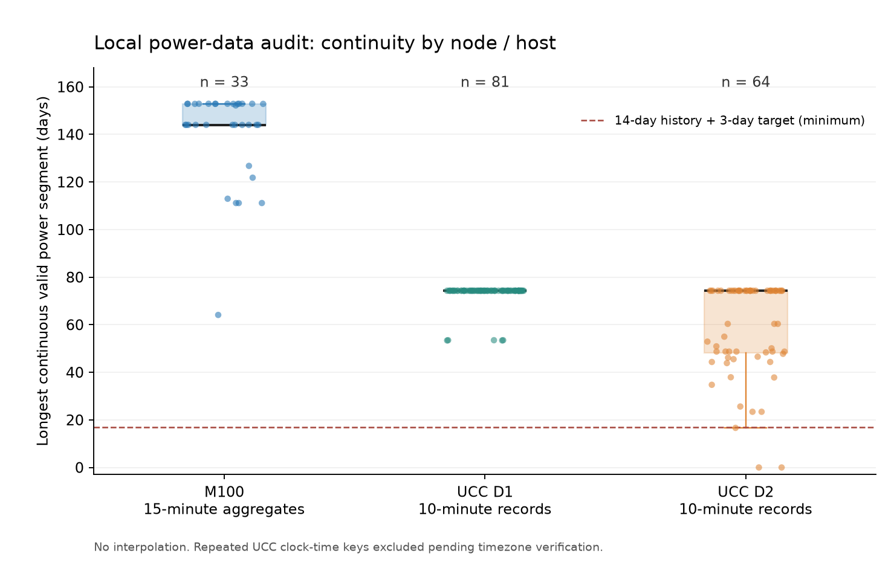

# M100 与 UCC2023 实际文件审计报告

后续能力说明：下文保留全文件原生审计口径；新完成的共同30min适配、固定72天质量筛选及双向迁移见[冻结协议](BENEFIT_TRANSFER_PROTOCOL.md)与[实验结果](BENEFIT_TRANSFER_RESULTS.md)。实验选择避开重复钟表小时的区间，未将UCC未核实的时区改称已核实。

审计日期：2026-10-25。检查对象是本地真实文件，未进行模型训练、数据插值或异常值删除，也未读取 Eagle。上一轮“本地无 M100/UCC 文件”是当时的状态；本报告以当前文件全量扫描为准。

后续进展：M100 已按本审计之后单独冻结的[实验协议](M100_PROTOCOL.md)完成适配和[跨节点实验](M100_RESULTS.md)。下面记录的是数据审计当时的事实与准入结论，不将后续训练混入本次审计记录。

**M100 本地 15 分钟聚合数据可作为下一阶段节点功率监督的候选；UCC2023 确有服务器实测功率，但应保留原生 10 分钟协议，并先解决时区和缺失问题。两者均不能当作设施总功率。**

| 检查项 | M100：本地两个机架包 | UCC2023：本地 D1 / D2 |
| --- | --- | --- |
| 功率字段 | `total_power_avg`；来自 IPMI 节点总功率 `total_power` 的区间均值，单位 W；另有 std/min/max | `Power`；论文定义为物理服务器功率，单位 W |
| 时间粒度 | 实际时间戳均对齐 15 分钟，UTC；本地是官方聚合版本，不是 20 秒原始分区 | 实际时间戳均对齐原生 10 分钟；时间字符串没有时区/UTC 偏移 |
| 本次规模 | 33 个节点，2,782,426 行；仅代表本地两个包 | D1：81 个主机标识、2,748,525 行；D2：64 个、1,281,024 行 |
| 时间覆盖 | 2020-03-09—2022-09-28，跨约 934 个日历日期，期间有缺口 | D1：2018-10-09—2019-06-20；D2：2019-02-01—2019-06-20；各主机起点不完全相同 |
| 每节点最长连续有效功率段 | **64.11—152.89 天，中位数 144.01 天** | D1：**53.39—74.30 天，中位数 74.30 天**；D2：**0—74.30 天，中位数 74.30 天** |
| 辅助特征 | CPU 插槽/内存功率、CPU/GPU/内存温度、风扇、进风温度、供电指标及 Nagios 状态；当前聚合包没有 CPU/GPU 利用率或作业序列 | CPU_Load、Ram/Ram_Used、CPU 核数相关字段、网络、VM 数、两路 CPU 温度；D1 部分主机有风扇和进风温度；D2 无这些列；未见 GPU 指标 |
| 功率字段缺失 | **230,383 行，8.2799%** | D1：**83 行，0.0030%**；D2：**177,244 行，13.8361%** |
| 缺失时间槽 | **174,642 个**，与“有记录但功率为 NaN”分开统计 | D1：**94,537 个**；D2：**0 个**，但功率仍大量缺失 |
| 重复节点/时间键 | **0** | D1：486 个键、972 行涉及；D2：384 个键、768 行涉及，均集中在 2019-04-07 02:00—02:50 |
| 功率负值、零值、无穷值 | 均为 **0** | 两份文件均为 **0**；这不代表没有缺失或其他质量问题 |
| 可支撑 14 天历史 + 24h / 3d 的节点数 | **33/33、33/33** | D1：**81/81、81/81**；D2：**62/64、61/64**；只表示至少存在一个足够长的功率段，不代表完成训练/验证/测试拆分 |

功率语义依据 [M100 IPMI 文档](https://gitlab.com/ecs-lab/exadata/-/blob/main/documentation/plugins/ipmi.md)和 [UCC 作者论文](https://hpc.ec.tuwien.ac.at/files/UCC_23_data_center_analysis.pdf)。本地文件身份分别匹配 [M100 聚合数据发布记录](https://zenodo.org/records/7541722)和 [UCC2023 发布记录](https://zenodo.org/records/10069402)的官方 MD5。上述行数、缺失、重复和连续长度来自本次全量扫描，而非引用论文样本量。

## 1. 文件身份与检查范围

| 文件 | 字节数 | 官方 MD5 | 结果 |
| --- | ---: | --- | --- |
| M100/0.tar | 269,844,480 | ae8a04b847562dfa807863100dc6777d | 匹配；16 个节点 Parquet |
| M100/1.tar | 509,143,040 | 6313d691ce2e280bb363681983b2decf | 匹配；17 个节点 Parquet |
| UCC2023/dataset1_combined.csv | 613,212,066 | 0b931f2b2cc4f236ef9b66e2716b69b2 | 匹配；完整 CSV |
| UCC2023/dataset2_combined.csv | 184,178,675 | 8660d51cfb62dfc15f65c79406cb715f | 匹配；完整 CSV |

33 个 M100 节点全部直接从压缩包读取，包含尚未单独解包的节点；已有 16 个解包文件也逐一比对，SHA-256 均与包内成员一致。原始文件审计前后大小/mtime 一致；完整 SHA-256、实际 schema、Python 版本和脚本摘要保存在[审计 JSON](figures/power-data-audit-20261025/audit.json)。官方 MD5 用于核对发布文件身份，本地 SHA-256 用于后续完整性追踪。

本次覆盖 **178 个节点/主机标识、6,811,975 行**。M100 其他机架、原始 20 秒时序及完整集群资源/作业插件不在本次检查范围。没有下载新数据或改写已有原始数据。

## 2. 连续有效天数的计算口径

“文件起止日期跨度”“累计有效日数”“最长连续有效段”分别统计，不能相互替代。

- 有效功率点必须有可解析、对齐本数据原生网格的时间戳，功率有限且非负，并且节点/时间键不重复。零功率单列计数，本次为零。所有重复键暂整组排除，不平均、不任意取首条。
- 缺一条、功率 NaN、无穷或重复歧义都会中断连续段；不插值，不把中断两端拼接。
- N 个连续点的覆盖长度按 `N × 采样间隔 / 24h` 计算；起止时间中的末端时间戳为最后一个样本标签。该长度不表示已核实聚合区间左右边界。
- 另计严格完整日：M100 每日 96 个有效点，UCC 每日 144 个。UCC 日历暂按 CSV 原始钟表日期，尚不是已还原的绝对时间。
- “功率与核心辅助特征共同有效”还要求预先列明的辅助列均为有限值。M100 检查进风温度、两路 CPU 功率及四路 GPU 核心温度；UCC 检查 CPU_Load、Ram_Used 及两路 CPU 温度。没有要求所有可选传感器都存在。

| 长度指标 | M100 | UCC D1 | UCC D2 |
| --- | ---: | ---: | ---: |
| 每节点最长功率段：最小 / 中位 / 最大，天 | 64.11 / 144.01 / 152.89 | 53.39 / 74.30 / 74.30 | 0 / 74.30 / 74.30 |
| 每节点最长连续完整日：最小 / 中位 / 最大 | 63 / 143 / 152 | 52 / 73 / 73 | 0 / 73 / 73 |
| 每节点累计完整日：最小 / 中位 / 最大 | 631 / 742 / 769 | 112 / 243 / 245 | 0 / 126 / 127 |
| 功率与核心辅助列共同有效的最长段：最小 / 中位 / 最大，天 | 64.11 / 144.01 / 152.89 | 53.39 / 74.30 / 74.30 | 0 / 74.30 / 74.30 |
| 有效唯一功率槽 / 各节点起止间应有槽 | 2,552,043 / 2,957,068 | 2,747,470 / 2,842,576 | 1,103,084 / 1,280,640 |
| 有效功率网格覆盖率 | 86.3032% | 96.6542% | 86.1354% |

“功率缺失率”分母是文件行数；“网格覆盖率”分母是各节点起止间应有原生槽数，后者同时反映缺行、缺值和重复歧义。不能把两个百分比直接相减。核心辅助列与功率的最长段恰好相同，不代表这些列没有额外缺失，逐列数量见[特征明细](figures/power-data-audit-20261025/features.csv)。



逐节点最长段起止、缺口、累计完整日及辅助列清单见 [nodes.csv](figures/power-data-audit-20261025/nodes.csv)。

## 3. M100：功率标签可信，不能把聚合包当成完整原始监控

本地对应的是 DOI `10.5281/zenodo.7541722` 的时间聚合版本。[官方发布说明](https://zenodo.org/records/7541722)明确按节点提供 15 分钟 IPMI 统计及 Nagios 标签；不是此前登记的 DOI `7588815` 原始月度分区。本次每个节点有 354 个数据列：timestamp、value 和 88 种传感器的 avg/std/min/max。两个包传感器集合并不完全一致，跨节点合计有 104 种 avg 字段，不能按单一节点 schema 假定全部存在。

`total_power_avg` 的有限值范围为 **259.56—1904.89 W**，min ≤ avg ≤ max、std ≥ 0 的聚合内部检查没有发现违反记录。它代表节点总功率测量的聚合，CPU 插槽功率、GPU 温度和电源输入功率都是不同量，不能互相代替；也没有外部校准证据可据此声称计量精度等级。

所有记录时间戳都在 15 分钟网格，未发现重复或不可解析时间；但共存在 159 个相邻时间缺口，缺失 174,642 个槽，另有 230,383 行功率 NaN。最短最长段来自节点 3，只有 64.11 天；不能因为总体覆盖近 2.6 年就宣称每个节点都有近 2.6 年连续有效数据。

当前聚合包**没有每区间原始采样数**，无法从 avg/std/min/max 反推出每个 15 分钟区间是否拥有 45 个完整的 20 秒样本；也未在本次取得并复算官方聚合边界实现。现有 `adapt_m100_total_power` 是原始 20 秒长表适配器，不能直接接收这里的宽表，不能对每个已聚合点再次要求 45 条记录。正式接入需单独声明“已发布聚合观测”的采样语义和可用时刻。

辅助特征检查还发现：

- `gv100card0/1/3/4_avg` 在全部 33 个节点的有限记录上均恒为 0，且官方 IPMI 文档未给出明确单位；不能当作 GPU 利用率。GPU 核心/显存温度是有效的温度传感器，并非利用率。
- CPU 插槽功率、进风温度和 GPU 温度确有记录；CPU/GPU 利用率、频率和完整作业状态需另取 Ganglia/SLURM 等原始插件，本地这些聚合包不具备。
- `value` 是 Nagios 聚合状态附加列，缺失 **368,618 行**，非零 **181,506 行**。依照 [Nagios 插件说明](https://gitlab.com/ecs-lab/exadata/-/blob/main/documentation/plugins/nagios.md)，状态编码有主机/服务上下文差异；当前宽表不足以恢复全部告警描述，不能把缺失填成“正常”，也不能把该列当作功率。

## 4. UCC2023：真实功率与发布文件清洗口径需分别看待

论文说明通过 collectd、IPMI/传感器采集物理机器功率。实际 CSV 的 `Power` 范围为 **D1 55.87—448 W、D2 260—806 W**，与论文功率范围相符；无需利用 CPU 利用率反推功率。文件不含 UTC 偏移或 GPU 利用率。

公开文件确实保留了缺失数据。对所有原始列执行“全列非缺失计数”，本次得到 **D1 2,653,869 行、D2 961,158 行**，与[论文列出的清洗后行数](https://hpc.ec.tuwien.ac.at/files/UCC_23_data_center_analysis.pdf)完全相同。这解释了论文行数为何小于原始 CSV 行数；本次只计数，没有据此删除记录。全列完整记录只覆盖 D1 的 **76** 个主机和 D2 的 **62** 个主机，因此不建议不加区分地对全部列 dropna 后再报告原始主机覆盖。

D1 实际含 `qh2-rcc120`—`qh2-rcc200` 共 **81** 个标识，与论文描述的 80 台不同。已核对 CSV 身份及标识首尾空白，本次按文件中的 81 个标识报告，未擅自删除“多出”的主机。D1 的 2,664,813 行标识带首尾空白，统计时在内存中去除，不改写文件。主机数量口径差异仍需原作者或发布说明解释。

### 重复时间与夏令时

D1 的 486 个重复键恰为 `81 × 6`，D2 的 384 个恰为 `64 × 6`。所有重复都发生在 **2019-04-07 02:00、02:10、02:20、02:30、02:40、02:50**，每个主机有一次钟表时间回退；同键至少一个测量字段不同，并非逐行完全相同的复制。

[ASX 当年官方公告](https://asxonline.com/public/notices/2019/apr/0289.19.04.html)确认维多利亚州当日 03:00 回拨到 02:00；结合论文的墨尔本采集地点，**夏令时回拨是合理解释，但仍是推断，不能据此把 CSV 时区直接确认为 Australia/Melbourne**。本报告采用保守的重复键整组排除规则，因此 UCC 最长段结果是时区待核实条件下的保守值。正式适配应核实原始时区、顺序及 fold/偏移，保存两次真实观测；不应直接取平均或全局去重。

### 缺失和辅助指标

- D2 的 `qh2-rcc264`：20,016 行功率全部缺失；`qh2-rcc263`：19,589 行缺失，虽有 427 个有限功率值，最长连续段只有一个 10 分钟点。二者不满足 14 天历史 + 24h 要求。
- D2 的 `qh2-rcc226` 最长连续段 **16.65 天**，满足 14 天历史 + 24h，但不足以一次性提供 14 天历史 + 3d；D2 因而分别只有 62/61 个主机通过这两个最低长度检查。
- D1 的 `qh2-rcc196`—`qh2-rcc200` 五个主机的风扇和进风温度字段全缺，不能给所有 D1 主机配置同一个“必需风扇特征”。D2 本身没有风扇和进风温度列。
- CPU_Load 没有超出 [0,100] 的记录；D1 有 **10,934 行 CPU_cores_used > CPU_cores**。这些是需要核对分配核数/配置变化语义的记录，不能直接等同于 CPU 实际利用率超过物理上限，也未自动删除。
- Ram/Ram_Used 的 CSV 数值约落在 64/193 等容量尺度，而论文表格使用 mb 描述。内存、网络的确切倍率不能仅按列名推定；本次保留原数值，未贸然除以 1024 或换算成利用率。这不影响已核实的 Power=W。

## 5. 异常筛查与后续准入结论

作为描述性检查，按每个节点功率分布 `Q3 + 3×IQR` 标记较高值，M100/D1/D2 分别有 **73,530 / 57,233 / 11,875** 行。该规则只用于提示复核，未清洗任何记录，也不能证明这些高负荷是真实故障。若后续要设剔除或截断阈值，须在训练/独立验证阶段确定，不能据固定测试误差反复筛点。

1. **M100 优先推进节点功率监督协议。** 本地 33 节点均有足够长的连续功率段，15 分钟网格与当前任务匹配；仍须完成聚合边界/可用时刻核验、独立宽表适配，以及基于训练与验证信息冻结的时间/节点角色拆分。本次审计不等于已接入正式预测。
2. **UCC 保留原生 10 分钟，先处理时区和缺失。** 此时 14 天历史、24h、3d 分别为 **2016 / 144 / 432 点**。如需与 M100 共用无插值网格，可另立 30 分钟协议，对应 **672 / 48 / 144 点**，并核对每区间实际采样覆盖和边界；本次没有修改当前 SAPF 的 15 分钟默认协议。
3. **不把 10 分钟记录插值成 15 分钟实测标签。** 两种网格不能直接整分，插值后的标签必须单独声明，不能混入真实功率验收。共同 30 分钟方案也只是待设计协议，尚未生成数据或训练模型。
4. **按计量边界分别评估。** 当前两套数据支持节点/物理服务器功率研究；不能将节点样本简单求和并改称包含制冷、配电等开销的设施总表。Eagle 继续整体保留为最终独立测试域。

## 6. 复算与证据

主审计使用可复现脚本 [audit_power_sources.py](../scripts/audit_power_sources.py)，没有依赖模型代码。按独立实现将每个节点重新索引到完整原生网格，再用布尔连续段分组复算最长段、有效点、功率空值和缺行，**178 个节点、712 项核对全部通过**，见[独立复算记录](figures/power-data-audit-20261025/independent-checks.json)。另外检查了 17 天边界、缺失中断、冲突重复、负值和无穷值的合成边界情形。

```powershell
# output 必须是新目录；只读原始文件，不插值、不拟合模型
.\.venv\Scripts\python.exe scripts/audit_power_sources.py --output results/analysis/power_sources/recheck_01
```

完整证据：[字段/schema/文件哈希与规则](figures/power-data-audit-20261025/audit.json)、[逐节点明细](figures/power-data-audit-20261025/nodes.csv)、[逐字段缺失与范围](figures/power-data-audit-20261025/features.csv)、[重复钟表时刻](figures/power-data-audit-20261025/duplicate-clock-times.csv)、[证据清单](figures/power-data-audit-20261025/evidence.json)。这次没有更改上一轮 Google 模型、参数、预测或已发布证据副本。
