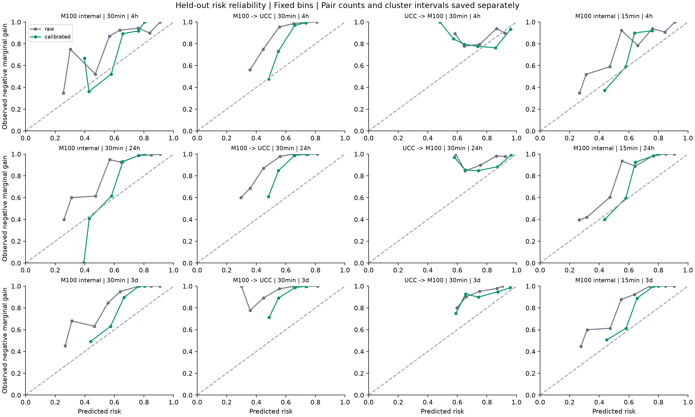
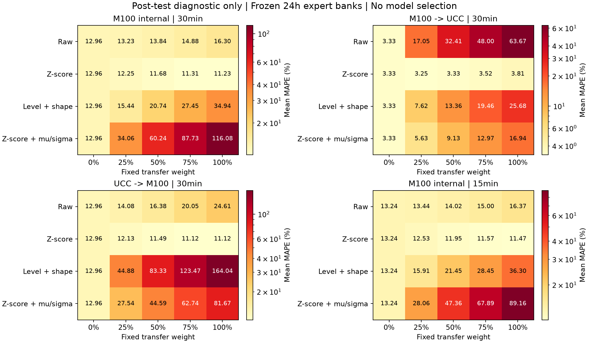
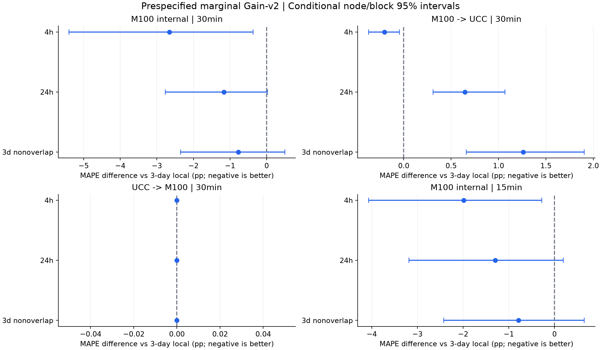

# SAPF Gain-v2四周任务执行报告

2026-10-26。**四周阶段的工程、实验和统计交付已完成；科学成功门槛未全部达到。**预先固定的边际收益主方法改善了M100内部和M100→UCC的4h，但正向24h/3d出现负迁移，反向三个时长仍100%回退。Level–Shape直接拼接也没有自动解决归一化问题，部分单源专家发生严重跨分布失稳。

正式运行：[20261025T175359Z_sapf_gain_v2_42a876](../results/runs/20261025T175359Z_sapf_gain_v2_42a876/manifest.json)。[协议](SAPF_GAIN_V2_PROTOCOL.md)、[预注册](figures/gain-v2-prereg-20261026/preregistration.json)、[完整证据目录](figures/gain-v2-20261025T175359Z_42a876/README.md)。模型只拟合一套方案，没有根据新测试结果修改标签、表示、阈值、校准、种子或重训。末端审计发生过浮点精确比较错误，已在保留全部预测的情况下修复，见第7节和[独立修订记录](SAPF_GAIN_V2_AUDIT_AMENDMENT.md)。

## 1. 四周任务完成清单

| 任务 | 实际交付 |
| --- | --- |
| 独立分支与冻结 | 基线f89dc7d、research/sapf-gain-v2、协议标签sapf-gain-v2-protocol-20261026（39a5c5a），完整预注册与新日期测试 |
| 统一DataAdapter | 显式scope/unit/原生与输出粒度/时区/区间/源哈希/协变量、quality_mask和available_at；真实审计84项，包含Google 57域 |
| 四种收益目标 | single、fixed、marginal、pairwise rank；共同两步50%融合，独立校准身份与策略选参身份；精确率/召回率/校准曲线 |
| 四种表示 | raw、z-score、Level–Shape、z-score+μ/σ；各有多源Ridge和单源→目标矩阵，合计48张矩阵 |
| 完整融合消融 | 本地两强基线、纯迁移、25/50/75%固定混合、当前SAPF、四种收益目标、强制迁移、关闭校准、事后oracle |
| 4h补齐 | M100 15min=16点、共同30min=8点，与24h/3d联合评估；14天历史；4h日均指标明确N/A |
| 统计框架 | 非重叠3d、节点cluster/块bootstrap、辅助HAC-DM、Holm校正、风险识别的节点cluster区间及statistics.csv |

四种点式/排序目标共享源专家与动作空间，不能从测试较好的目标另选一个冒称“预先固定主方法”。主方法始终为`gain_v2_marginal`，主专家表示始终为`level_shape`。第三独立数据源、深度编码器及Eagle最终验证未纳入本轮四周范围。

## 2. 新评价样本与边界

M100全局角色为8源/2独立校准/2策略验证/9新测试节点；UCC为12/4/4/89。原15min M100测试10节点仍退出全部新角色；本轮必需窗口缺失的M100 node27、UCC rcc246没有换入其他身份。

M100新起报2022-02-18—02-26，UCC新起报2019-03-29—04-06；3d各使用其中前7个起报，非重叠D54/D57/D60为每域3次。测试身份曾在旧研究中出现，本轮只对未被既有预测实验评分的新日期作留出。M100内部15/30min、反向M100目标都共享同一批9节点和日期，不能当作独立中心重复证据。

UCC早期全体停报，不能不加说明地构造连续64天新开发段。因此UCC训练/校准/选参仍使用独立身份2019-04-09起的已审计开发资料，新目标日期更早；M100源资料也晚于UCC目标年份。**这些是离线跨数据集/跨时段实验，不是当时可部署的因果回测，也不是从未见过中心身份的最终验收。**

4h沿用预声明的每日源钟表午夜起报，每域9次；已验证16/8点完整预测生命周期，但未覆盖全天六个不同4小时起报段。模型只使用相对日/周相位，尚未按已核实物理时区对齐源与目标的实际星期；不能把本轮4h结果直接等同于全天设施预测验收。

目标为M100节点`total_power_avg`和UCC物理服务器`Power`的真实发布功率，W→kW。Google只验证统一契约，不并入kW排行榜。UCC保留naive source clock；内部2000年合成UTC坐标不是原始UTC。缺失、重复、非有限、负值均有质量位且不插值；必需历史和标签窗口对所有方法一致。桶可用性仍有“标签+一个聚合间隔、无额外延迟”的假定，原始聚合左右边界未独立核实。

## 3. 预声明主结果

以下为节点等权**曲线MAPE（%）**；3d这里先给每日滚动辅助结果，下一张表给非重叠主检验。固定50%是与收益主方法**同一Level–Shape专家池**的对照，不是上一轮z-score专家的固定混合。该差异非常重要，见第5节。

| 研究 | 时长 | 前一天同刻 | 前三天均值 | 同池固定50% | 当前SAPF | 边际Gain-v2 | 事后oracle |
| --- | --- | ---: | ---: | ---: | ---: | ---: | ---: |
| M100内部30min | 4h | 14.4207 | 12.7055 | 13.8048 | 10.5325 | 10.0471 | 2.7643 |
| M100内部30min | 24h | 14.3150 | 12.9576 | 20.7359 | 11.8206 | 11.7910 | 7.6406 |
| M100内部30min | 3d | 14.9472 | 12.7362 | 20.1547 | 12.1642 | 12.1658 | 9.6689 |
| M100→UCC | 4h | 3.3550 | 3.4673 | 11.4007 | 3.1739 | 3.2636 | 1.0331 |
| M100→UCC | 24h | 3.2116 | 3.3317 | 13.3596 | 3.7590 | 3.9774 | 2.2177 |
| M100→UCC | 3d | 3.7744 | 3.5948 | 16.2857 | 3.7163 | 4.7384 | 2.7819 |
| UCC→M100 | 4h | 14.4207 | 12.7055 | 217.3730 | 12.7055 | 12.7055 | 2.9531 |
| UCC→M100 | 24h | 14.3150 | 12.9576 | 83.3291 | 12.9576 | 12.9576 | 7.2185 |
| UCC→M100 | 3d | 14.9472 | 12.7362 | 85.0159 | 12.7362 | 12.7362 | 9.8551 |
| M100内部15min | 4h | 14.7487 | 12.9756 | 14.6953 | 10.7151 | 10.9918 | 3.3264 |
| M100内部15min | 24h | 14.6605 | 13.2404 | 21.4506 | 12.0115 | 11.9411 | 8.0088 |
| M100内部15min | 3d | 15.2566 | 13.0138 | 21.0107 | 12.6920 | 12.8874 | 9.9654 |

| 非重叠3d主检验 | 本地三天均值：平均/最差 | 边际Gain-v2：平均/最差 | Gain-v2比本地更差节点 |
| --- | --- | --- | --- |
| M100内部30min | 13.0443 / 33.6889 | 12.2732 / 32.2204 | 0/9 |
| M100→UCC | 3.5829 / 10.3866 | 4.8428 / 22.8227 | 31/89 |
| UCC→M100 | 13.0443 / 33.6889 | 13.0443 / 33.6889 | 0/9，全部回退 |
| M100内部15min | 13.3188 / 34.3060 | 12.5334 / 31.3422 | 2/9 |

正向24h/3d平均与最差节点均恶化；不能只用4h或“胜过失稳的同池固定混合”宣称跨中心鲁棒性成功。反向没有负迁移是回退结果，仍没有找到可部署的正迁移。oracle只是在预声明有限候选中利用真值选最优，包括切换两个本地基线；它不是部署方法，也不应将全部oracle差距归因于外部知识。

全部18种方法（17可部署+oracle）、每节点MAPE/WAPE/RMSE/MAE、最差域和计数在[完整指标](figures/gain-v2-20261025T175359Z_42a876/metrics.csv)与[汇总](figures/gain-v2-20261025T175359Z_42a876/all-domain-summary.csv)。WAPE按节点计算再等权汇总，RMSE/MAE为kW，不能等同于汇总设施总功率后的指标。

## 4. 四种收益目标与校准结果

收益教师标签只来自训练身份，最晚D42；独立校准D44—D46，策略验证D49—D51，源最终拟合截止D54。三个源组共22,080条源内点式样本、88,320条成对排序训练比较，另有1,368条独立校准记录；这些相关配对不是这么多个独立实验。μ/σ和目标历史只用于当前窗口特征/尺度恢复，不做目标标签拟合。

single学习独立专家相对本地的收益，fixed学习固定50%融合收益，marginal学习当前集合上的边际收益，rank学习同一当前预测下的候选次序。第一步fixed与marginal标签严格相等，第二步的已有专家k按预声明轮转构造且不能是伪目标j或候选i。共同动作是最多两个不同专家、每步50%融合；无正收益合格源时停止。

| Study | Horizon | single | fixed | marginal | rank |
| --- | --- | ---: | ---: | ---: | ---: |
| m100_internal_15 | 24h | 13.2494 | 12.2701 | 11.9411 | 12.4510 |
| m100_internal_15 | 3d | 13.0138 | 12.2658 | 12.8874 | 12.7876 |
| m100_internal_15 | 4h | 11.5458 | 9.7061 | 10.9918 | 9.5338 |
| m100_internal_30 | 24h | 12.9576 | 11.3232 | 11.7910 | 11.7393 |
| m100_internal_30 | 3d | 12.7362 | 12.7586 | 12.1658 | 12.1959 |
| m100_internal_30 | 4h | 12.7055 | 9.5970 | 10.0471 | 11.2560 |
| m100_to_ucc_30 | 24h | 3.3317 | 3.3282 | 3.9774 | 3.8958 |
| m100_to_ucc_30 | 3d | 3.5948 | 3.6382 | 4.7384 | 4.7068 |
| m100_to_ucc_30 | 4h | 3.4673 | 3.4409 | 3.2636 | 3.5837 |
| ucc_to_m100_30 | 24h | 12.9576 | 12.9576 | 12.9576 | 12.9576 |
| ucc_to_m100_30 | 3d | 12.7362 | 12.7362 | 12.7362 | 12.7362 |
| ucc_to_m100_30 | 4h | 12.7055 | 12.7055 | 12.7055 | 14.5139 |

四种目标没有一致赢家。新主方法在正向4h略优于两本地基线，但仍不及当前SAPF的3.1739%；15min 4h的固定融合标签/排序也优于预声明主方法。它们保留为对照，未据测试改选主方法。

| 主方法 | 时长 | 正收益精确率 / 召回率 | 零迁移起报 | 风险AUROC | Brier / 源基率常数 |
| --- | --- | --- | ---: | ---: | --- |
| M100内部30min | 4h | 33.83% / 90.80% | 44.44% | 0.8192 | 0.1619 / 0.2046 |
| M100内部30min | 24h | 29.27% / 98.56% | 44.44% | 0.8953 | 0.1427 / 0.1893 |
| M100内部30min | 3d | 26.10% / 100% | 44.44% | 0.8837 | 0.1438 / 0.1820 |
| M100→UCC | 4h | 19.24% / 98.95% | 71.66% | 0.8639 | 0.1521 / 0.1705 |
| M100→UCC | 24h | 11.90% / 100% | 73.28% | 0.8729 | 0.1433 / 0.1539 |
| M100→UCC | 3d | 8.94% / 100% | 70.30% | 0.8563 | 0.1421 / 0.1473 |
| UCC→M100 | 4h | N/A / 0% | 100% | 0.5677 | 0.1553 / 0.1560 |
| UCC→M100 | 24h | N/A / 0% | 100% | 0.6380 | 0.1105 / 0.1270 |
| UCC→M100 | 3d | N/A / 0% | 100% | 0.6516 | 0.0879 / 0.1105 |
| M100内部15min | 4h | 33.97% / 91.38% | 44.44% | 0.8223 | 0.1663 / 0.2089 |
| M100内部15min | 24h | 30.98% / 99.32% | 44.44% | 0.8889 | 0.1487 / 0.1985 |
| M100内部15min | 3d | 26.92% / 100% | 44.44% | 0.8671 | 0.1494 / 0.1911 |

这里正收益指第0步全部候选的实际50%边际融合收益，精确率/召回率由“预计收益>0”判定；不是“被选专家精确率”。后者、负风险混淆计数、最终成功迁移率（全体与实际迁移起报两种分母）、机会捕获率均在[风险汇总](figures/gain-v2-20261025T175359Z_42a876/all-risk-summary.csv)。

正向24h/3d虽达到100%正收益召回，精确率却只有11.90%/8.94%，最终成功迁移起报仅占全部起报9.49%/5.94%。**提高召回或风险AUROC并不自动带来有效融合。**反向仍有168/102/50个实际有益候选配对，预计正收益却全为0，核心保守问题未解决。

独立校准后的主方法Brier点估计在12个组合均不高于源基率常数，但反向4h的Brier差cluster区间跨0，不能声称处处显著改善。校准曲线使用固定分箱，源校准期为拟合内诊断，新测试曲线与其分开。风险模型目标共同为负边际收益，不将排序胜率冒称MAPE改善或已校准概率。



## 5. 归一化、尺度失稳与公平对照

四种表示均已完成多源联合Ridge及单源→目标评估，见[48张矩阵](figures/gain-v2-20261025T175359Z_42a876/matrices/)与[长表](figures/gain-v2-20261025T175359Z_42a876/source-target-matrices-long.csv)。Level–Shape拼接完整raw和z-score滞后，以历史局部μ/σ恢复输出，Ridge正则处理共线性；本轮结果**不支持这种直接拼接一定更可迁移**。

为防止把“胜过较差同池基线”误写成超越强历史方法，测试后另外对四个**已冻结**表示的专家池做了全固定α=[0,0.25,0.5,0.75,1]交叉诊断。它不重新拟合、不选新主模型、不进入预声明Holm族；属于明确标记的事后分析。

| 同一新测试上的50%混合 | 4h：Level–Shape / z-score | 24h：Level–Shape / z-score | 3d：Level–Shape / z-score |
| --- | --- | --- | --- |
| M100内部30min | 13.8048 / 10.8972 | 20.7359 / 11.6803 | 20.1547 / 11.7224 |
| M100→UCC | 11.4007 / 3.0577 | 13.3596 / 3.3304 | 16.2857 / 3.6988 |
| UCC→M100 | 217.3730 / 11.1099 | 83.3291 / 11.4874 | 85.0159 / 11.8268 |
| M100内部15min | 14.6953 / 11.1523 | 21.4506 / 11.9492 | 21.0107 / 11.9676 |

反向简单z-score固定混合三个时长都优于本地，而边际主方法仍回退，证实“有用外部信息存在、当前路由没有抓住”的问题依然存在。与此同时，主方法与上一轮固定混合的专家表示、日期和划分不同，不能用217%或83%的失稳对照宣称已经全面超过旧方案。不同μ/σ跨域外推与双通道共线性都是后续训练/验证端应检查的候选原因，本轮没有据测试确定因果或调参。



强制迁移和关闭校准均继承主方法的原设置，完整结果保留在指标表；强制迁移不构成部署建议。oracle也不用于参数选择，保存逐起报选择并明确`oracle_only=true`。

## 6. 统计结论与阶段门槛

主比较为边际方法对本地三天、前一天和固定50%，36个滚动+12个非重叠比较，每类bootstrap的Holm族48项；辅助域级DM族1392项。节点内使用约3天的循环块，非重叠3d为1个起报一块，2000次。风险另按目标节点cluster bootstrap，避免以相关专家配对数放大证据。



M100内部30min 4h相对三天均值ΔMAPE为−2.6584pp，节点+块95%区间[−5.3993,−0.3687]；正向4h为−0.2037pp，[−0.3714,−0.0449]。这些逐比较区间虽未跨0，Holm校正后p分别0.7286/0.2899，不能据此宣称已证明总体提升。

正向非重叠3d则为**+1.2599pp**，[+0.6615,+1.9050]，同族Holm p=0.0240；最差节点差+12.4361pp，区间[+4.2674,+17.6628]。这是本轮条件下明确的恶化信号，应优先保留而不是只报告较好时长。所有3d的滚动/非重叠起报仅7/3个，DM依预声明显示N/A；4h/24h的短序列DM也仅为辅助。

| 建议成功标准 | 本轮判定 |
| --- | --- |
| 内部和至少一个方向平均改善 | 点估计层面的弱门槛部分达到；未建立跨时长、强基线及多重校正后的稳定优势 |
| 不再漏掉全部正收益 | 未全面达到：UCC→M100三个时长仍全部漏掉；正向高召回伴随大量误报 |
| 避免以100%回退充当改进 | 未达到：反向仍全部回退 |
| 最差域不恶化 | 未达到：正向24h/3d，尤其非重叠3d明显恶化；不把不显著解释为已证明非劣 |
| 风险Brier不劣源常数 | 主方法12个点估计达到；反向4h区间证据不足，且校准改善并未保证选源收益 |
| 补齐4h及可复现基线 | 已达到，15/30min分开，物理层级明确 |

统计只针对这些节点和短日期区间。两个中心内节点并不独立，置信区间不能升级为未知中心总体推断。方法参考[DM原论文](https://doi.org/10.1080/07350015.1995.10524599)和[Holm原论文](https://www.ime.usp.br/~abe/lista/pdf4R8xPVzCnX.pdf)，完整数字与缺失原因见[statistics.csv](figures/gain-v2-20261025T175359Z_42a876/statistics.csv)和[risk-statistics.csv](figures/gain-v2-20261025T175359Z_42a876/risk-statistics.csv)。

## 7. 验证、审计修复与复现

| 检查 | 结果 |
| --- | --- |
| 预测前完整测试 | 73 passed，220.52s |
| 审计修复后端到端回归 | 同一完整四研究fixture，1 passed，53.31s |
| 数据契约 | 84项记录，含Google57域；不做Google新精度验收 |
| 原生功率独立复算 | 151份缓存、528,384个网格槽（含区间外缺失），质量位/缺失/重复/原始钟表一致 |
| 指标复算 | 14,616条，含4h日均N/A和非重叠3d |
| 表示专家复算 | 手工重建Ridge特征，96,400个专家配对一致 |
| 路由复算 | 17,400次起报路由重建，144,600个第0步收益配对；预测最大差0 kW |
| 精确回退 | 11,047个方法×起报，保存曲线与本地逐点完全一致 |
| 冻结/恢复 | 237个模型状态先于所有测试冻结；204项恢复通过 |
| 原结果保护 | 审计修复前后375个既有结果文件哈希一致，无重训、无结果覆盖 |
| 正常CLI | --results latest显示4研究、3时长、全部默认比较及非重叠3d |

原审计错误比较了零迁移前后MAPE的逐位相等；相同预测在C/F数组布局下求和可差约2.84e−14pp。修复只改审计文件为直接比较预测曲线，原failed manifest、修订前后源码哈希和全部结果保护哈希均保留。原85个预注册计算文件中84个保持原样，唯一例外为已明示的审计器；预测、训练、校准、统计和评分公式均未改。不是第二次试验或按新结果修模型。

oracle保存沿用了本地基线float32输出容器，与有限候选直接搜索的最大差约3.03e−6 MAPE百分点，独立上界核对容差为1e−4pp；没有更改任何冻结预测。该数值精度差异不改变本报告的研究判断。

```powershell
# 查看正式结果，不重训
.\.venv\Scripts\python.exe scripts/run_experiment.py --results latest
# 当前修复后审计；输出必须为新路径
.\.venv\Scripts\python.exe scripts/audit_cross_domain.py --run results/runs/20261025T175359Z_sapf_gain_v2_42a876 --output results/analysis/gain_v2/recheck-new.json
# 独立原生功率、指标、专家、门控与oracle复核，不fit
.\.venv\Scripts\python.exe docs/figures/gain-v2-20261025T175359Z_42a876/verify_independently.py --output results/analysis/gain_v2/independent-new.json
```

原预注册与39a5c5a协议标签保留；当前结果版本含明示的审计补丁。[复现说明](figures/gain-v2-20261025T175359Z_42a876/README.md)给出当前源码快照、环境和仅用于重放的预注册副本。重放同一日期不能再次宣称独立新测试。

本阶段得到的科学证据是：融合价值比独立专家精度更合适，但目标重定义、校准和直接Level–Shape拼接仍不足以稳定捕获跨分布正迁移。后续工作应回到训练/独立验证端处理尺度外推、互补性和尾部约束，并预留新样本；本轮测试已成为开发证据。Eagle继续整体封存，第三数据集与最终未知中心验证仍须另行开展，节点功率也不能代替设施总表验收。
