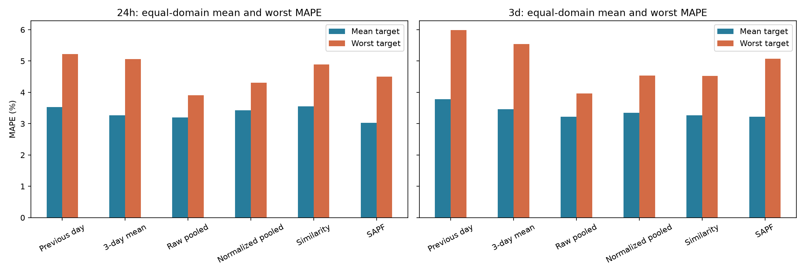
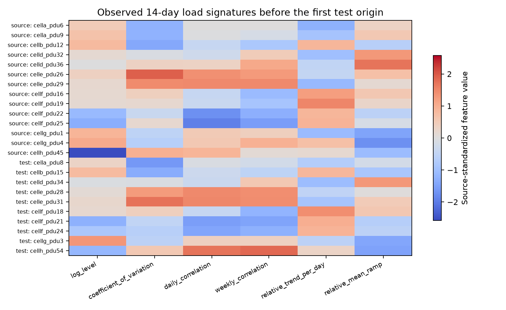
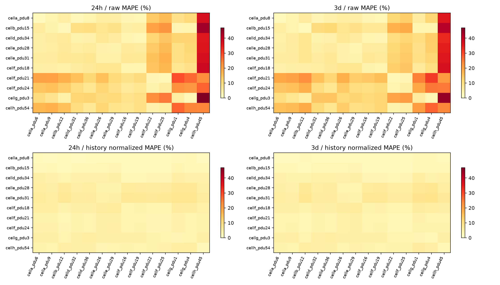

# SAPF 第一阶段实验结果

版本说明：本文为Google首阶段冻结结果。后续M100新留节点、收益监督与M100↔UCC 30min实测功率实验见[新报告](BENEFIT_TRANSFER_RESULTS.md)；原Google模型、预测和证据不重算或覆盖。

**已完成主线归档、24h/3d 统一入口、Google 差异分析、历史归一化和源域选择性迁移原型。结果支持部分机制，但没有证明 SAPF 已全面改善鲁棒性：24h 平均 MAPE 改善，最差域变差；3d 未超过原始多源 Ridge。没有根据这些测试结果调整模型或参数。**

日期：2026-10-25（Asia/Shanghai）。分支 research/sapf-v1，基准 bc6a439。本轮代码尚未提交或推送。主运行：[20261025T082346Z_sapf_5644ac](../results/runs/20261025T082346Z_sapf_5644ac/manifest.json)。

## 1. 实验与归档完成范围

源码、配置、旧报告和图已按 bc6a439 冻结到 [归档](../archive/pre_sapf_bc6a439/README.md)：131 个源文件，主线移出 75 个旧文件，索引 44 次历史运行。历史数据/预测/模型/缓存保留原位置，不覆盖；20,229 个既有产物保护检查通过，其中 8,164 项有 SHA-256，12,065 项按大小/mtime 检查。

主入口仍为 scripts/run_experiment.py，默认 24h=96、3d=288，历史 1344 点，15 分钟采样；默认只展示配置、进度、平均/最差 MAPE 和保存位置。HDSF、7d、旧 Google/NLR 预设和原有测试保存在冻结包中，经同一入口显式访问，不再进入主线默认列表。

新协议在看新测试误差前固定为 14 个源域、11 个验证域、10 个测试域，互不重叠；此前三个 pilot 目标被排除。源开发标签截至 D18，验证域 D18/D19 起报，源最终拟合截至 D22。测试为 24h 的 D22—D30 和 3d 的 D22—D28，共 90/70 个起报、8640/20160 个曲线点。详见[完整协议](SAPF_PROTOCOL.md)与[预注册副本](figures/sapf-20261025T082346Z_5644ac/preregistration.json)。

该轮所有参数网格和模型源码哈希在测试前保存，完成该轮验收时与预注册一致，配置也未改变。后续 M100 接入前已另存[源码快照](../archive/pre_m100_sapf_20261025/README.md)；M100 的通用入口扩展和消融是后续版本，未用于重算本报告分数。Google 测试后仅补充审计和报告，没有重训或修改其模型、源池、参数与预测。

## 2. 公平主对照：曲线 MAPE（%）

各行使用相同目标域、历史与测试窗口，跨目标按域等权平均。归一化由每个起报前历史独立计算，没有目标监督拟合。相似性与 SAPF 只由独立验证域选择候选，验证期选参分数不当作泛化成绩。

| 方法 | 24h 平均 | 24h 最差域 | 3d 平均 | 3d 最差域 |
| --- | ---: | ---: | ---: | ---: |
| 前一天同刻 | 3.5338 | 5.2241 | 3.7836 | 5.9855 |
| 前三天同刻均值 | 3.2714 | 5.0608 | 3.4611 | 5.5402 |
| 原始多源 Ridge | 3.1996 | 3.9070 | **3.2167** | **3.9629** |
| 历史窗口归一化多源 Ridge | 3.4256 | 4.3096 | 3.3470 | 4.5423 |
| 相似性选择 | 3.5512 | 4.8960 | 3.2706 | 4.5243 |
| SAPF 可靠性选择 | **3.0232** | 4.5012 | 3.2241 | 5.0704 |

24h SAPF 相对原始多源 Ridge 的平均误差减少约 **5.51%**，但最差域误差增加约 **15.21%**。3d 平均误差增加约 **0.23%**，最差域增加约 **27.95%**。因此，不能仅凭 24h 平均优势宣称模型整体更稳健。



[全部曲线/日均 MAPE、WAPE、RMSE、MAE、计数及减少比例](figures/sapf-20261025T082346Z_5644ac/metrics.csv)。CSV 含全部 14 个原始单源和 14 个归一化单源，终端只展示事先固定的首个单源，不取测试最优单源。逐起报、步长、目标日、非重叠检验和完整预测 Parquet 保存在主运行的域/任务/方法目录。

## 3. 哪些规律可共享，哪些差异与迁移误差相关

首个测试起报前的 14 天，在 14 个源域及 10 个测试域中，历史平均利用率约 0.5321—0.7861，变异系数 0.0259—0.0836；日相关范围 0.1020—0.8892、周相关 0.2316—0.9056。日相关中位数约 0.5061，说明有共同周期性，但强度差异明显。相对日趋势从 -0.00313 到 0.00490，平均相对爬坡从 0.00487 到 0.01294。不能将这些统计直接解释为已知业务状态。



在全部源→目标配对起报中，原始单源误差与对数水平差的测试 Pearson 相关为 **0.9133 / 0.9328**（24h/3d）；历史归一化之后变为 **-0.0208 / 0.0074**。这支持幅值差异是当前纯单源迁移的重要关联因素，但不证明它是多源失败的唯一原因。

归一化源专家的测试误差与日内轮廓幅度差相关约为 0.3129/0.3653，验证期仅为 0.1603/0.0171；趋势差等关系也不稳定。仅凭少数历史统计最近邻不足以保证迁移可靠。验证/测试分开列出的[全部 Pearson/Spearman 系数](figures/sapf-20261025T082346Z_5644ac/feature-transfer-correlations.csv)和[逐起报诊断](figures/sapf-20261025T082346Z_5644ac/source-target-diagnostics.csv)保留了这些不利证据。

这些配对包含重复源、目标和重叠窗口，不是独立样本；没有据此宣称因果、显著性或测试前可知的最优源。

## 4. 三个递进机制的真实结论

### 历史窗口归一化

在 140 个固定源→目标配对上，单源平均 MAPE 从 **11.5561%→4.3833%（24h）**、**11.5626%→4.3561%（3d）**，分别有 **123/140、129/140** 配对改善。比较使用相同训练/测试域和起报，改变的是窗口归一化与尺度恢复。

但对多源 Ridge，归一化使 24h **9/10**、3d **6/10** 目标变差，平均增加 **0.2261 / 0.1303 个百分点**。因此，“减少幅值差异就一定提高多源预测”不成立。可能丢失了原始多源模型可利用的水平信息，或改变了短样本直接回归的条件；这只是待新数据检验的解释假设。



### 源域相似性

验证期选择的 24h 为 level_shape、top-1、温度 0.5；3d 为 shape、top-3、温度 2。测试时，24h 相似性平均值比归一化多源差 0.1256 个百分点，3d 改善 0.0764 个百分点。固定统计相似性只能提供有限信息，不能当作可靠的收益预测器。

### 选择性加权与可靠性回退

SAPF 的验证期选择：24h 为 top-7、level_shape、温度 0.5、最大迁移强度 0.5、可靠性幂 1；3d 为 top-7、level_shape、温度 2、最大强度 0.25、可靠性幂 1。目标历史动态门的测试均值为 **0.4226 / 0.2123**，其余权重属于固定前三天同刻均值。可靠性参数没有在测试期重新学习。

相对归一化多源，SAPF 有 8/10、7/10 个目标改善，但没有同步改善最差域。24h 最差 SAPF 域为 celle_pdu31（4.5012%）；3d 仍为该域（5.0704%），高于原始多源最差 3.9629%。

| 同目标固定比较 | 24h MAPE 变差 | 3d MAPE 变差 |
| --- | ---: | ---: |
| 归一化多源相对原始多源 | 9/10 | 6/10 |
| 相似性选择相对归一化多源 | 5/10 | 3/10 |
| SAPF 相对归一化多源 | 2/10 | 3/10 |
| SAPF 相对原始多源 | 3/10 | 6/10 |
| SAPF 相对本地历史参考 | 2/10 | 2/10 |
| 增加原始源域，相对每个固定原始单源 | 4/140 | 4/140 |
| 增加归一化源域，相对每个固定归一化单源 | 31/140 | 23/140 |

[完整配对差值](figures/sapf-20261025T082346Z_5644ac/paired-comparisons.csv)。以上不同基线的比例不能直接互减为同一种负迁移减少率；相对本地历史的差值是性能对照，不是加入某个源的因果证据。

本轮没有独立隔离“可靠性本身”和“局部回退本身”的全部消融，所以不能把 SAPF 平均收益全归因于可靠性。下一轮应在新的验证/评价安排中预注册这些消融，而不是现在根据已见测试反复挑门控参数。

## 5. 验证与复现证据

| 项目 | 结果与范围 |
| --- | --- |
| 当前测试 | 38 项，涵盖域/时间隔离、未来观测、单位、3d 聚合、归一化恢复、校准、冻结、篡改检测、归档、原数值环境路径与输出 |
| 新实验复算 | 2,856 项曲线/日均指标检查通过，验证/测试覆盖完整且起报/时间戳一致 |
| 模型恢复 | 68/68，按原批次重载完整测试输入，最大绝对差 0 |
| 冻结与角色 | 计划一致、源拟合、验证校准、截止和先冻结后测试通过 |
| 旧产物保护 | 20,229 项通过；哈希/大小-mtime 范围分别声明，不将元数据检查说成哈希证明 |
| 旧流程兼容 | 归档 CLI 帮助、原 Ridge 两任务预测恢复、HDSF 两任务反序列化/配置读取通过；未重跑基座 |
| 外部数据 | Alibaba 7/7 官方哈希匹配；M100 节点适配只有合成边界验证；UCC 本轮未接入 |

审计副本：[独立复算](figures/sapf-20261025T082346Z_5644ac/audit.json)、[完整恢复](figures/sapf-20261025T082346Z_5644ac/saved-model-audit.json)、[历史保护](figures/sapf-20261025T082346Z_5644ac/historical-protection.json)、[旧模型核对](figures/sapf-20261025T082346Z_5644ac/legacy-replay-verification.json)、[测试日志](figures/sapf-20261025T082346Z_5644ac/pytest-complete.log)、[来源与完整性摘要](figures/sapf-20261025T082346Z_5644ac/evidence.json)。原有 HDSF/18 模型测试在冻结源码中保留，当前主线测试不重新启动它们。现有 Pandas/NumPy 组合产生弃用警告，测试断言全部通过，未升级或覆盖环境。

实际执行过的主要命令：

```powershell
.\.venv\Scripts\python.exe scripts/run_experiment.py --demo
.\.venv\Scripts\python.exe scripts/run_experiment.py
.\.venv\Scripts\python.exe scripts/run_experiment.py --results latest
.\.venv\Scripts\python.exe scripts/run_experiment.py --results results/runs/20261014T191923Z_google_9a3ad6
.\.venv\Scripts\python.exe scripts/run_experiment.py --legacy-config configs/google_hdsf.yaml --help
.\.venv\Scripts\python.exe scripts/audit_datasets.py --hashes --output results/analysis/sapf/datasets.json
.\.venv\Scripts\python.exe scripts/audit_cross_domain.py --run results/runs/20261025T082346Z_sapf_5644ac --output results/analysis/sapf/independent-recomputation.json
.\.venv\Scripts\python.exe scripts/audit_cross_domain.py --verify archive/pre_sapf_bc6a439/protected-artifacts.json --output results/analysis/sapf/historical-protection.json
.\.venv\Scripts\python.exe -m pytest -q
git diff --check
```

审计输出要求新路径，不覆盖已有证据。合成运行 20261025T081908Z_sapf_2166e7 只检验程序，未用其 MAPE 支撑真实结论。保存的测试方案只执行了一次真实模型运行；之后的审计和图表重生成没有改写模型或预测。

## 6. 剩余工作与下一步

Google 仍是同一历史发布，样本仅一个月；所有测试域与源域存在同 cell 共性，不能写成未知算力中心的独立泛化验证。3d 起报/训练标签大量重叠，独立验证域只能缓解身份泄漏，不能创造更多独立时间证据。基于历史签名的可靠性与局部回退尚未解决最差域问题。

近期应保留原始多源 Ridge 这个强对照，使用源/验证信息预注册更充分消融与可靠性设计，并取得更长或新的独立数据。上述运行完成后，本地 M100 两个 15min 聚合包及 UCC 两份 CSV 已完成[实际文件审计](M100_UCC2023_DATA_AUDIT.md)，第一轮证据中的“本地未到位”仍是当时快照。M100 尚需聚合语义核实与正式适配，UCC 需时区核验及独立原生/30min 协议；均未加入本报告的 Google 模型或精度。Alibaba 暂只具备无标签资源模式的 schema 基础。共享深度编码和跨数据集功率监督尚未实现。

Eagle 整体保留最终独立测试，当前未读取。ESIF 分项功率、Google 利用率、未来节点/机架/设施实测功率分层报告。当前结果不是设施总表 kW 精度、MAPE≤5% 验收或完整 SAPF 方法已被证实的证据。
