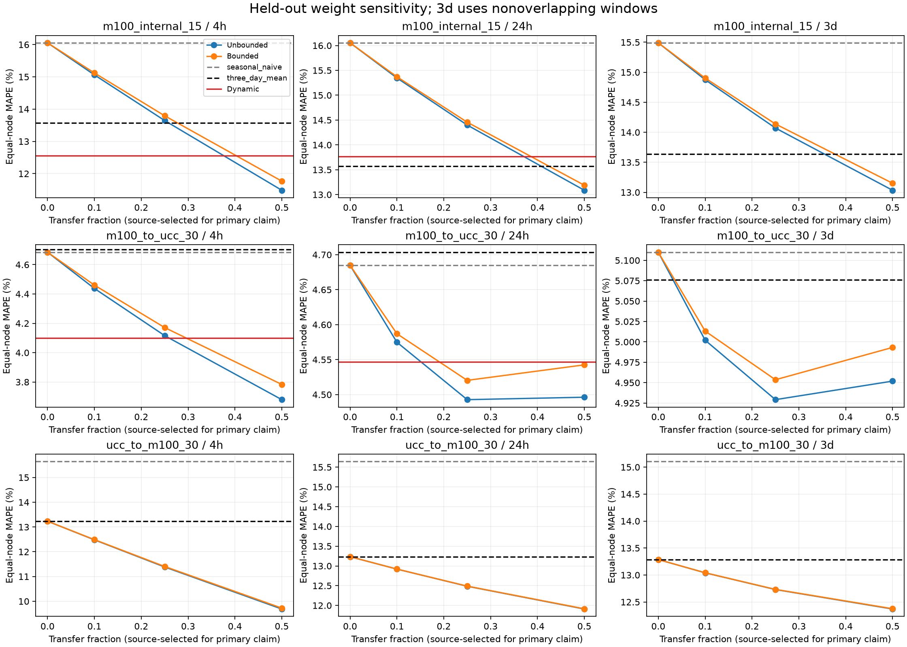

# SAPF最终方向验证结果与研究决策

本轮按[测试前协议](SAPF_ROBUST_PROTOCOL.md)完成。**建议保留稳健基础模型和简单迁移对照，停止继续优化本轮SAPF动态门控，不将当前结果写成已解决24h/3d跨中心泛化。**固定融合的平均收益不只存在于4h；但预声明的统计与尾部稳健性条件尚未同时满足。现有证据也不足以否定一切跨域迁移。

源开发运行：`20261026T080606Z_sapf_robust_dev_8b8652`。一次性新日期运行：`20261026T085237Z_sapf_robust_c9cded`，完整原始预测、模型、数据快照位于`results/runs/`对应目录。[可随Git查看的证据包](figures/robust-direction-20261026/README.md)保留全部汇总、域级指标、起报指标、统计、诊断、图及冻结哈希。

## 1. 实际执行范围

M100内部采用原生15min节点实测功率`total_power_avg`；双向迁移采用M100/UCC共同30min完整槽平均。UCC使用原生10min服务器实测`Power`。均为W→kW，14天历史，4h/24h/3d；没有把资源利用率、估算功率或节点功率写成设施总功率。

| 数据 | 源 / 独立开发 / 独立验证 / 新测试身份 | 新评分日期 | 4h / 24h / 3d每日起报数（每节点） | 3d非重叠起报数 |
| --- | --- | --- | --- | --- |
| M100 | 8 / 2 / 2 / 8 | 2022-03-01—03-27 | 162 / 27 / 25 | 9 |
| UCC | 12 / 4 / 4 / 90 | 2019-05-01—06-07 | 228 / 38 / 36 | 12 |

先按完整性排除M100 node21、node27，不补选节点；原15min已评分的10个M100测试身份继续退役。核对567个旧评分网格，新评分标签日期交集为0。所有方法使用相同身份、历史、起报和标签，窗口缺失即报错，不静默删样本。4h日均指标为N/A；3d主结果为非重叠窗口，另存每日滚动及日均结果。

**这是已知中心和设备上的新评分日期，不是全新中心。**跨数据集采用离线源资料，正向M100资料晚于UCC目标年份；UCC源资料截止2019-06-20，也包含晚于UCC目标评分期的资料，不能当作2019年的可部署前瞻回测。M100内部源拟合/选参早于新测试。UCC钟表时区仍未核实；保留发布钟表，不擅自赋UTC。额外上报延迟及原始聚合边界的限制仍存在。Eagle本轮未读取观测或标签，继续封存；ESIF不作为Eagle替代。

## 2. 源侧准入与模型冻结

九组z-score源专家均通过预定数值门槛。固定权重仅在源侧独立开发节点选择，独立验证节点确认信号；没有用新目标误差选择权重。

| 源组 | 源侧本地规则L | 4h / 24h / 3d预选alpha | 源侧稳定正信号 | 实际执行动态 |
| --- | --- | --- | --- | --- |
| M100 15min | 前一天同刻 | 0.5 / 0.5 / 0.25 | 4h、24h通过，3d未通过 | 4h、24h |
| M100 30min | 前一天同刻 | 0.5 / 0.5 / 0.25 | 同上 | 4h、24h |
| UCC 30min | 前三天同刻均值 | 0.5 / 0.5 / 0.25 | 仅4h通过，不能单独解锁主线 | 未执行 |

受限固定与动态共用相同专家池、L和`B=2×历史sigma`。动态只使用历史形态差异、L/E分歧及源内留域历史收益，采用冻结的二维历史类比方案。源侧教师标签最晚D44；独立开发、验证身份与源身份分离。最终源拟合截止D72。全部源组共同冻结后才开始新目标评分。

原SAPF及Gain-v2 marginal按本轮角色和相同可用源资料重训为结构对照，原有参数网格不变；不直接混排旧日期报告的数值。Gain-v2保留其原Level–Shape表示。H2主比较只解释同池新固定/受限固定/动态的差异。

## 3. H1：外部知识是否有用

下表“较强本地”是两种历史规则中在该测试上平均较好的一个，**仅作比较**；模型内部L始终是源侧预选规则。负迁移比例为固定融合比该本地规则更差的节点比例，属于预测性能比较，不是源知识的因果效应。

| 方向 / 时长 | 较强本地MAPE | 预选固定MAPE | 相对降低 | 最差本地→固定MAPE | 负迁移节点 |
| --- | --- | --- | --- | --- | --- |
| M100→UCC 24h | 4.6848%（前一天） | 4.4962% | 4.03% | 19.3396%→17.0458% | 30/90，33.33% |
| M100→UCC 3d | 5.0763%（前三天） | 4.9292% | 2.90% | 17.6347%→19.1949% | 41/90，45.56% |
| UCC→M100 24h | 13.2336%（前三天） | 11.9094% | 10.01% | 29.4866%→26.0333% | 0/8 |
| UCC→M100 3d | 13.2865%（前三天） | 12.7306% | 4.18% | 29.5428%→27.9145% | 0/8 |

四格平均降低均超过2%，说明存在值得保留的迁移收益信号，不应断言“只有4h有用”。但正向3d最差节点相对恶化8.85%，超过预定5%上限；两方向也不能直接合并为一个总体精度结论。

配对区间以“本地−固定”的MAPE百分点表示，正数有利于固定融合。采用节点抽样及跨节点同步时间块bootstrap，2000次、固定种子；下表与上述较强本地对应，完整H1族含两个本地基线，共8项。

| 方向 / 时长 | 平均改善百分点的95%区间 | 未校正p | Holm校正p | 全部预设条件 |
| --- | --- | --- | --- | --- |
| M100→UCC 24h | [-0.0365, 0.4035] | 0.0890 | 0.3848 | 未通过 |
| M100→UCC 3d | [-0.3298, 0.6528] | 0.5147 | 0.5147 | 未通过，且尾部恶化 |
| UCC→M100 24h | [0.3428, 2.3530] | 0.0080 | 0.0640 | 未通过多重校正门槛 |
| UCC→M100 3d | [-0.0089, 1.2911] | 0.0845 | 0.3848 | 未通过 |

因此H1有点估计收益，尚未达到本轮“稳定正迁移”的完整声明标准，8项主比较通过数为0。尤其反向24h不能因校正p接近0.05而改门槛，也不能把未显著当作已经证明无效。百分位区间与中心化双侧bootstrap检验不是严格互为反演；本轮按协议同时检查区间和校正p值。

其他指标也限制结论。正向3d固定融合的WAPE从5.2828%降至5.1672%，MAE从0.016149降至0.015993 kW，但RMSE从0.022818升至0.023424 kW。平均百分比误差降低没有消除大误差风险。完整域等权MAPE/WAPE/MAE/RMSE、每日滚动与日均结果见证据包，不把域等权WAPE写成全体点池化WAPE。

## 4. H2：动态决策是否超过简单固定融合

| 研究 / 时长 | 非受限固定MAPE | 受限固定MAPE | 受限动态MAPE |
| --- | --- | --- | --- |
| M100内部15min 4h | 11.4849% | 11.7676% | 12.5537% |
| M100内部15min 24h | 13.0866% | 13.1879% | 13.7697% |
| M100→UCC 4h | 3.6796% | 3.7831% | 4.0986% |
| M100→UCC 24h | 4.4962% | 4.5425% | 4.5467% |

四个实际执行格的动态平均MAPE均未超过同池固定融合。主任务正向24h动态比非受限固定高1.12%，比受限固定高0.09%；配对区间均跨0，不能声称统计上证明动态必然更差，也没有额外收益证据。H2预留族16项中仅4项实际执行，另外12项未准入，记N/A并保守留在校正族中，不能当作已测试失败或全回退成功。

正向24h动态零迁移比例为50.53%；在同一受限专家池四个候选存在至少2%实际收益的起报中，固定融合利用88.00%，动态仅利用44.06%，错过55.94%。正向4h对应利用率89.99%与48.39%，动态零迁移50.34%。M100内部24h动态并非全回退（零迁移10.19%），但机会利用87.63%，仍低于受限固定的96.24%。本轮保守决策丢失了可用收益，未换来额外精度优势。

机会统计是测试后的有限候选诊断，不是可部署oracle；分母为max(本地MAPE,0.1)。该统计只用于共享同一z-score池和L的固定/受限/动态方法；普通基线、原始Ridge及旧门控不能据此解释为“利用了外部知识”。

另外，九格受限固定的平均MAPE均未优于各自非受限固定。限制修正幅度提供了输出约束，本轮没有证明它能额外降低平均误差。所有3d和反向动态保持未执行，未根据新测试补开实验。

## 5. 与基础模型、旧方案及Google证据的关系

| 方向 / 主时长 | 原始Ridge | z-score纯专家均值E | 预选固定 | 原SAPF | Gain-v2参考 | 新动态 |
| --- | --- | --- | --- | --- | --- | --- |
| M100→UCC 24h | 8.3211% | 4.9688% | 4.4962% | 4.6614% | 4.7566% | 4.5467% |
| M100→UCC 3d | 8.8463% | 5.4615% | 4.9292% | 5.0627% | 5.0954% | N/A |
| UCC→M100 24h | 11.3221% | 11.2067% | 11.9094% | 12.8287% | 13.2336% | N/A |
| UCC→M100 3d | 12.2209% | 12.3186% | 12.7306% | 13.2865% | 13.2865% | N/A |

固定融合也不是所有场景中的最强方法。反向两个主时长原始Ridge及纯专家均值均优于预选固定；不能只与较弱历史规则相比就宣布新方案最优。4h补充实验中，M100内部原始Ridge为8.0033%，反向原始Ridge为7.0699%，也分别优于固定融合11.4849%和9.6874%。

反向24h源侧未通过动态准入，但新目标上的固定融合8/8节点均改善，这说明“源侧拒绝”也可能错过有价值的迁移；本轮保留该证据，不据此调阈值重跑。M100内部3d预选固定14.0705%仍高于前三天均值13.6360%，与跨中心结果分开解释。

Google早期“多源Ridge未必优于历史规则”的结论在本轮得到更具体的边界：正向原始Ridge仍较弱，但经过尺度适配的简单迁移有平均收益；反向原始Ridge本身已经很强。已有Google、M100和UCC旧分数均为开发证据，不与本轮新日期汇总排名。不同采样、负荷尺度、计量层级和日期的MAPE不能直接当作同一难度比赛。



图中全部候选只作敏感性描述。3d正式固定权重始终为源侧预选0.25，不按目标图中的较优候选换权重。

## 6. 专家完整性与失败案例

九格新目标均通过冻结的数值门槛，非有限预测为0，严重z-score与平均功率放大事件均为0，独立反归一化复核最大差为0 kW。完整原始预测、标准化预测及单源逐起报误差保留在本机运行目录；证据包提供全部单源域级误差矩阵、分布与图。

**门槛通过不等于所有原始输出物理有效。**原始单源仍有少量负功率，例如M100内部24h出现约-2.36 kW单点输出。九格原始负点比例均小于预定1%上限；统一非负处理在测试前已声明，并同样用于全部新融合专家。不能用裁剪后的结果声称原始专家没有异常，也不能隐去原始分布。受限修正与非负处理的作用、预测误差高低需要分开判断。

正向3d最差目标为`ucc_d1_qh2_rcc131`：前三天均值17.6347%，固定融合19.1949%。其滚动起报历史CV约0.146—0.291，处于中/高波动组；这不是已核实的作业状态。D1的66个节点中28个负迁移，平均MAPE5.1665%→4.9448%；D2的24个节点中13个负迁移，平均4.8284%→4.8862%。总体均值掩盖了分组恶化。

D1/D2是发布文件分组，未核实为具体硬件型号；M100机架、历史CV和误差的关联不构成硬件或作业状态因果解释。尚不足以完成真实硬件类型/运行状态归因。M100只有两个机架，内部跨节点不能写成跨数据中心泛化。

## 7. 方向决策与四个问题的回答

1. **外部中心知识有用吗？**相对所列本地规则，有平均精度收益信号，尤其反向24h；但完整稳定性门槛未通过，也尚未证明收益专属于某种外部知识而非一般预测/平滑能力。
2. **SAPF动态比固定融合更有价值吗？**本轮未证明。执行的同池动态没有额外平均收益，并错过大量可用机会。建议停止继续优化本轮类比门控；这不是对所有自适应方法的不可能性证明。
3. **收益覆盖24h/3d吗？**两方向两主时长的固定融合平均值均改善超过2%，并非仅4h有效；3d正向尾部与统计不确定性仍阻止完整中短期成功结论。
4. **新独立评价中仍有收益吗？**此前未评分的新日期出现了收益信号，模型已统一冻结；设备/中心身份已知且跨数据集为离线资料，尚无全新中心的前瞻泛化证明。Eagle没有被用来补充成功成绩。

**据此保留原始Ridge、z-score专家及简单固定融合作为后续基线，暂停追加当前SAPF门控复杂度。**近期优先补足独立中心、真实功率标签和时间协议，而不是用本轮已评分结果继续选邻居、改阈值或换alpha。当前没有理由把方向简单收缩成“只有4h有效”，也没有证据支持继续以“动态选择优于固定迁移”作为已验证创新。Eagle最终一次测试需另行固定兼容的节点级协议后再决定，本轮继续封存。

## 8. 验证和复现

测试前提交`a722278`，标签`sapf-robust-protocol-20261026`。本轮80项不同测试均有通过记录：原有72项首次通过，受并行源码编辑影响的1项在固定代码下重跑通过，新增7项通过。原失败是旧Gain-v2审计正确检出源码变化，记录保留；没有为其改预测或放宽审计条件。

真实运行统一冻结193份命名模型状态；586项冻结哈希检查、148项完整保存/恢复、73,290项域级曲线/日均/非重叠指标复算通过。独立NumPy核验主任务2,352项指标，最大差约7.1e-15。当前普通CLI的`--results latest`及公共审计入口验证通过。此前911份冻结模型哈希保全检查通过，旧证据与本轮结果分开保留。

```powershell
.\.venv\Scripts\python.exe scripts/run_experiment.py --results latest
.\.venv\Scripts\python.exe scripts/audit_cross_domain.py --run results/runs/20261026T085237Z_sapf_robust_c9cded --output results/analysis/robust_direction/another-readonly-audit.json
.\.venv\Scripts\python.exe scripts/plot_robust.py results/runs/20261026T085237Z_sapf_robust_c9cded
```

复现、统计重算与图表说明见[证据入口](figures/robust-direction-20261026/README.md)。没有在新测试后重拟合模型或修改参数；描述性分组诊断和本报告是测试后解释，不是新的独立成绩。
