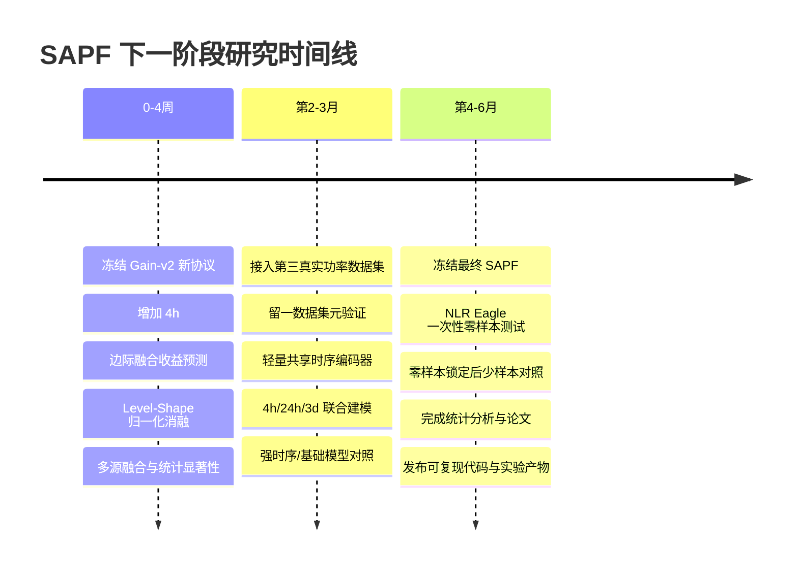

# SAPF当前研究成果评估与下一阶段研究计划

## 执行摘要

当前SAPF已完成Google域内迁移、M100真实节点功率迁移及M100↔UCC双向跨数据集实验，证明“更多源数据不必然更好”，也暴露出收益预测偏保守、归一化与多源融合冲突等关键问题。下一阶段应暂缓扩大模型复杂度，优先重构迁移收益目标、完善校准与消融，引入第三个独立功率数据源；待协议冻结后，再对NLR Eagle进行一次性零样本测试。

## 当前成果与阶段判断

从最初设想看，SAPF的目标是：**从异构算力中心中学习可迁移的负荷变化规律，并在一个从未参与训练的新算力中心上，根据起报前历史动态判断“迁移什么、信任什么、融合多少”**。最终项目任务仍要求15分钟分辨率、过去14天历史输入，并优先完成4小时、24小时、3天预测；核心项目目标是数据中心整体总有功功率kW，MAPE为首要指标。现阶段公开数据只能分别支持利用率、节点功率或服务器功率实验，不能把这些成绩直接等同于设施总表功率精度。fileciteturn0file4

### 当前实验版图

| 数据/场景                 | 已完成                                                       | 当前最重要结果                                               | 尚未完成                                 | 能支持的结论                                                 |
| ------------------------- | ------------------------------------------------------------ | ------------------------------------------------------------ | ---------------------------------------- | ------------------------------------------------------------ |
| **Google PowerData 2019** | 15 min；14源/11验证/10测试域；24h、3d；Ridge、归一化、相似性、SAPF | 24h SAPF平均MAPE **3.0232%**，优于原始多源Ridge的3.1996%；但最差域由3.9070%恶化至4.5012%。3d SAPF 3.2241%，未超过原始Ridge 3.2167% | 4h；真正跨数据中心训练/测试；真实kW      | 能证明同一Google发布中的跨电力域机制现象，**不能证明跨设施泛化**。Google官方数据包含57个power domains，且其目标是功率利用信息，不是设施总表kW。fileciteturn0file3 citeturn0search0 |
| **M100 15 min**           | 33节点；12源/11验证/10测试；24h、3d；完整消融                | SAPF 24h/3d平均MAPE为**13.1163%/15.9795%**，优于原始多源Ridge，但仍差于前三天同刻均值11.8758%/12.7118%；本地历史权重约82.55%/64.93% | 4h；跨更多机架/中心；深度共享表征        | 能证明真实节点功率上存在明显负迁移，也证明当前SAPF很大程度依赖本地回退。fileciteturn0file8 |
| **M100↔UCC 30 min**       | 共同30 min协议；M100→UCC、UCC→M100双向；24h、3d；收益预测器和强制迁移消融 | M100→UCC 24h收益策略为**3.5849%**，略优于本地3.6746%；但3d全部回退。UCC→M100两个时长收益策略均100%回退，而固定50%混合反而达到15.5619%/17.2307%，明显优于本地17.4445%/18.0035% | 4h；第三数据集；收益校准；共享编码器     | 这是目前**最有价值的跨中心证据**：可迁移知识确实存在，但当前收益预测器没有稳定识别它。fileciteturn0file6 |
| **UCC原生数据**           | 已审计；145个主机标识；功率字段、缺失、DST重复等已核查；参与30 min跨数据集实验 | D1功率缺失极少，D2约13.84%；时间原生10 min，时区仍未核实     | 原生10 min独立预测基准；4h；辅助特征实验 | 可作为真实服务器功率源，但不能插值成15 min“实测真值”。fileciteturn0file0 |
| **NLR Eagle**             | 目前仅登记为final holdout，未用于训练、验证、校准和策略设计  | 尚无SAPF测试结果                                             | **最终零样本4h/24h/3d测试**              | 当前保留方式是正确的。Eagle官方提供2019–2024年节点级、1分钟iLO瞬时功率快照，可作为独立外部节点功率测试，但不是设施总表。fileciteturn0file1 citeturn0search3 |
| **Alibaba GPU v2020**     | 7张表schema与哈希已核验                                      | 有任务、实例和资源活动信息，但没有可信同步功率标签           | 无标签预训练、任务表征学习               | 更适合后续辅助表征学习，而不是直接作为功率监督源。fileciteturn0file1 |

这意味着，**当前研究没有背离最初方向，反而已经找到了真正值得研究的问题**：源数据之间确实存在可迁移信息，但“相似”不等于“有益”，而“能够识别风险”也不等于“能够发现正迁移”。

最典型的证据是UCC→M100。实际测试中有552/1,440个24h专家配对和365/1,200个3d专家配对是有益的，但现有收益模型一个“预计正收益”配对都没有给出，最终100%退回本地历史；与此同时，固定50%混合又确实优于本地基线。fileciteturn0file6 这表明**现在最应该修正的不是预测主干，而是“迁移价值”的定义和学习方式。**

另一个已经相当稳定的发现是归一化悖论。Google中，单源归一化使24h/3d平均MAPE从11.5561%/11.5626%降至4.3833%/4.3561%；M100中，单源归一化同样大幅改善。但相同归一化用于多源联合Ridge后，Google和M100都出现明显恶化。fileciteturn0file3 fileciteturn0file8 因此，SAPF后续不应再把“尺度信息”和“变化形状”二选一，而应显式做成**Level–Shape双通道表征**。

## 主要问题与风险

当前阶段至少有九项必须正视的问题，其中前五项应视为P0/P1级科学风险。

| 优先级 | 问题                                                         | 当前证据                                                     | 风险                                                         | 下一阶段处理原则                                             |
| ------ | ------------------------------------------------------------ | ------------------------------------------------------------ | ------------------------------------------------------------ | ------------------------------------------------------------ |
| **P0** | **迁移收益标签定义不够合理**                                 | 当前收益定义是“单个源专家相对本地历史的MAPE改善”；但UCC→M100中固定融合明显有效，而单专家收益预测器全部拒绝 | 会把“单独不够好但与本地互补”的专家错误判成无价值             | 把学习目标改成**边际融合收益**，即“加入该专家后，最终融合结果改善多少” |
| **P0** | **模型过度保守，容易把SAPF变成拒绝迁移模型**                 | M100→UCC 3d以及UCC→M100两个任务零迁移率均为100%              | 负迁移比例看起来很好，但只是因为没有迁移，无法支撑SAPF的核心价值 | 同时报告“成功迁移率、正迁移召回率、零迁移率”，不能只优化风险 |
| **P0** | **跨数据集收益/风险发生明显分布偏移**                        | M100→UCC风险AUROC仅0.6029/0.6193，且Brier 0.2250/0.2169还差于源基率常数0.2128/0.2016；UCC→M100收益预测平均低估约7.70/6.70个百分点 | 验证域上学到的阈值不能可靠移植到新中心                       | 增加第三独立中心，并做**留一数据集元验证**和独立校准         |
| **P0** | **归一化机制与多源融合存在结构性冲突**                       | 单源归一化大幅改善，但多源归一化在M100 24h/3d分别使9/10节点变差 | 单纯RevIN式归一化可能抹掉具有预测价值的绝对负荷水平          | 使用raw-level与normalized-shape双分支，不再完全丢弃均值/尺度 |
| **P1** | **强本地历史基线仍然难以稳定击败**                           | M100中前三天同刻均值优于SAPF；M100→UCC 24h中前一天同刻3.4772%也优于收益策略3.5849% | 审稿人会质疑“跨域学习究竟增加了什么价值”                     | 把Seasonal Naive视为**核心强基线而非弱基线**，要求SAPF至少在多中心上稳定改善 |
| **P1** | **独立数据中心数量仍太少**                                   | Google不是kW；M100和UCC是目前真正参与双向真实功率跨数据集实验的两套数据 | 几千个专家配对并不等于几千个独立中心；统计独立性很弱         | 接入第三个真实功率数据源后再做元学习/收益模型结论            |
| **P1** | **3d滚动窗口强相关**                                         | 现有3d测试常以每日起报，预测区间重叠                         | 若直接把每个起报视作独立样本，会夸大显著性                   | 主结果增加非重叠起报；统计检验采用域级聚类/块bootstrap       |
| **P1** | **4h任务还没有进入主线实验**                                 | 当前主要是24h/3d；技术目标明确要求4h、24h、3d优先            | 当前论文与项目任务仍有缺口                                   | 四周内加入4h，且分别定义15 min与共同30 min协议               |
| **P1** | **物理预测目标和项目最终目标仍有层级差异**                   | Google是利用率；M100是节点功率；UCC是服务器功率；Eagle也是节点功率 | 即使节点级MAPE很好，也不能声明设施总有功功率达到95%          | 论文中严格按measurement scope分表；项目验收另寻设施总表数据  |
| **P2** | **代码分支存在“本地已清理、公开cross-domain-v2仍有旧入口”的状态差异** | 新文档说明HDSF等已归档；但公开`research/cross-domain-v2`仍可见`run_hdsf.py`、`report_hdsf.py`、`reproduce_google_hdsf.py`、`cross_domain_experiment.py`等入口 | 后续复现容易混淆“哪个分支才是论文实现”                       | 尽快固定`research/sapf-v1`/`sapf-gain-v2`，打tag并停止在旧分支继续演化。fileciteturn0file15 fileciteturn2file0 |

这里最重要的研究转折可以写成一句话：

> **SAPF下一阶段不再预测“哪个专家单独最好”，而要预测“哪个外部知识加入当前本地预测后，能够产生正的边际价值”。**

这与现有结果完全一致：固定混合有时比每个单独迁移策略更好，说明外部专家的价值来自**互补性**，而不仅是独立准确率。

## 分阶段研究计划与资源预算

下表中的人日按“一名熟悉当前PowerForecast代码的研究人员”估计；计算资源是建议配置，而不是硬性最低要求。当前Ridge/ExtraTrees阶段主要依赖CPU，真正需要GPU应放到三个月之后的共享编码器阶段。

### 四周阶段：先把“迁移价值判断”做对

| 类别          | 优先级 | 具体任务                           | 目标与必做实验                                               | 预计人日 | 建议资源                   | 交付物                                          | 主要困难与应对                                               |
| ------------- | ------ | ---------------------------------- | ------------------------------------------------------------ | -------: | -------------------------- | ----------------------------------------------- | ------------------------------------------------------------ |
| **工程**      | P0     | 建立SAPF Gain-v2独立分支和冻结协议 | 从当前结果分叉，不修改已看过测试集对应的旧结果；固定新时间段/新域或留出新的外部评价集 |      1–2 | CPU即可；20 GB额外存储     | `SAPF_GAIN_V2_PROTOCOL.md`、预注册JSON、git tag | 已经看过旧测试结果；**不得在同一测试集上调新阈值后再宣称泛化** |
| **工程**      | P0     | 统一数据适配契约                   | M100/UCC/Google接口统一，显式保存scope、unit、interval、timezone、available_at、quality mask |      2–3 | 16核CPU、64 GB RAM         | `DataAdapter`契约、schema测试、审计报告         | UCC时区未确认；继续保留`naive source clock`，不擅自改UTC     |
| **科研**      | **P0** | **收益目标V2**                     | 比较“单专家收益”“固定融合收益”“边际融合收益”“pairwise ranking”四种标签 |      4–5 | 16–32核CPU、64 GB；无需GPU | 收益预测器V2、校准曲线、正迁移召回/精确率       | 样本相关性强；按目标域聚类评价，而不是把专家配对当独立样本   |
| **科研**      | **P0** | **归一化V2**                       | raw、局部z-score、双通道level+shape、带μ/σ尺度元数据四组对照 |      3–4 | CPU；64 GB                 | 归一化消融表、源→目标矩阵                       | 双通道可能增加共线性；先用Ridge/MLP轻量验证                  |
| **科研**      | P0     | 多源融合完整消融                   | local only、纯迁移、25/50/75%固定混合、当前SAPF、Gain-v2、强制迁移、oracle上界 |      3–4 | CPU                        | 多源融合消融表                                  | oracle只能作为“潜在上界”，不能作为部署方法                   |
| **科研**      | P1     | 增加4h任务                         | 15 min协议：16点；30 min跨数据集协议：8点。与24h/3d共同评估  |      2–3 | CPU                        | 4h结果、horizon-wise迁移分析                    | 不能把30 min 4h结果冒充项目15 min 4h结果                     |
| **科研/统计** | P1     | 统计显著性框架                     | 非重叠3d、域级bootstrap、DM辅助检验、Holm校正                |      2–3 | CPU                        | `statistics.csv`、置信区间和显著性报告          | 有效独立域少，避免过度解读p值                                |

**四周工作量：约17–24人日。** 这一阶段建议完全不引入大Transformer。当前最值得回答的是：**有没有一个简单、可解释的收益目标，可以把UCC→M100中已经存在的正迁移重新找出来？**

成功标准不应只设为“平均MAPE下降”，而应同时满足：

| 指标         | 四周建议门槛                                                 |
| ------------ | ------------------------------------------------------------ |
| 平均MAPE     | 至少在M100内部与一个跨数据集方向上优于本地历史和固定50%融合之一 |
| 正迁移召回率 | 不再出现“实际有大量有益配对、预测正收益为0”的情况            |
| 零迁移率     | 不以100%回退作为所谓安全改进                                 |
| 最差域MAPE   | 不显著恶化；优先控制相对本地基线的尾部风险                   |
| 风险校准     | Brier至少不劣于源基率常数；同时报告AUROC                     |
| 4h           | 建立完整基线，为项目目标补齐第一个缺口                       |

### 三个月阶段：从“人工特征路由”升级为“共享动态表征”

| 类别          | 优先级 | 具体任务                 | 目标与必做实验                                               | 预计人日 | 建议资源                            | 交付物                     | 主要困难与应对                                               |
| ------------- | ------ | ------------------------ | ------------------------------------------------------------ | -------: | ----------------------------------- | -------------------------- | ------------------------------------------------------------ |
| **数据工程**  | P0     | 接入第三独立数据源       | 优先HazardNet；完成真实性、单位、时间粒度、节点覆盖和缺失审计 |      4–6 | 32核CPU、128 GB RAM、300–500 GB存储 | 第三数据集审计报告和适配器 | 数据量增大；采用Parquet/DuckDB/流式读取                      |
| **科研**      | **P0** | 留一数据集元验证         | M100+第三源→UCC；UCC+第三源→M100；M100+UCC→第三源            |      5–7 | CPU为主                             | leave-one-dataset-out结果  | 第三数据源物理结构不同；保持target scope分层评价             |
| **科研**      | **P0** | Level–Shape共享编码器    | 两分支：绝对水平/尺度信息 + 归一化动态形状；轻量TCN/Patch编码器 |     7–10 | 1×24 GB GPU，64–128 GB RAM          | SAPF Encoder v1            | 深度模型可能不如简单基线；保留Ridge强对照，先小模型          |
| **科研**      | P1     | Horizon-conditioned SAPF | 4h/24h/3d共享编码，horizon作为条件；比较独立训练和联合训练   |      3–5 | 1×24 GB GPU                         | 多时长统一模型             | 3d与4h目标不同；允许独立head                                 |
| **科研**      | P1     | 无标签表征预训练         | Alibaba仅用于任务/资源行为的自监督表征，不作为功率真值       |      4–6 | 1×24–48 GB GPU、200 GB缓存          | 任务侧encoder实验          | Alibaba资源统计含生命周期聚合，严格禁止未来泄漏。fileciteturn0file1 |
| **科研**      | P1     | 当前强时序模型对照       | PatchTST/iTransformer类监督基线；增加至少一个现代零样本TSFM对照 |      3–5 | 1×24–48 GB GPU                      | baseline benchmark         | 2025–2026跨域通用时序模型已经在统一表征和零/少样本适配上发展较快，仅做“Transformer+MoE”创新不足。ICML 2025已有统一表征与自适应迁移工作，TimesFM-3也已提供现代零样本多变量时序基准。citeturn2search2 citeturn3search0 |
| **统计/论文** | P1     | 多数据集稳定性分析       | 平均、最差域、负迁移、正迁移召回、校准、跨时长一致性         |      4–5 | CPU                                 | 论文主要实验图表v1         | 结果不一致也保留，不筛结果                                   |

**三个月累计新增约30–44人日**；如果由一人完成，应理解为并行实验、数据处理和论文整理穿插进行，而不是连续全职算力占用。

这一阶段的决定性目标是：**从“两套数据的双向迁移”提升到“至少三套独立真实功率数据的留一数据集泛化”。** 只有这样，收益预测器才有可能学习“跨数据集的迁移规律”，而不是学习M100或UCC特有的经验。

### 六个月阶段：冻结模型并进行NLR Eagle最终零样本验证

| 类别          | 优先级 | 具体任务            | 目标与必做实验                                               | 预计人日 | 建议资源                                | 交付物                                | 主要困难与应对                                               |
| ------------- | ------ | ------------------- | ------------------------------------------------------------ | -------: | --------------------------------------- | ------------------------------------- | ------------------------------------------------------------ |
| **科研/治理** | **P0** | Eagle测试前总冻结   | 固定所有数据、模型、随机种子、超参数、预处理和评价代码；生成hash |      2–3 | CPU                                     | `EAGLE_PREREGISTRATION.json`、冻结tag | **在冻结前不读取Eagle观测值/标签**                           |
| **数据工程**  | P0     | Eagle一次性适配     | 官方数据为1分钟节点瞬时功率快照；建立15 min质量控制和时间聚合协议 |      4–6 | 32核CPU、128 GB RAM、100–200 GB工作空间 | Eagle adapter和审计报告               | 1分钟瞬时快照不等于连续积分功率；必须标明为样本均值性质。官方数据覆盖2019–2024年约2000节点。citeturn0search3 |
| **科研**      | **P0** | **零样本4h/24h/3d** | 完全冻结SAPF；目标域仅提供每个起报前14天历史，不做参数更新   |      4–6 | 1×24 GB GPU或CPU，视最终encoder         | Eagle零样本主表                       | 目标域规模大；分节点/机架批式推理                            |
| **科研**      | P1     | 零样本后少样本对照  | **零样本结果先锁定**，然后独立进行1天/3天/7天或1%/5%/10%标签微调 |      3–5 | 1×24 GB GPU                             | zero-shot vs few-shot曲线             | 少样本结果必须和零样本严格分表，不能反向修改零样本模型       |
| **科研**      | P1     | 辅助特征扩展        | 在零样本主结果完成后，再考虑Eagle jobs/GPU companion数据用于解释和增强 |      3–5 | CPU/GPU                                 | 多变量附加实验                        | NLR另有包含约13.8M作业记录和节点能耗/利用信息的Eagle Jobs数据，但若提前使用会破坏“Eagle整体封存”的当前设计，因此应放在主零样本之后。citeturn5search0 |
| **论文**      | P0     | 完成论文与复现包    | 结果表、失败案例、代码tag、数据manifest、统计报告            |     8–12 | 无特殊GPU                               | 投稿稿件、artifact                    | 若Eagle效果不理想，论文主题转向“可靠迁移判别/负迁移分析”，不要隐藏失败 |

**六个月阶段累计研究与工程工作量建议按70–95人日规划。**

这里要特别强调：即使最终SAPF在Eagle节点功率上取得MAPE≤5%，也只能说明**Eagle节点级功率预测**达到该误差范围，仍不能直接证明“整个数据中心总有功功率达到95%准确率”。项目总表目标与公开节点级标签之间必须继续严格区分。fileciteturn0file4

## 关键实验设计与统计协议

接下来的实验应以“新协议、新验证集、新测试集”为原则。已经看过的Google、M100旧测试结果主要用于形成假设，不再用于Gain-v2阈值优化。

| 关键实验                | 数据划分                                                     | 核心方法                                                     | 必须对比的基线                                               | 主评价                                                       | 统计方法                                                     |
| ----------------------- | ------------------------------------------------------------ | ------------------------------------------------------------ | ------------------------------------------------------------ | ------------------------------------------------------------ | ------------------------------------------------------------ |
| **迁移收益预测器V2**    | 每个源数据集内部：训练域生成leave-one-domain-out伪目标收益；独立验证域做校准/阈值选择；测试域完全冻结。第三数据集加入后做leave-one-dataset-out | 预测`marginal_gain = L(current blend) − L(blend + expert_i)`；同时训练负迁移风险；比较回归与pairwise ranking | 本地历史、固定50%融合、Gain-v1 ExtraTrees、只风险门、无veto、oracle source ranking | MAPE、正收益precision/recall、AUROC、Brier、收益MAE、零迁移率 | **目标域为聚类单元**的bootstrap；风险指标按目标域重采样，不按专家配对当独立样本 |
| **归一化策略**          | 完全复用相同源/验证/测试身份与起报；只改变表示               | raw；window-z；RevIN式；**Level–Shape双分支**；Shape+μ/σ metadata | 原始Ridge、normalized Ridge、当前SAPF                        | 平均/最差MAPE、单源与多源差值、负迁移比例                    | 同目标同起报成对差；目标域bootstrap 95% CI                   |
| **多源融合消融**        | 同一固定测试集一次性运行                                     | local、source-only、25/50/75%固定融合、learned scalar gate、Gain-v2 top-k、强制迁移 | 当前SAPF、固定50%混合                                        | MAPE、WAPE、RMSE、MAE、worst-domain、positive-transfer recall | 域级配对检验；跨域Wilcoxon/置换作为补充                      |
| **多时长实验**          | 15 min：4h=16、24h=96、3d=288；共同30 min：4h=8、24h=48、3d=144 | 独立模型 vs horizon-conditioned共享模型                      | Seasonal naive、Ridge、SAPF Gain-v2                          | 分时长MAPE + 提前量误差曲线                                  | 不能把不同时间分辨率结果合并成一个平均数                     |
| **跨数据集零样本**      | 训练/验证只来自源数据；整个目标数据集标签不参与拟合和校准    | leave-one-dataset-out SAPF                                   | local history、fixed blend、raw/norm multi、现代TS模型       | 等目标域平均和最差域MAPE                                     | 数据集层面报告每方向结果，不仅做总体池化                     |
| **NLR Eagle最终零样本** | Eagle不参与训练/验证；冻结后才读取；每起报只允许过去14天     | SAPF final                                                   | 前一天同刻、前三天均值、最终强基线                           | 4h/24h/3d MAPE、WAPE、RMSE、MAE、最差节点/机架               | 非重叠起报 + 块bootstrap；零样本锁定后才允许少样本实验       |

### 收益标签应怎样改

当前定义为：

\[
g_i=L(y,\hat y_{\text{local}})-L(y,\hat y_i)
\]

它回答的是：

> “第 \(i\) 个专家单独用，是否比本地历史更好？”

下一阶段更建议定义：

\[
g_i^{\text{marginal}}
=
L(y,\hat y_{\text{current}})
-
L\left(y,
(1-\alpha)\hat y_{\text{current}}+\alpha\hat y_i
\right)
\]

这里的`\(\hat y_{\text{current}}\)`可以首先就是本地历史，也可以是已经选中的专家集合。它真正回答：

> **“把这个源域知识加入当前预测之后，最终结果有没有改善？”**

这与UCC→M100“固定融合有效、单专家收益预测失败”的现象直接对应。fileciteturn0file6

还应增加一个**oracle融合上界**：在测试后仅用于分析，利用真实未来标签搜索最优源或最优混合权重，回答“这个目标上理论上到底有没有可迁移空间”。它绝不能用于参数选择，但非常有价值。如果oracle也只比本地历史好0.05个百分点，那么继续优化复杂路由的价值有限；如果oracle能改善3–5个百分点，而SAPF抓不到，就说明问题明确位于“选择/融合模块”。

### 显著性检验建议

当前3d日滚动预测有大量重叠窗口，所以不能把数万个曲线点当成独立样本。Diebold–Mariano检验本来就是为比较预测损失并允许序列相关而设计，可作为单目标域预测能力比较的辅助工具；对重叠预测应使用HAC/适当滞后。citeturn4search3

更稳妥的主协议是：

**第一层：域级效应。** 对每个测试节点/服务器/电力域先计算`ΔMAPE = MAPE(SAPF) − MAPE(baseline)`，报告均值、中位数、95%置信区间和改善域比例。

**第二层：块bootstrap。** 以目标域为外层cluster，在域内按forecast origin成块采样；3d若每日起报，块长度至少覆盖3个相邻起报，或直接使用每3天一次的非重叠起报。Stationary bootstrap本身就是针对弱依赖时间序列设计的重采样方法。citeturn4search4

**第三层：多重比较控制。** 若对多个域分别做DM检验，应使用Holm等方法校正多重比较；论文结论以效应量和跨域一致性为主，不以少数p值为主。

**风险模型**的AUROC、Brier、precision/recall也必须按目标域聚类bootstrap。现有2,352或5,544条收益样本包含大量重复专家、目标与重叠窗口，因此不能把这些数字解释为几千个独立实验。你现有冻结协议已经正确意识到了这一点。fileciteturn0file5

## 工程复现与数据扩展

### 代码结构建议

你现在应该维持“一条实验主入口”，而不是随着每个科研想法再造一个脚本。新README已经把`run_experiment.py`作为统一入口，并把数据、训练生命周期、评价、冻结分开，这是正确方向。fileciteturn0file15

建议最终收敛为：

```text
scripts/
  run_experiment.py          # 唯一正式训练/预测入口
  prepare_data.py            # 数据预处理
  audit_datasets.py          # 数据完整性/物理语义审计
  audit_experiment.py        # 结果、冻结、泄漏复核

src/
  data/
    contracts.py
    google.py
    m100.py
    ucc.py
    hazardnet.py
    eagle.py                 # 最终阶段才启用
    windows.py

  models/
    baselines/
    sapf/
      representation.py
      experts.py
      gain.py
      router.py
      fusion.py

  training/
    lifecycle.py
    splits.py

  evaluation/
    metrics.py
    statistics.py
    reporting.py
```

数据适配器不要只返回一列`power`。至少应携带以下元数据：

| 字段                       | 用途                                                         |
| -------------------------- | ------------------------------------------------------------ |
| `dataset_id` / `domain_id` | 标识来源与设备域                                             |
| `measurement_scope`        | `power_domain / node / server / rack / facility`             |
| `target_kind`              | `measured_power / utilization / derived_power / estimated_power` |
| `unit`                     | W、kW、utilization_fraction等                                |
| `native_interval`          | 1min、10min、15min、30min                                    |
| `timezone_status`          | verified UTC / verified local / unknown                      |
| `timestamp_semantics`      | 瞬时、区间均值、未知边界                                     |
| `available_at`             | 防止使用尚未发布的数据                                       |
| `quality_mask`             | 缺失、重复、异常等                                           |
| `source_hash`              | 数据文件追踪                                                 |
| `covariate_schema`         | CPU/温度/任务等可选特征及可用时刻                            |

这样做可以从代码层面阻止“Google utilization”和“M100 kW”误混成一个监督标签，也能保证UCC的10 min数据不会被悄悄插值成15 min实测值。M100/UCC审计已经说明两者的时间粒度、时区和物理标签确实不同。fileciteturn0file0

### 应归档与应保留

| 处理             | 模块                                                         | 理由                                                  |
| ---------------- | ------------------------------------------------------------ | ----------------------------------------------------- |
| **归档，不硬删** | `run_hdsf.py`、`report_hdsf.py`、`reproduce_google_hdsf.py`、`audit_hdsf_core.py`、`requirements-hdsf.txt` | HDSF不再是当前主线，但历史结果仍需复现                |
| **归档或合并**   | `cross_domain_experiment.py`、`google_comparison.py`         | 若功能已被统一入口和reporting覆盖，应停止作为正式入口 |
| **从主线禁用**   | `analyze_nlr.py`对Eagle的直接访问能力                        | 在最终冻结前避免误打开final holdout                   |
| **保留**         | `run_experiment.py`                                          | 唯一正式入口                                          |
| **保留**         | `prepare_data.py`、通用dataset audit                         | 所有新数据必须先审计后训练                            |
| **保留**         | normalized/SAPF/gain/router模块                              | 当前科研核心                                          |
| **保留并增强**   | lifecycle/freeze/test-start/hash逻辑                         | 这是目前实验设计中很强的一部分                        |
| **保留**         | 公共metrics和预测复算                                        | 保证所有模型同一评价口径                              |
| **保留**         | `archive/`和旧结果索引                                       | 论文复现与审计需要                                    |

值得注意的是，你上传的新SAPF文档已经说明旧HDSF和7d等被归档，但当前公开的`research/cross-domain-v2`分支仍能看到多套旧脚本和HDSF入口。fileciteturn2file0 因此工程上最优先的事情之一不是继续删文件，而是**明确哪个分支代表论文主线，并给旧分支打只读tag**。

### 运行输出与结果目录

默认终端建议只保留：

```text
[SAPF] run_id=...
dataset=M100,UCC | protocol=30min | horizons=4h,24h,3d
split=train/val/test=...
models=8 | progress=...
RESULT mean_MAPE=... worst_MAPE=... negative_transfer=...
saved_to=results/runs/...
```

完整调试信息全部写入文件，不在终端刷屏。每次正式运行应至少包含：

```text
results/runs/<run_id>/
  manifest.json
  protocol.json
  config.yaml
  dataset_fingerprints.json
  splits.json
  source_code_hash.json
  validation_selection.json
  frozen-before-test.json
  test-start.json
  predictions.parquet
  routing.parquet
  gain_predictions.parquet
  metrics/
    overall.csv
    per_domain.csv
    per_origin.csv
    per_horizon.csv
  statistics/
    bootstrap.csv
    dm_tests.csv
    calibration.csv
  logs/run.log
```

### 优先接入的额外公开数据

我建议**不是再接两个同类型小数据，而是有目的地补三个研究缺口**。

| 优先级   | 数据集与下载                                                 | 能解决什么问题                                               | 使用方式与限制                                               |
| -------- | ------------------------------------------------------------ | ------------------------------------------------------------ | ------------------------------------------------------------ |
| **最高** | [HazardNet / Marconi A2](https://zenodo.org/records/10050368) | 增加第三个大规模HPC节点功率域；公开数据包含3312个计算节点的功率以及进/出风温度，覆盖接近一年，可用于真正的第三数据源LODO | 优先作为**第三真实功率源**。但它与M100同属CINECA生态，因此不能把它单独当成“完全独立运营商”证据。citeturn1search1 |
| **高**   | [F-DATA / Fugaku](https://zenodo.org/records/11467483)       | 填补“任务行为—功率”监督缺口；约2400万作业，记录持续时间、功耗、FLOPS、带宽等 | 适合作业级功耗表征/辅助预训练，不宜直接当连续15 min功率时序真值。citeturn1search15 |
| **中高** | [Danish High-Resolution Server Room Dataset v4](https://zenodo.org/records/19398358) | 增加服务器功率、温度、气流等热环境耦合信息；原始分辨率可达秒级，同时有分钟级补充数据 | 适合验证多变量/热工特征是否改善跨域路由；规模和场景不同于HPC，正好用于检验异质性。citeturn1search3 |

最先下载并审计的仍然应该是**HazardNet**，因为当前最缺的不是更多辅助特征，而是一个能让收益预测器做“留一数据集验证”的第三真实功率源。

## 论文主题、研究时间线与立即执行

### 论文主题候选

| 主题                                                         | 建议定位                 | 核心贡献                                                     | 必须完成的实验                                               | 最大审稿风险                                              | 规避方式                                                     |
| ------------------------------------------------------------ | ------------------------ | ------------------------------------------------------------ | ------------------------------------------------------------ | --------------------------------------------------------- | ------------------------------------------------------------ |
| **中文：面向未知算力中心的收益感知选择性功率预测：迁移什么、信任什么、如何融合**  **英文：What to Transfer, What to Trust, and What to Blend: Benefit-Aware Selective Power Forecasting for Unseen Computing Centers** | **首选，最贴近当前成果** | ①证明异构数据增加不一定提升预测；②从“单专家收益”升级为**边际融合收益**；③负迁移风险与正迁移机会联合建模；④三数据集LODO + Eagle零样本 | Google机制分析、M100/UCC/第三真实功率源、4h/24h/3d、Gain-v1 vs Gain-v2、固定融合强基线、完整消融、最终Eagle | 当前Gain-v2可能仍不超过简单融合；审稿人会认为只是门控器   | 在论文中把固定50%融合列为强基线；给出oracle headroom；必须证明Gain-v2在**多个未知目标**上稳定提升而非单场景 |
| **中文：异构算力功率时间序列的Level–Shape统一表征与零样本跨中心预测**  **英文：Unified Level–Shape Representations for Zero-Shot Power Forecasting Across Heterogeneous Computing Centers** | 风险更高，但方法潜力更大 | ①显式解耦绝对水平与动态形状；②跨粒度/跨单位共享动态编码；③任务/温度等可选异构特征；④零样本和少样本统一评测 | raw vs normalized vs dual-branch；3+中心真实功率；通用时序基础模型对照；Eagle zero-shot/few-shot | “统一表征+自适应迁移”已有较强时序文献，容易被认为创新不足 | 把创新落在**算力功率计量语义、Level–Shape冲突、跨中心收益选择**上，而不是泛化的Transformer结构。ICML 2025已有统一表征与自适应迁移工作，因此必须提供算力场景特有证据。citeturn2search2 |

从目前结果看，我更建议**优先做第一篇**。因为你已经拥有很好的反例链条：

> Google：简单相似性不稳定 → M100：回退主导性能 → M100/UCC：风险模型能排序一部分负迁移，但会错过真实正迁移 → 因此需要“边际融合收益感知”。

这比重新从零讲“我们设计了一个更复杂的Transformer”更自然，也更容易形成强研究故事。

### 时间线



我的总体判断是：**当前SAPF最有价值的成果并不是已经取得了多高的预测精度，而是已经通过三轮逐步增强的实验，证明了一个可发表的问题确实存在：跨算力中心的可迁移知识存在，但它既不能用简单相似性识别，也不能仅靠“预测单专家是否安全”来利用。**

因此，下一阶段不要急着把模型做大。**四周内最重要的三件事是：重新定义收益、建立Level–Shape双通道、补齐4h并在新验证协议上做完整融合消融。** 第三个真实功率数据集随后决定这一机制是否具备真正的跨中心泛化能力；NLR Eagle则继续保持封存，直到模型与统计协议完全冻结。

### 下一步的三个立即可执行命令

```powershell
git switch -c research/sapf-gain-v2
```

```powershell
.\.venv\Scripts\python.exe -m pytest -q
```

```powershell
.\.venv\Scripts\python.exe scripts\audit_datasets.py --hashes --output results\analysis\sapf\datasets-20261026.json
```